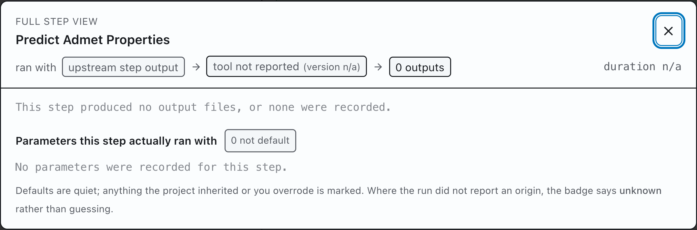

# Tutorial W3 — The full step view: opening one step as an object

> **Who this is for:** anyone who wants to go all the way down into a *single* step of a run — to see what fed
> it, the settings it actually ran with (and where each one came from), and its output files shown both the
> normal way and as the raw bytes behind them. No coding needed. By the end you'll know how to open a step as
> a self-contained object and check a result for yourself, instead of taking it on trust.
> **Time:** ~9 minutes to read.
> **Where it fits:** Tutorial W1 covered the workflow panel's tabs *before* and *during* a run; Tutorial W2
> covered the *after-run* section (Results, Reproducibility record). This tutorial is the deepest
> level: the **one-step detail view** you open from a step row. Tutorial 5 taught you to open individual output
> *files*; this goes further, wrapping a step's files together with its provenance and the exact settings it
> used.

---

## 1. The problem this solves

A workflow report tells you *what a run found*. But before you cite a number, hand a result to a reviewer, or
re-run with one setting changed, you often need to answer sharper questions about a **single step**:

- What exactly fed this step, and what tool produced its output?
- What settings did it *actually* run with — not what the configuration screen intended, but what resolved at
  run time — and where did each value come from (a default, a project-wide instruction, or a change you made)?
- Is the plain-language summary above a file telling the truth about the file's real contents?

Normally those questions mean reading the pipeline source code or downloading files and opening them in another
program. BioMate's **full step view** answers them on one screen. It opens a single step as an **object**: a
provenance line at the top, the resolved settings with an origin tag on each, and every output shown two ways —
the normal rendered view and the **raw bytes** the rendered view was built from.

> **In one sentence:** the full step view lets you open any finished step on its own, see exactly what it ran
> with and where each setting came from, and check its output by flipping between the rendered view and the raw
> bytes behind it.

---

## 2. The ideas you need first (plain-language background)

**A step is a place in a run, not a free-floating record.** The full step view always shows a step *inside* its
run — which output you're looking at, which settings resolved, what came out. (The big stages are *phases* and
the individual tools inside them are *steps* — the same phase/step idea from Tutorials 3 and W1.)

**Provenance = the causal chain of one step.** "Provenance" means the recorded history of how something was
produced. For a step, that is a single line: **what fed it → which tool and version ran → how many outputs it
produced → how long it took.** Seeing that chain is how you trust an output without reading the pipeline.

**Resolved parameters = what the step *actually* ran with.** A parameter is a setting (a threshold, a reference
genome, an on/off flag — the "phone number for the analysis" idea from W1). The configuration screen shows what
you *intended*; the full step view shows what **resolved** at run time. The difference matters: a value can
arrive from a default, from a standing project instruction, or from a change you made, and the resolved view is
where you see which.

**Origin = where a setting's value came from.** Each resolved setting carries a small **origin badge**:

- **default** (grey, quiet) — the workflow's own built-in value.
- **inherited** (amber, loud) — the value came from a **project instruction** (a standing setting applied to
  everything in a project). This is the origin people are most often surprised by, so it is marked loudly.
- **override** (blue) — the value differs from the default because it was changed by hand.
- **unknown** (dashed grey) — BioMate had no default to compare against for this setting, so it refuses to
  label the origin and says **unknown** rather than guessing.

*(Why it matters: a surprising result is very often explained by an **inherited** value you didn't set on this
run. The badge makes that visible on the exact step, not buried in a project's settings.)*

**Rendered vs raw.** The **rendered** view shows a file the normal way (a table as a grid, an image as a
picture, a structure in 3-D — all the viewers from Tutorial 5). The **raw** view shows the file's actual
**bytes** — the plain text the step wrote — so you can confirm the rendered view, and the summary above it,
match what is really in the file. *(Why it matters: a rendered view you can't check against the source is
something you have to take on faith; the raw toggle makes it falsifiable.)*

**Evidence class.** BioMate picks how to render each output from the file itself — a picture-type file gets an
image viewer, a table-type file gets a grid, and so on. You don't choose or convert anything (this is the same
inline-viewer behaviour as Tutorial 5; the full step view adds the raw side on top of it).

---

## 3. When you'd use this

- You want to verify **one specific step** before you trust the whole run — a QC step, the final results step, a
  step whose number ended up in the report.
- A result looks surprising and you suspect a setting you didn't choose on this run (often an **inherited**
  project instruction) is responsible — the origin badges tell you at a glance.
- You need the **auditor's check** for a reproducibility or regulatory review: flip a step's output to **raw**
  and confirm the rendered summary matches the bytes.
- A step **failed** and you want its error, the exact invocation, and the log positioned at the failure — in
  one place.

---

## 4. Step by step — opening and reading a step

### 4.1 Open the full step view

You reach it from the **Phases** tab of the workflow panel (W1 §6), **while the run's panel is still open**:

1. In the **Phases** tab, expand the phase that contains the step you care about.
2. On a step that has finished — status **DONE** or **FAILED** — click its **Details** button. (A step that is
   still pending or running has no Details button yet; it appears once the step reaches a finished state.)
3. The step opens as an object in a dialog over the panel. Its header reads **Full step view** with the step's
   name.

There is a second door: when you preview a step's output file in the panel (Tutorial 5), the preview's header
carries a **"Full step view"** button that opens the same object with that file already selected.

<!-- CAPTURE route=/ ; state=Phases tab, one phase expanded, a completed step row showing its DONE chip and the Details / Rerun action buttons, with the cursor on "Details" ; focus=panel-phases ; note=show that Details appears on a DONE (or FAILED) step row — the entry point to the full step view -->
*(Figure to add: a completed step row in the Phases tab, with the **Details** button that opens the full step
view.)*

### 4.2 Read the provenance row (what fed it → what ran → what came out)

At the top, under the step name, is the provenance line:

> **ran with** `[inputs]` → `[tool + version]` → `[N outputs]` · `duration`

Read it left to right: what fed the step, the tool and version that ran, how many output files it produced, and
the wall-clock time. Where the run didn't record a piece of this, the view says so honestly rather than
inventing it — *"upstream step output"* when the inputs aren't named, *"tool not reported" / "(version n/a)"*
for an untracked tool, *"duration n/a"* for untracked time. (In the current panel data, the tool, version,
duration, and named inputs are usually **not** tracked per step, so expect those to read "n/a" — see Honest
limits. The **output count** is always real.)

### 4.3 Read the resolved parameters and their origins

Below the output area is **"Parameters this step actually ran with."** A small **"N not default"** count sits
beside the heading, so you can tell at a glance whether this step ran plain (0 not default) or tuned. Each row
shows the setting's name, its value, and an **origin badge** (§2):

- Scan the **amber "inherited"** badges first — those came from a project instruction and most often explain a
  surprising result.
- **Blue "override"** means someone changed it by hand; **grey "default"** is the workflow's own value.
- A dashed-grey **"unknown"** badge is not an error — it means the run reported no default to compare against,
  so BioMate declines to label the origin (hover it for that explanation).

This is a **read-only** view: you *read* what the step ran with here; you change settings and re-run from
elsewhere (see §4.6 and Honest limits). It's the audit surface, deliberately deeper than the single "Resolved
parameters" list in the after-run Reproducibility record (W2 §6) — here each value is tied to one step and
tagged with where it came from.

<!-- CAPTURE route=/ ; state=full-step-view dialog open on a completed step — header "Full step view" + step name, the provenance row ("ran with … → tool … → N outputs · duration" with honest n/a where untracked), and the "Parameters this step actually ran with" block showing at least one origin badge and the "N not default" count ; focus=full-step-view-dialog ; note=real step from a completed run; show origin badges (default grey, and if present inherited amber / override blue) and the honest "n/a" provenance fields -->
*(Figure to add: the full step view's header and provenance row, with the resolved-parameters block showing
origin badges and the "N not default" count.)*

### 4.4 Open an output — rendered, then raw

If the step produced files, each one is a **tab** at the top of the view (even a single output gets a tab, so
the count is never ambiguous). Click a tab to select that output; the viewer below shows it.

In the top-right of the output area is the **rendered ⇄ raw** switch — the most important control on this
screen:

- **rendered** (the default) shows the file the normal way, using the exact same inline viewers as Tutorial 5 —
  a grid for a table, a picture for an image, a rotatable model for a structure, and so on. The full step view
  does not rebuild those viewers; it reuses them.
- **raw** shows the file's **first bytes exactly as the step wrote them**, as plain text, with the note *"Raw
  first: the summary above is derived from these bytes, and you can check it."* This is how you confirm the
  rendered view and any summary are faithful to the real file.

If a file is binary (bytes a browser can't show as text), the raw view says so plainly and offers a direct
**download** instead of a broken display — the one honest exception, and it names itself.

Selecting a different output tab resets the switch to **rendered**. At the bottom of the view, a **Download**
link gives you the selected file itself, unmodified.

<!-- CAPTURE route=/ ; state=full-step-view dialog, an output tab selected, the rendered ⇄ raw toggle set to "raw" showing the first bytes of a text/table output with the "Raw first: the summary above is derived from these bytes…" caption ; focus=rendered-raw-toggle ; note=show the raw side of the toggle on a real text output (e.g. a QC .tsv or .log), with the rendered tab visible beside it -->
*(Figure to add: the rendered ⇄ raw switch set to **raw**, showing a file's first bytes with the "you can check
it" caption.)*

### 4.5 Where "number → source" fits (and where it doesn't yet)

The platform's intended end state is that **every number in a run's findings is a link**: click it and land on
the exact output that backs it, in its step, with the value in view. The pieces for selecting an output by id
exist in the full step view, but the finding-side wiring that *calls* it from a clicked number is a follow-up,
so that full click-the-number-into-this-view path is **not** wired today (Honest limits). What *does* work now:
a finding number in the after-run **Summary** links to its output **file** in the **Outputs** tab (covered in
W2 §4 and Tutorial 5) — a slightly shallower jump than landing inside this step view, but the same idea of
"every headline number is evidence you can open."

### 4.6 Re-running from this step

You might expect a "Re-run from here" button in this view to change one setting and re-run just this step and
what depends on it. That button is **built but not connected on this surface today** (Honest limits). To
re-run with a changed setting right now, use the step row's own **Rerun** / **Params** buttons in the Phases
tab (W1 §6) or **"Run again with edits"** in the after-run section (W2 §8). The full step view is, for now, the
place you **read and verify** a step; re-running happens from those neighbouring controls.

---

## 5. Honest limits — what this view does and doesn't do today

- **"Re-run from here" does not appear in the step view yet.** The button exists in the component but the panel
  opens the view without connecting it, so you won't see it. Re-run with edits from the step row's **Rerun /
  Params** (W1) or the after-run **"Run again with edits"** (W2) instead. This is a wiring gap, not a missing
  capability.
- **Clicking a finding *number* does not jump *into* this view yet.** The output-selection hook is scaffolding;
  the finding-side call that would open this view at the exact backing output is a documented follow-up. Today,
  a finding number links to its output **file** in the Outputs section (W2 §4 / Tutorial 5), not into the full step
  view.
- **Resolved parameters are read-only here.** You *read* the values and their origins; there is no in-place
  edit-and-apply on this screen. Editing is done via the Rerun/Params flow (W1) or "Run again with edits" (W2).
- **Some provenance fields read "n/a."** Per-step **tool, version, duration, and named inputs** are not tracked
  in the current panel data, so the provenance row shows "tool not reported" / "(version n/a)" / "duration
  n/a" / "upstream step output" for them. These are honest empty states, not rendering bugs — the fields are
  omitted rather than guessed. The output count, the resolved parameters, and the output files themselves are
  always real.
- **You open it from the run panel, not from the after-run report.** The **Details** / "Full step view" buttons
  live in the Phases tab (and in a step-output preview opened there). The after-run **Outputs** tab opens the
  rich file viewer and a download, but **not** this provenance/origin surface. If you've moved on to the
  after-run report, reopen the run's panel and use the phase list's **Details** button to get back to a step as
  an object.
- **The raw view shows the first bytes, not the whole file.** It renders roughly the first several thousand
  bytes of a text file (and marks that it was trimmed). For the complete file, use **Download**.
- **Binary files are download-only in raw.** If a file's bytes aren't text, the raw view says so and offers a
  download instead of a broken preview (this is expected — see §4.4).

---

## 6. Where to go next

| You want to… | Where |
|---|---|
| The panel *before* and *during* a run (settings, phases, QC gate) | **Tutorial W1** |
| The *after-run* section (Results, Reproducibility record) | **Tutorial W2** |
| Open and read an individual output file (tables, structures, 3-D, etc.) | **Tutorial 5** |
| Change a setting and re-run a step | **Tutorial W1** (Rerun / Params) or **W2** (Run again with edits) |
| Understand project instructions (the source of "inherited" values) | **Tutorial 4** |
| The whole run-and-read-the-report story at a high level | **Tutorial 3** |

The habit: **Phases tab → a finished step's Details → read the provenance → check the origin badges → flip the
output to raw to confirm it.**

---

## 7. Key terms

| Term | What it means — and why you care |
|---|---|
| **Full step view** | One step opened as a self-contained object — its provenance, the settings it actually ran with, and its outputs rendered and raw. Opened from a finished step's **Details** button. |
| **Provenance row** | The one-line causal chain of a step: what fed it → tool + version → number of outputs → duration. Shows honest "n/a" where a field wasn't tracked. |
| **Resolved parameters** | What the step *actually ran with* (not just what was intended), shown read-only, each with an origin badge. |
| **Origin badge** | Where a setting's value came from: **default** (workflow's own), **inherited** (a project instruction — marked loudly), **override** (changed by hand), or **unknown** (no default to compare — shown honestly, not guessed). |
| **"N not default"** | A count beside the parameters telling you how many settings were inherited or overridden — i.e. whether the step ran plain or tuned. |
| **Rendered ⇄ raw** | The switch between the normal file view and the file's actual bytes, so you can check that the rendered view and summary match the real file. |
| **Raw bytes** | The plain text the step wrote, shown exactly (first bytes). The auditor's view; binary files are offered as a download instead. |
| **Number → source** | The intended "click a finding number to open its exact backing output" path. Today a finding number opens its output **file** in the Outputs section; landing *inside* the full step view is a follow-up. |

---

_Companion technical references (for power users / developers):
`docs/user-manual/modules/I07-full-step-view-provenance.md`, `I08-outputs-viewers-interactive.md`. Source
components: `frontend/client/src/components/steps/step-detail.tsx` (the view itself) and
`frontend/client/src/components/nextflow-workflow-viewer.tsx` (`buildStepDetailStep`, the Details entry point).
Design spec: `reference/claude_design/data_centroid_design_v2/spec/08 The full step view.html`._
