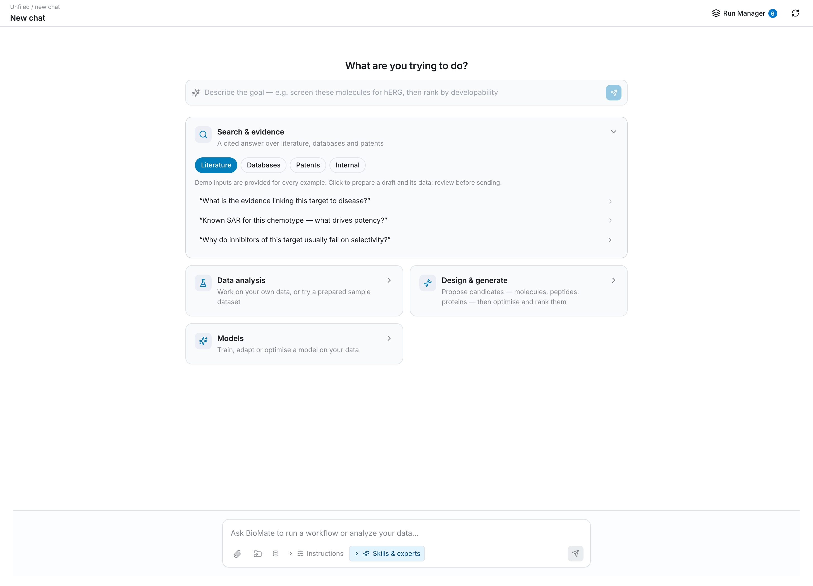

# 模块一 —— 检索与证据：问一句"目前都知道些什么？"

> **适合谁读：** 任何人 —— 不需要编程，也不需要生物信息学背景。读完这一篇，你会知道如何向 BioMate 提一个
> 知识性问题、如何读懂它给出的带出处的答案、如何分辨一个扎实的答案和一个单薄的答案，以及如何把一条发现
> 变成日后项目能用得上的东西。
> **用时：** 阅读约 9 分钟；答案本身几秒钟就返回。
> **它在教程中的位置：** 教程零介绍了那个唯一的入口。这是四个功能模块里第一个深入讲的 —— 它读文献、查
> 数据库、给出答案，而**完全不碰你自己的数据**。它的姊妹模块**数据分析**（模块二）才是真正在你的数据上
> 跑起来的那个。

---

## 1. 它解决什么问题

在动手做实验或分析之前，你通常得先搞清楚现在已经知道了些什么。*这个蛋白真的和这种病有关联吗？有人报告
过这个副作用吗？这个靶点已经解出了哪些结构？我自己的团队是不是早就测过、还得出过某个结论？* 要回答这些
问题，平常意味着打开 PubMed、几个数据库，再加上你自己的旧文件，分散在一堆标签页里读上一个小时，还得祈祷
别漏掉那篇唱反调的论文。

**检索与证据**这个模块替你把这些读完，然后交回一个简短的答案 —— 而且**每一条论断都带着它的出处** ——
这样你是去**核查**答案，而不是盲目相信它。它**不动你的任何东西**：不读你上传的任何文件、不启动任何计算、
也不花一分钱算力。它唯一的承诺就是：可追溯。

> **一句话概括：** 用大白话问一句"关于 X 目前都知道些什么"，几秒内就能拿到一个答案，其中每一句事实性陈述
> 都系在一个真实、可打开的出处上 —— 并且如实标注这个答案**没有**覆盖到哪些地方。

---

## 2. 开始前需要了解的几个概念（用大白话讲）

**即时通道（Instant lane）。** BioMate 的每一个请求都会落进两条通道之一（教程零）。检索与证据永远走
**即时（Instant）**通道：几秒钟给出一个带出处的答案，没有大计算，也不产生费用。（另一条通道是
**云端（Cloud）**，用来在你的数据上跑工作流 —— 那是模块二和教程三的事。）

**一个带出处的答案是一份小型的、有来源的报告，而不是聊天机器人的一段话。** 这个答案有固定的结构，每一
部分都各司其职：
- **论断（claims）** —— 答案正文，其中每一句事实性陈述都带一个小小的编号标记（`¹`、`²`），把它系到下方
  的某个出处上。*没有*标记的句子是铺垫或背景，而且它的写法本身就读得出来 —— 它不会假装自己是一条有出处
  的事实。
- **出处清单（source list）** —— 每个出处占一行，列出作者、年份、刊物（期刊），以及 —— 这点很重要 ——
  **它具体依据的位置**：这句话真正倚靠的那张图、那张表或那条论断。不是一串光秃秃的链接。每一行都带一个
  **打开（open）**操作。
- **"出处存在分歧（Sources disagree）"这一行** —— 如果两个出处在同一个论点上确实冲突，BioMate 会把*两
  种*立场连同各自的出处**并排**展示，而不是悄悄把它们折中成一句听上去很笃定的话。如果并不存在真正的冲突，
  这一行就根本不出现。
- **边界说明块（boundary block）—— 始终显示。** 一段简短的说明，讲清楚*这个答案不构成哪方面的证据* ——
  对一个检索类的答案而言，就是说它只综合了已发表的文献，**没有**拿你自己的数据核对过。动手之前先读它。

**四条轨道（tracks）—— 答案的形态因来源而不同。** 打开检索与证据卡片时，你会看到四个标签页（轨道）。
它们之所以存在，是因为一个专利类的答案、一条数据库记录、和一篇文献综述，确实是三种不同形态的答案。你**不
必**在提问前先挑一条轨道 —— 一个问得清楚的问题，会在所有适合它的语料上作答，答案本身会告诉你用了哪些。
轨道只是一个入口、一处取例子的地方，而不是一个必须设置的选项。

| 轨道 | 它读什么 | 答案长什么样 |
|---|---|---|
| **文献（Literature）** | 同行评议的论文和预印本 | 一篇保留了分歧、不抹平冲突的综述 |
| **数据库（Databases）** | 经过整理的序列、结构、通路、实验与临床试验登记库 | 一条条记录，附上找到它们的那条查询 |
| **专利（Patents）** | 申请文件与授权专利 | *（见下方的如实说明 —— 今天这是一道入口，而非真正的专利检索）* |
| **内部（Internal）** | 你所在机构自己的报告与运行历史 | "我们已经做过什么、得出过什么结论"，同样受那套出处规则约束 |

**受检索覆盖面所限 —— 最重要的一条如实观念。** BioMate 只能引用它的检索**实际找到**的东西。如果文献检索
找到了相关论文，你就能得到一个有据可依的答案。如果它**什么都没找到**，如实的做法是说"没有找到，以下是
检索过的范围"—— 而不是写出一段听着很笃定、却带着凭空捏造的参考文献的话。BioMate 内置了一道防线来防止这
种情况（而那个始终存在的边界说明块正是其中一环），但你心里要装着的正确模型是：**这是一个会标注出处的
检索工具，而不是一个总能给出答案的神谕。** 一个单薄或空白的结果是信息，不是故障。

---

## 3. 什么时候用它

- 你想知道某个靶点、通路、副作用或机制是否有文献支持 —— *在*投入时间和金钱去验证它*之前*。
- 你需要一个快速、**有出处**的答案，能直接贴进组会或基金申请里，还附着参考文献，好让同事去核对。
- 你想拉取现成的记录 —— 某个靶点已报告的结构、某类化学骨架已知的脱靶、命中某条通路的临床试验及其终点。
- 你想问问你*自己*机构的记录："我们以前测过这个骨架吗？当时得出了什么结论？"

---

## 4. 一步步来 —— 提一个证据性问题

我们用一个贯穿其他教程、认得出来的例子：蛋白 **JAK1** 与**类风湿性关节炎**（RA，一种常见的自身免疫病）
之间的关联。JAK1 是一个真实、研究充分的药物靶点，所以它很适合用来检验一个*扎实*答案长什么样。

<!-- CAPTURE route=/ ; state=cold start, Search & evidence card expanded showing the four track tabs (Literature · Databases · Patents · Internal) and a few example-intent rows in quotes ; focus=cold-start Search & evidence module card ; note=展示轨道栏 + .exrow 示例意图；尚未发送任何内容 -->

1. **打开检索与证据卡片（可选）。** 在冷启动状态下（一个全新的空对话里），点开**检索与证据（Search &
   evidence）**卡片，就能看到它的四条轨道和示例问题。点任意一个示例，会把它**预填**进消息框 —— 也就是
   把一个建议的问题填好，但**不会**替你发送。你也可以完全跳过这张卡片，直接打字提问。
2. **用大白话打出你的问题。** 例如：
   *"把 JAK1 与类风湿性关节炎关联起来的证据有哪些，强度如何？"*
   你打字时，BioMate 会读取你的目标，并会显示一句简短的复述 —— 它听出来的那条**通道**（这里是**即时
   Instant**）和一个主题领域。它不会给你一个数据库名称的菜单。
3. **核对通道，再发送。** 对于一个"目前都知道些什么"的问题，你应该看到它读成**即时（Instant）**。想改措辞
   就改，然后按**发送（Send）**。*到这时才会真正开始运作* —— 而且因为走的是即时通道，不会按一次流程运行
   来计费。
4. **读答案（见下一节）。**

> **拉取记录，而不是综述。** 如果你问的是一个*数据库*风格的问题 —— 例如*"把 JAK1 已报告的每一个结构都
> 拉出来"*或*"这类化学骨架已知的脱靶有哪些？"* —— BioMate 会把查询扇出到各个经过整理的生物数据库，返回
> 匹配的记录以及找到它们的那条查询，而不是一段散文式的综述。同一道入口，不同形态的答案。

---

## 5. 如何读懂答案

<!-- CAPTURE route=/ ; state=chat showing a completed Search answer: lane chip naming corpora used, body text with superscript anchors, the Citations panel expanded with per-source rows (authors · year · venue · "cited for" locus + open), and the amber Boundary block below ; focus=research answer + citation panel + boundary ; note=展示一个真实、已填充的答案，带出处和那个始终存在的边界说明块 -->
*（待补图：一个已填充的 JAK1/RA 答案 —— 带编号标记的论断、每行标明"依据位置（cited for）"并带**打开**
操作的出处清单，以及下方琥珀色的边界说明块。）*

- **对照标记来读论断。** 每个编号标记都把一句话系到清单里的某个出处上。没有标记的句子是背景，不是一条有
  出处的事实 —— 当成铺垫来看。
- **打开一个出处去核查它。** 每个出处行都显示作者、年份、刊物，以及**"依据位置（cited for）"** —— 也就是
  所倚靠的那张具体的图、表或论断。**打开（open）**操作会带你一个一个地过一遍这些出处。（它会链接到出版商
  的页面去看全文，而不是假装把文章正文搬进 BioMate 里。）你也可以把某个出处的详情、或它的 DOI / PubMed ID
  复制进你的文献管理软件。
- **判断证据强度。** 两个如实的信号能帮你掂量这个答案：
  - **"是怎么检索到的（How this was searched）"** —— 当检索路径上报了这些数字时，一个小面板会按出处显示
    找到了多少条记录、过滤后保留了多少条（例如"找到 18 条 · 保留 4 条"）。这只在有真实计数时才出现；它不
    出现并不代表出错。
  - **"出处存在分歧（Sources disagree）"** —— 一行琥珀色提示，只在检索到的出处确实冲突时才出现。展开它
    会看到两种立场连同各自的出处。BioMate 绝不会通过偏向更新的、或被引更多的论文来悄悄摆平这个冲突 ——
    那个判断留给你。
- **读边界说明块。** 底部那段琥珀色的说明*始终*都在。对一个检索类的答案，它实质上是在说：这只综合了检索
  到的文献；没有拿你自己的数据验证过；在依赖它之前，请对照你的数据核对。这是整个答案如实的框定。

> **单薄或空白，也是一个真实的答案。** 如果证据基础单薄 —— 只有一个出处，或只来自一个实验室 —— 答案会
> 明说，而*不会*给一条站不住脚的论断披上笃定的外衣。如果什么都没检索到，BioMate 会告诉你它检索过什么，
> 并提出帮你把检索范围放宽或换个说法，而不是凭空编出出处。当你看到一个简短、留有余地的答案时，那是防线
> 在起作用，不是工具在出错。

---

## 6. 拿到答案后能做什么

一个证据性答案是起点，BioMate 给了你三种被认可的方式把它往下带。前两种需要先打开一个**项目（project）**
（BioMate 用来装一项工作的文件夹 —— 见教程四）：

- **保存到项目笔记** —— 把答案*连同它的出处*一起写进项目里，于是来源也跟着一起保留下来；一个保存下来的
  答案绝不会丢掉它的引文。（没有打开项目时，这项会被禁用并给出提示，而不是假装成功。）
- **生成一条项目指令** —— 把一条发现提升为一条简短的常设规则，助手会在这个项目日后的对话里一直沿用它 ——
  例如*"使用 GRCh38、Ensembl 110。"* 它会被存成一条精炼的指令，而不是整个答案。
- **对照我们的数据核验** —— 把同一个问题变成一次在*你自己*数据上的真实分析。这一步会从即时通道跨进
  **云端（Cloud）**通道（模块二／教程三），所以 BioMate 在动用任何花钱的算力之前会先向你确认。

---

## 7. 如实的边界 —— 该抱什么预期

- **它受检索所限，不是神谕。** 答案的好坏取决于检索能找回什么。证据基础单薄，就给一个留有余地的答案；
  检索为空，就给一个如实的"什么都没找到"，而不是一个笃定的猜测。BioMate 有一道防线，防止在检索返回为空时
  编造参考文献 —— 但正确的预期是把它当成一个*会标注出处的检索工具*，而不是对每个问题都保证有答案。
- **"专利"轨道是一道入口，不是专利检索（就目前而言）。** 一个用专利口吻问的问题 —— "谁持有这个骨架的
  物质组成权利要求？"、"这一系列化合物的自由实施空间如何？" —— 返回的仍然是一个**以文献为依据**的答案。
  BioMate 今天**不**检索专利数据库。任何自由实施（FTO）的问题，请向专利律师确认。
- **"内部"轨道只会和你的记录一样完整。** 内部轨道读的是你所在机构自己的报告和运行历史。它只能引用真正
  已经存进 BioMate 的东西 —— 它不会去搜你的邮件、共享盘，或存在别处的实验记录本。
- **文献的引文导出目前是部分支持的。** 你可以复制某个出处的详情，并在文献管理软件里使用它的 DOI / PubMed
  ID。完整格式化的 BibTeX 目前只为*工作流工具*的引文填充（也就是教程三那些报告里的引文），还没覆盖到每一个
  文献出处 —— 所以在一个纯文献答案上，"导出 BibTeX"按钮会被隐藏，而不是导出一个空文件。
- **一个答案是文献，不是对你数据的裁决。** 这正是那个始终存在的边界说明块的全部意义。要在你自己的文件上
  检验一条论断，就用**对照我们的数据核验**（一次云端运行）。
- **空着的区块是如实，不是故障。** "是怎么检索到的"面板和"出处存在分歧"这一行，都*只*在有真实数据支撑时
  才出现。一个答案里没有它们，只是说明没有可供如实展示的东西 —— 而不是哪里坏了。

---

## 8. 接下来去哪儿

| 你想… | 模块 | 通道 | 教程 |
|---|---|---|---|
| 问"目前都知道些什么"（带出处的答案） | 检索与证据 | 即时 | *本篇* |
| 在你自己的数据上跑一次分析 | 数据分析 | 即时 → 云端 | **模块二** / **教程三** |
| 先把一个文件带进来，好拿去分析 | — | — | **教程四** |
| 设计新的候选分子 | 设计与生成 | — | **教程一** |
| 从实验结果里学习、改进下一轮 | 模型 | — | **教程二** |

习惯始终是同一个：**打出一个问题 → 核对通道（即时）→ 发送 → 连同出处一起读答案 → 读边界说明 → 需要时
保存它、或对照你的数据核验它。**

---

## 9. 关键术语

| 术语 | 含义 —— 以及你为什么要在意 |
|---|---|
| **检索与证据（Search & evidence）** | 回答"目前都知道些什么"的模块，覆盖文献和数据库。不动你的任何东西；永远走即时通道。 |
| **即时通道（Instant lane）** | 几秒钟给出一个带出处的答案，没有计算，没有流程费用。（云端是另一条通道，用于在你的数据上运行。） |
| **带出处的答案** | 一份小型、有来源的报告：论断系在出处上、出处清单标明所依据的位置、外加一个始终存在的边界说明块。 |
| **轨道（文献 / 数据库 / 专利 / 内部）** | 四类语料。一个入口、一处取例子的地方 —— 而不是提问前必须挑的设置。 |
| **依据位置（"cited for"）** | 一个出处被用来支撑的那张具体的图、表或论断 —— 显示它而不是一个光秃秃的链接，好让你核查那条具体证据。 |
| **出处存在分歧（Sources disagree）** | 一行如实的提示，只在检索到的出处确实冲突时出现；它并列呈现两种立场，而不替你选一个。 |
| **边界说明块（Boundary block）** | 那段始终显示的说明，讲清楚这个答案不构成哪方面的证据（此处：仅限文献，不含你的数据）。 |
| **受检索覆盖面所限** | 答案受限于检索能找到什么。单薄 → 留有余地；为空 → 如实的"什么都没找到"，绝不编造出处。 |
| **保存到笔记 / 生成指令 / 对照我们的数据核验** | 三个出口：把答案留在项目里、把它变成一条常设规则，或在你的数据上检验它（一次云端运行）。 |

---

> **关于目前你会看到什么的如实说明。** 一个 JAK1/RA 的文献问题会返回一个真实、带出处的答案，连同它的
> 边界说明块；而保存／生成指令／对照数据核验这几个出口，都接到了真实的项目知识端点（它们需要先打开一个
> 项目）。透明度面板（"是怎么检索到的"）和分歧提示行，只有在检索路径提供了真实计数或真实冲突时才会填充 ——
> 否则一个普通答案会干净利落地退化成一份朴素的出处清单。专利轨道会把一个用专利口吻问的问题路由到一个以
> 文献为依据的答案；今天它背后并没有专利数据库检索。

_面向进阶用户 / 开发者的配套技术参考：`docs/user-manual/modules/I03-search-and-evidence.md`。_
