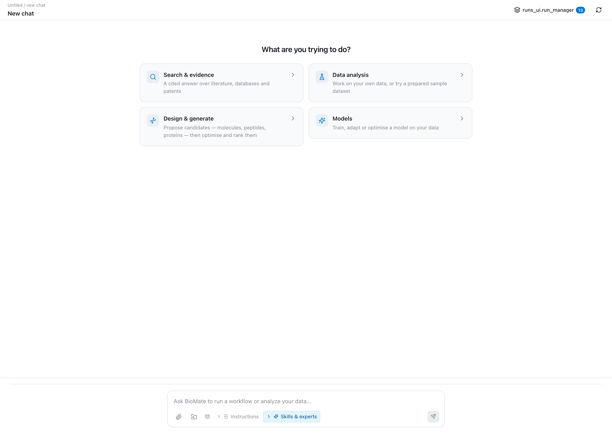

# 教程零 —— 入门：向 BioMate 提出你的第一个问题

> **适合谁读：** 任何第一次打开 BioMate 的人 —— 不需要编程，也不需要生物信息学背景。读完这一篇，你会知道
> BioMate 是什么、如何向它提出请求、如何判断你的请求会返回一个快速答案还是启动一次较大的分析，以及如何读懂
> 你的第一个结果。
> **用时：** 阅读约 8 分钟；第一个示例几秒钟就能跑完。
> **它在教程中的位置：** 这是起点。后面更深入的旅程 —— 设计分子（教程一）、从实验结果中学习（教程二）、
> 运行一条完整的分析工作流（教程三）—— 都从这一页所讲的内容开始。

---

## 1. BioMate 是什么（用一段大白话说清楚）

BioMate 是一个面向药物发现与生物学的云端工作台。你不用自己安装软件、再把各种工具连起来，而是用大白话描述
你想做什么。随后 BioMate 要么**从科学文献和数据库中给出答案**，要么**在云端计算机上运行一条经过测试的分析**，
并把结果连同"它是如何得到结果的"记录一起交回。它涵盖几类不同的工作 —— 查找证据、分析你自己的数据、设计新分子、
从实验测量中学习 —— 而这篇教程讲的，正是它们共用的那一个入口。

> **一句话概括：** 你用日常的话告诉 BioMate 一个目标，它判断这属于哪类工作并去完成 —— 而且在任何东西开始
> 运行或产生费用*之前*，它总会先让你看清它打算做什么。

---

## 2. 开始前需要了解的几个概念（用大白话讲）

**冷启动（起始页）—— 入口。** 每一个新对话都从**冷启动**开始：这个界面上有一个**意图输入框**（你在里面
输入你的目标）和四张**模块卡片**。它是空白对话里你看到的第一样东西，你随时可以通过开一个新对话回到这里
（侧边栏 → **New chat / 新对话**）。可以把它想成一个前台接待：你说出你需要什么，它为你指向正确的方向。

**四个模块 —— BioMate 能做的几类工作。** 这四张卡片标出了四类工作，方便你认出自己的目标属于哪一类：

- **检索与证据（Search & evidence）** —— 问"目前已知什么？"，得到一个简短的、**带引用**的答案（本教程的示例）。
- **数据分析（Data analysis）** —— "在我的数据上运行这项分析"（例如 RNA-seq、变异检测）。教程三讲。
- **设计与生成（Design & generate）** —— "为一个药物项目提出新的候选分子"。教程一讲。
- **模型（Models）** —— "从我的实验结果中学习，改进下一轮。"教程二讲。

你**不必**先去选一个模块。直接在意图输入框里输入你的目标，让 BioMate 自己判断这属于哪类工作即可。

**即时 vs 云端 —— 最值得先搞懂的一件事。** BioMate 会把每个请求归入两条**通道**之一，并在你发送*之前*就告诉你
是哪一条：

- **即时（Instant）** —— **几秒钟内给出一个带引用的答案**。它读取文献和数据库，直接在对话里回复。没有大规模
  计算，也没有流程账单。问"关于 X 目前已知什么"就是即时的。
- **云端（Cloud）** —— 一条**经过验证的工作流**，在云端计算机上运行，耗时几分钟到几小时（并消耗付费算力）。
  在你自己的数据上运行一项分析就是云端的。

这一点为什么重要：这条通道会提前告诉你本次请求在**时间与成本**上的后果。而且 BioMate **在运行任何云端通道的任务
之前，总会先向你确认** —— 云端请求在你确认之前，绝不会开始消耗付费算力。

**在你审阅并发送之前，什么都不会运行。** 这是贯穿整个产品的安全规则。意图输入框只会**预填**你的消息框；
点击模块卡片里的**示例**还会**附上该示例预备好的演示数据集**，开箱即可运行、无需上传 —— 但无论哪种方式都
不会自作主张地发送。你读一遍被填进去的内容、按需调整或换上你自己的数据，然后自己按发送。

---

## 3. 什么时候用它

- 你第一次打开 BioMate，想真正问它一个问题。
- 你拿不准自己想要的是一个快速答案还是一次完整分析 —— 并且想在投入时间或算力*之前*先看清是哪一种。
- 你想学会那一个贯穿所有其他教程的流程（输入目标 → 核对通道 → 发送 → 读结果）。

---

## 4. 一步步来 —— 提出你的第一个问题

我们提一个证据类问题，因为它几秒钟就返回，而且能完整展示一个 BioMate 答案的结构。我们用一个真实示例：蛋白质
**JAK1** 与**类风湿关节炎**（一种常见的自身免疫病）之间的关联 —— 和教程一用的是同一个靶点。

*冷启动，实况截图：顶部是意图输入框，中间是四张模块卡片（检索与证据 · 数据分析 · 设计与生成 · 模型），
底部是消息框（编排区 / Composer）。*

1. **打开一个新对话。** 冷启动会在任何空白对话里自动出现（侧边栏 → **New chat** 可随时回到它）。
2. **在意图输入框里用大白话输入你的目标。** 例如：
   *"有哪些证据把 JAK1 和类风湿关节炎联系起来，证据有多强？"*
   随着你输入，BioMate 会读取你的目标，并在**设计上**会显示一句简短的**复述** —— 它听出来的通道（这里是
   **即时**）和一个主题领域。它不会给你列一堆工具名称，只是告诉你它理解到的是哪类工作。
3. **核对通道。** 对于"已知什么"这类问题，你应当看到一个**即时**的判定（"几秒内给出带引用的答案"）。如果你
   哪次看到的通道不对，可以在发送前调整你的措辞（或在消息框里选择通道）—— 但对这个问题而言，即时是对的。
4. **审阅被预填的消息并发送。** 你的目标会被放进**编排区**（对话底部的消息框）。这是你编辑它的机会。当它表达
   的正是你的意思时，按**发送**（或回车键；Shift+回车换行）。*只有到这一步，才真正开始运行。*

<!-- CAPTURE route=/ ; state=intent bar filled with a knowledge question, lane preview showing "Instant · cited answer" ; focus=composer + lane-preview strip ; note=shows the Instant verdict + "BioMate will confirm before running anything cloud" line before send -->
*（待补图：消息框在你发送前显示"即时 · 带引用的答案"这一通道判定。）*

> **消息框还能做更多（留到以后）。** 除了打字，编排区还让你**附上自己的文件**（回形针图标，用于你电脑上的
> 文件）和**指向 BioMate 已经持有的数据**（数据库图标，省去重复上传）。证据类问题这两样都用不到，但教程一至三
> 会用到。此外还有可选的**Instructions（指令）**（一条应用于每条消息的固定偏好，例如"倾向于保守的阈值"）和
> **技能与专家（Skills & experts）**（领域推理包）—— 第一次用时可以放心忽略。

---

## 5. 如何读懂你的第一个答案

一个证据答案是一份小而有出处的报告 —— 不只是一段话。下面是你会看到的内容，以及怎么读：

- **答案正文**，带有像 `[1]`、`[2]` 这样的编号标记，把每一条主张与一个来源对应起来。BioMate 只列出答案实际
  用到的来源，所以这个清单反映的是正文真正依据的东西，而不是一份注水的参考文献表。
- **可打开的引用。** 每个来源都显示其标题、期刊和年份，并有一个**打开**操作，让你逐个查阅这些来源。（它会
  链接到出版商页面去看全文，而不是假装把文章正文展示给你。）
- **"来源存在分歧"（出现时）。** 如果两个来源在同一点上确实相互矛盾，BioMate 会把它们连同各自的出处并排展示，
  而不是悄悄挑一个。如果并没有真正的分歧，这个板块就干脆不出现 —— 它绝不会为了显得周全而被编造出来。
- **边界说明 —— 始终显示。** 答案下方有一段话，说明这个答案*不构成哪方面的证据* —— 对证据答案而言，就是说它
  只综合了已发表的文献，尚未对照你自己的数据核验过。在据此行动之前，先读这一段。

> **拿到答案该怎么做。** 证据答案是一个起点。如果你开着一个项目，可以把它**保存到项目里**（它会连同出处一起，
> 和项目的笔记存放在一起）。如果你想更进一步，一个**"对照你自己的数据核验"**的后续操作，会把同一个问题变成一次
> 在你数据上的真实分析（那一次属于云端运行 —— BioMate 会先确认）。

---

## 6. 如实的限制 —— 第一天你该有的预期

- **证据答案是文献，不是对你数据的裁决。** 它反映的是已发表的内容，并附上出处；它没有在你的文件上跑过。那条
  始终显示的边界说明就是这个意思。
- **如果你问的是专利 / 自由实施（FTO）类问题，"专利"这个说法只是一个入口，并非专利检索。** 一个以专利措辞提出的
  问题，今天返回的仍是一个以文献为依据的答案 —— BioMate 并不检索专利数据库。自由实施请与律师确认。
- **文献的引用导出目前是部分支持的。** 你可以复制某个来源的详细信息，并把它的 DOI / PubMed ID 用到你的文献
  管理软件里；完整格式化的 BibTeX 目前只为工作流工具的引用生成，尚未覆盖每一个文献来源。
- **BioMate 在设计上不会用编造的内容去填充某个板块。** 检索透明度条、分歧栏、以及格式化的引用，都**只有**在有
  真实数据支撑时才出现 —— 否则它们保持隐藏。一个空板块意味着"没有可以如实展示的东西"，而不是一个 bug。

---

## 7. 下一步去哪儿

| 你想… | 模块 | 通道 | 教程 |
|---|---|---|---|
| 问"已知什么"（带引用的答案） | 检索与证据 | 即时 | *本篇* |
| 设计新的候选分子 | 设计与生成 | — | **教程一** |
| 从实验结果中学习、改进下一轮 | 模型 | — | **教程二** |
| 在你的数据上运行一次完整分析 | 数据分析 | 云端 | **教程三** |

习惯始终是同一个：**输入目标 → 核对通道 → 审阅 → 发送 → 读结果（连同它的出处或它的记录）。** BioMate 里其余
的一切，都是这一个循环的更丰富版本。

---

## 8. 关键术语

| 术语 | 含义 —— 以及你为什么要在意 |
|---|---|
| **冷启动（Cold start）** | 新的空白对话打开时的那个屏幕 —— 意图输入框加四张模块卡片。你的入口；用 **New chat** 回到它。 |
| **意图输入框（Intent bar）** | 你用大白话输入目标的那个框；BioMate 读取它，并在你发送前告诉你通道和主题。 |
| **模块（Module）** | 四类工作之一：检索与证据、数据分析、设计与生成、模型。你不必先选一个 —— 意图输入框会为你分流。 |
| **编排区（Composer）** | 对话底部的消息框；也可用来附文件、指向已有数据、设置指令。不按发送就什么都不会发出去。 |
| **通道（即时 / 云端）** | 你的请求是一个快速的带引用答案（**即时**，几秒，无流程费用），还是一条完整工作流（**云端**，几分钟到几小时，付费，先确认）。发送前就会显示。 |
| **预填（Seed）** | 从卡片或意图输入框把内容填进你的消息框。被预填的目标是一个起点 —— 由你审阅并发送，它绝不会替你发出。 |
| **带引用的答案** | 即时通道的结果，附带出处，呈现真实的分歧，并说明它不构成哪方面的证据。 |
| **边界说明（Boundary block）** | 证据答案下方那段话，说明它*不*覆盖什么 —— 始终显示，让你知道这个答案的边界。 |

---

_面向进阶用户 / 开发者的配套技术参考：
`docs/user-manual/modules/I01-getting-started-cold-start.md`、`I02-composer-talking-to-biomate.md`、
`I03-search-and-evidence.md`。_
