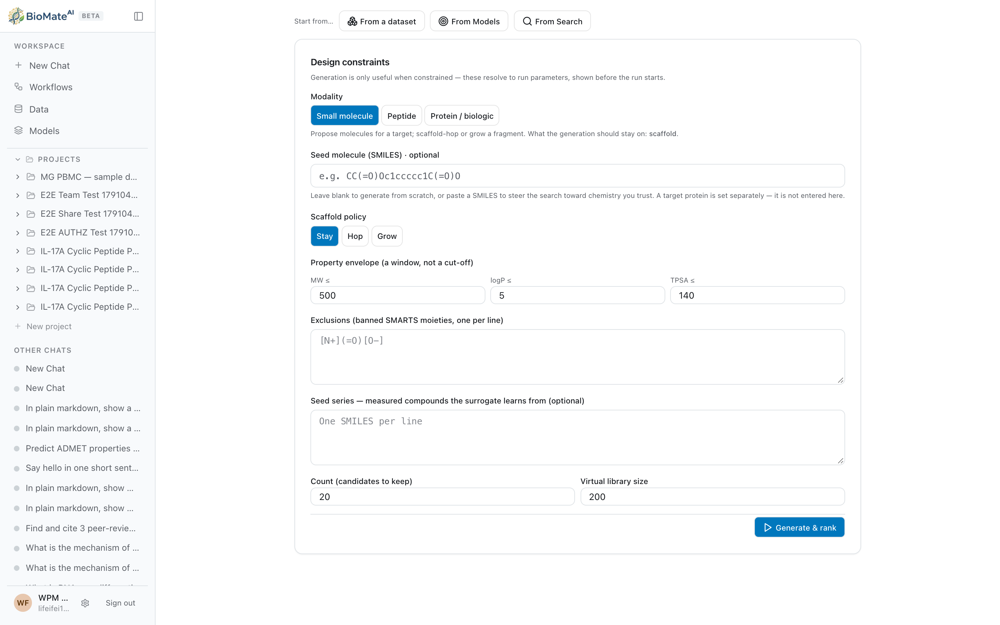
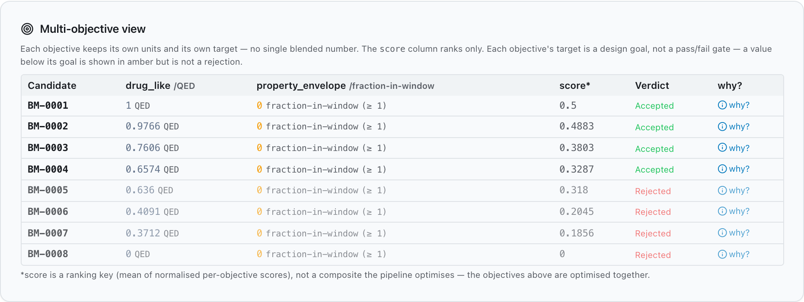

# 教程一 —— 设计并生成新药分子（Design & Generate）

> **适合谁读：** 任何人 —— 不需要编程，也不需要化学背景。读完这一篇，你会明白什么是"分子设计"、它
> 为什么困难，以及如何在 BioMate 中运行它、并看懂结果。
> **用时：** 阅读约 10 分钟；运行约 2 分钟。

---

## 1. 它解决什么问题（你为什么会用到它）

一款新药，通常是从一个**分子**开始的 —— 也就是一组特定排列的原子，它能结合到与疾病相关的**靶点**
（通常是一种蛋白质）上，并改变这个靶点的功能。举个例子：很多治疗类风湿关节炎的药物，正是通过阻断
**JAK1** 这一炎症信号蛋白来发挥作用的。难点在于，一个真正有用的药物分子必须**同时**满足好几项要求：

- 它必须足够**牢固地结合靶点**才能起效（活性 / potency）；
- 它必须**安全** —— 不能损害心脏、肝脏等器官；
- 它必须在实验室里以合理的成本**造得出来**（可合成性 / synthesizability）；
- 它还得在体内**表现良好** —— 能被吸收，又不会太快被代谢清除。

类药分子的可能数量大约有 10⁶⁰ 个 —— 比可观测宇宙里的恒星还多。没有任何化学家能靠手工画出并测试其中
哪怕极小的一部分。在传统流程里，光是从这片海量空间里初步筛出第一批可供测试的候选分子，一支化学团队
往往就要花上好几个月。**Design & Generate** 就是 BioMate 里自动完成这第一步筛选的工具：它会提出全新的候选
分子、预测关键性质、把明显不安全的那些剔除出来，再给你一份简短的、排好序的候选名单 —— 几分钟，而不是
几个月。这是药物发现最前端的一步，发生在你花钱去合成或测试任何东西**之前**。

> **一句话概括：** 不再是**你**去想分子，而是由 BioMate 来提出、打分、排序 —— 这样你从一份经过筛选的
> 名单开始，而不是面对一张白纸。

---

## 2. 开始前需要了解的几个概念（用大白话讲）

你不需要化学训练，但先弄懂几个概念，屏幕上的一切就都说得通了。

**"生成"与"筛选"的区别。** "筛选"是测试你**已经有**的分子；"生成"（也就是本工具）是创造出以前**不存在**
的新分子。本教程讲的是生成。

**种子分子，以及它从哪里来。** 生成器不会凭空开始 —— 你要给它一个**种子**：一个已知的分子，让它围绕
这个分子去做变化。可以类比成：给作曲家一段短旋律，请他在此基础上改编出不同的版本。种子以 **SMILES**
字符串的形式给出 —— 这是一种表示分子结构的标准文本代码（例如阿司匹林就是 `CC(=O)Oc1ccccc1C(=O)O`）。
这些代码你不用自己写：到免费数据库 **PubChem**（pubchem.ncbi.nlm.nih.gov）上查任意一个已知分子，复制它
的 "Canonical SMILES" 即可；或者请你的化学合作者给你一个。

> **要点 —— 靶点与种子不是一回事。** 你的疾病**靶点**通常是一种*蛋白质*（比如 JAK1），而你在这里填的
> **种子**是一个*分子*（一个小化合物）。如果你已经有一个已知能作用于该靶点的分子，就用它做种子；如果你
> 手上只有蛋白质靶点、还没有分子，可以在 **ChEMBL** 或 **PubChem** 上搜索靶点的名称，挑一个已知的结合物，
> 用它的 SMILES 做种子。*（直接指定蛋白质结合口袋的功能还在规划中；目前的起点是一个种子分子。）*

**骨架，以及"保持 / 跳跃 / 生长"。** **骨架（scaffold）**是分子的核心骨干 —— 决定其基本形状的那部分。
你可以告诉 BioMate 要多大胆：
- **保持（Stay）** —— 保留同一个核心，只改动它周围的修饰基团（最保守）。
- **跳跃（Hop）** —— 换到一个*不同的*核心，但它仍应能结合靶点。化学家这样做，是为了绕开竞争对手的专利，
  或者避开某个会带来毒性的核心。
- **生长（Grow）** —— 从一个小片段出发，把它逐步搭建成一个完整的药物大小的分子。

**性质"窗口"（是偏好，不是硬性规定）。** 几十年的数据表明，能被人体吸收的分子，往往落在三项可测性质的
某些范围内：
- **MW**（分子量）—— 大致就是分子的大小；
- **logP** —— 它偏油还是偏水；
- **TPSA** —— 它表面有多少是极性的。

你为什么要关心这些（用实际的话说）：这三者合在一起，可以预测一个分子能不能做成**口服药**（而不是只能
注射）、它**穿过细胞膜**有多容易，以及它能不能到达**细胞内部**或大脑里的靶点。一般来说，更小、更不极性
的分子更容易穿过细胞膜 —— 所以如果你的靶点在细胞内部，你可能想把窗口往低的数值调。BioMate 允许你为这
些性质设定一个目标窗口。这个窗口是用于排序的**软性偏好**，而**不是**一道硬性门槛：一个稍微落在窗口之外
的有潜力的分子不会被剔除，只是得分略低而已。

（像**多肽**这类大分子，正好落在这个小分子窗口**之外** —— 这也正是它们被作为一种单独的模式来处理的原因。
见第 3 节。）

**同时追求多个目标 —— 以及为什么没有"单一的万能分数"。** 你想要一个分子既有活性、又安全、还好合成。这几
个目标会相互拉扯 —— 改善其中一个，往往会拖累另一个。所以 BioMate 把每个目标**分开、各用各的单位**来展示，
绝不把它们揉成一个"综合"分数。如何权衡，由**你**来定。这是刻意为之的：单一的综合分数藏着一个隐患 ——
一个在某项安全指标上并不达标的分子，可能因为其他指标把平均分拉高了，就这样蒙混过关。

**安全闸门（safety gate）。** 有些化学子结构是已知有风险的 —— 活性反应基团，或过去被发现与毒性相关的片段。
它们被称为**结构警示（structural alerts）**—— 这类"红旗"后面可能演变成真正的临床问题，比如心律风险
（即 hERG/QT 效应）或肝损伤。任何含有这类片段的候选分子都会被**标记并搁置 —— 但仍然会连同原因一起展示给
你**。可以把一个警示看作一面*警示旗*，而不是一项已证实的毒性测量（有些被标记的基团在合适的情境下其实没
问题）。关键在于：BioMate 从不隐藏结果 —— 安全是一道看得见的闸门，而不是一个暗中进行的过滤器。

> **关于"活性"的一点如实说明。** 要准确预测一个分子对某个*特定*靶点结合得有多强，需要一个专门为该靶点
> 训练过的模型。在 BioMate 没有可靠模型的地方，它**不会**编造一个结合数值 —— 而是如实地说"暂无"。所以你
> 今天看到的分数，是关于**类药性**和**性质匹配度**的，并以安全作为闸门；针对特定靶点的活性预测是另一项
> 能力（见教程二"模型"）。

---

## 3. 什么时候用它

- 你已经有一个验证过的靶点（比如某种自身免疫病里的炎症靶点），想先拿到第一批候选分子来考虑。
- 你已经有一个有潜力的分子，但想要**更安全或更好合成**的变体。
- 你需要通过换一个不同的核心来**绕开已有专利**（骨架跳跃）。

> **如果你关心的是环肽 / 大环分子**（这是 BioMate 在免疫相关疾病上的一个重点方向）：请注意，**目前真正能
> 端到端跑通的是小分子生成器**。多肽（Peptide）和蛋白（Protein）模式会显示表单、并记录你的设置，但还不能
> 产出候选分子 —— 屏幕上会有相应提示。

---

## 4. 一步步操作

*Design & Generate 界面。你填入几项约束条件，然后点击 "Generate & rank"。*

1. **打开 Design & Generate。** 在主界面选择 "Design & generate"（或直接访问 `/design` 页面）。你会看到
   上图这个表单 —— 它是一组约束条件，而不是一个聊天框。
2. **选择模式（modality）** —— *小分子（Small molecule）*、*多肽（Peptide）* 或 *蛋白 / 生物制剂
   （Protein / biologic）*。先从小分子开始（关于多肽，见第 3 节的说明）。
3. **填入一个种子**到 "Target / seed" 框里。以 SMILES 字符串的形式输入一个分子。*（别被标签误导：这个框
   要填的是一个分子代码，而不是你蛋白质靶点的名字 —— 从哪里获取见第 2 节。）* 如果你还没有，就按第 2 节
   说的去 PubChem 或 ChEMBL 查。本次演示用阿司匹林（`CC(=O)Oc1ccccc1C(=O)O`）—— 选它只是因为大家都熟悉；
   实际工作中你会用一个和你靶点相关的分子。
4. **选择骨架策略** —— 保持、跳跃或生长（见第 2 节）。"保持"是稳妥的默认选项。
5. **设定性质窗口** —— MW、logP、TPSA。默认值是合理的类药取值；除非你有理由，否则保持默认即可（比如，当
   靶点在细胞内部时，可以把它们调低一些）。
6. **（可选）排除项与种子序列。** *排除项（Exclusions）* = 要禁用的化学基团，以 SMILES/SMARTS 模式输入，
   每行一个（SMARTS 是同一类文本代码，带通配符）。*种子序列（Seed series）* = 另外几个已知分子（以 SMILES
   输入，每行一个），供工具学习参考。两者都是可选的 —— 第一次运行可以跳过。
7. **设定要保留的候选数量**，然后点击 **Generate & rank**。它会在一分钟内完成，结果就显示在同一个面板里。

---

## 5. 如何看懂结果

*多目标视图：每个候选分子是一行，每个目标各占一列、各用各的单位 —— 不会被揉成一个单一分数。（结果页面
上还会另外显示一张权衡图和一份被剔除项的汇总。）*

- **每一行是一个被提出的分子**（BM-0001、BM-0002……）。
- **每个目标各占一列** —— 这里是 `drug_like`（一个 0–1 的*启发式*类药性估计，越高越好）和
  `property_envelope`（就是你在第 5 步设定的性质窗口的列名 —— 是同一回事）。你可以直接并排看到它们之间的权衡。
- **"score\*" 只是一个排序用的键值**，不是质量结论 —— 它只负责给名单排序。屏幕上的脚注会特意说明这一点。
- **判定（Verdict）** —— *Accepted*（通过）表示通过了检查；*Rejected*（剔除）表示触发了安全闸门。**被剔除
  的分子仍会连同原因一起显示**，这样你能知道*为什么* —— 没有任何东西被隐藏。
- 每一行上的 **"why?"** 会解释这个分子是怎么打分的，还包括与它最接近的那个真实的、已知的分子 —— 所以结果
  绝不会是一笔糊涂账。
- 结果页面还会显示一张**权衡图**（即 "Pareto" 视图）。这样看它：每个点是一个候选分子；位于点群前沿边界上
  的那些点，是现有的最佳折中方案 —— 想让其中某一个在某个目标上更好，就得接受它在另一个目标上更差。你根据
  自己最看重什么，从这条边界上去挑（例如，宁可牺牲分子大小，也要更安全）。
- 一份**剔除汇总**会告诉你候选分子*为什么*被剔除。剔除率偏高，是提示你种子或约束条件需要调整的最清晰的信号
  —— 这是一个有用的诊断，而不是一次失败。

> **如果没有得到任何结果：** BioMate 会告诉你这是*哪一种*"空"。"所有候选都被搁置了"意味着要调整你的约束或
> 种子（这是你能动手改的）。"暂时不可用"意味着是我们这边的问题，而不是你的输入 —— 你不需要做任何改动。

---

## 6. 接下来会发生什么 —— 闭环

一份名单只是起点，还远不是一款成品药 —— 这些候选分子离临床还很远，它的价值在于*让你起步更聪明*。从结果里，
你可以**导出一份订货单（order sheet）**：这个文件把每个候选分子与一个实验室编号配对，这样化学家（自己的或
委托 CRO 的）就能把排在前面的分子真正合成出来并测试。等实验结果回来后，它们会进入 BioMate 的**模型（Models）**
模块（教程二），模型会从真实测量中*学习*，并提出更好的下一轮。这个循环 —— **设计 → 合成 → 测试 → 学习 →
再设计** —— 就是"闭环"，也是 BioMate 为什么能越跑越准的原因。教程二会详细讲这个闭环，还包括一个类风湿关节炎
的实例，说明它如何把设计引导着避开一个真实的安全风险。

通常的分工是：**临床医生或生物学家**提供验证过的靶点，以及现实中要规避的安全问题；**BioMate**生成并给候选
分子排序；**药物化学家**审阅名单，决定去合成哪些。

---

## 7. 关键术语

| 术语 | 含义 —— 以及你为什么要在意 |
|---|---|
| **靶点（Target）** | 药物要作用的那个体内蛋白质（或其他分子），例如类风湿关节炎里的 JAK1。 |
| **种子（Seed）** | 你让 BioMate 围绕其做变化的一个已知分子；以 SMILES 代码输入。 |
| **SMILES** | 表示分子结构的一段短文本代码；到 PubChem/ChEMBL 上查到后复制即可。 |
| **骨架（Scaffold）** | 分子的核心骨干。"骨架跳跃"就是换到一个不同的核心（比如为了绕开专利）。 |
| **MW / logP / TPSA** | 大小、油水倾向、表面极性 —— 合在一起可预测口服吸收、穿膜能力、以及能否进入大脑。 |
| **可合成性（Synthesizability）** | 一个分子能不能在实验室里以合理成本造出来 —— 有些分子纸面上看着不错，却造不出来。 |
| **多目标（Multi-objective）** | 同时优化多个相互竞争的目标（活性、安全、可合成性），分开展示而不混成一个分数。 |
| **结构警示 / 安全闸门** | 与反应性或毒性风险相关的子结构 —— 是一面警示旗，而不是一项已证实的毒性测量。 |
| **Pareto / 权衡** | 这样一组候选分子：想让某个目标更好，就必须让另一个变差 —— 即现有的最佳折中集合。 |
| **闭环（Closed loop）** | 把真实实验结果反馈回去，让下一轮设计变得更好。 |

---

> **关于目前能跑什么的如实说明。** 目前，**小分子**生成器可以端到端运行；**多肽和蛋白**模式会显示表单、
> 记录你的设置，但还不能产出候选分子（屏幕上会说明）。另外，BioMate 绝不会编造一个它拿不出依据的活性或
> 毒性*数值* —— 在没有可靠预测器的地方，它会说"暂无"，而不是猜一个。

_面向进阶用户 / 开发者的配套技术参考：`docs/user-manual/modules/I11-design-and-generate.md`。_
