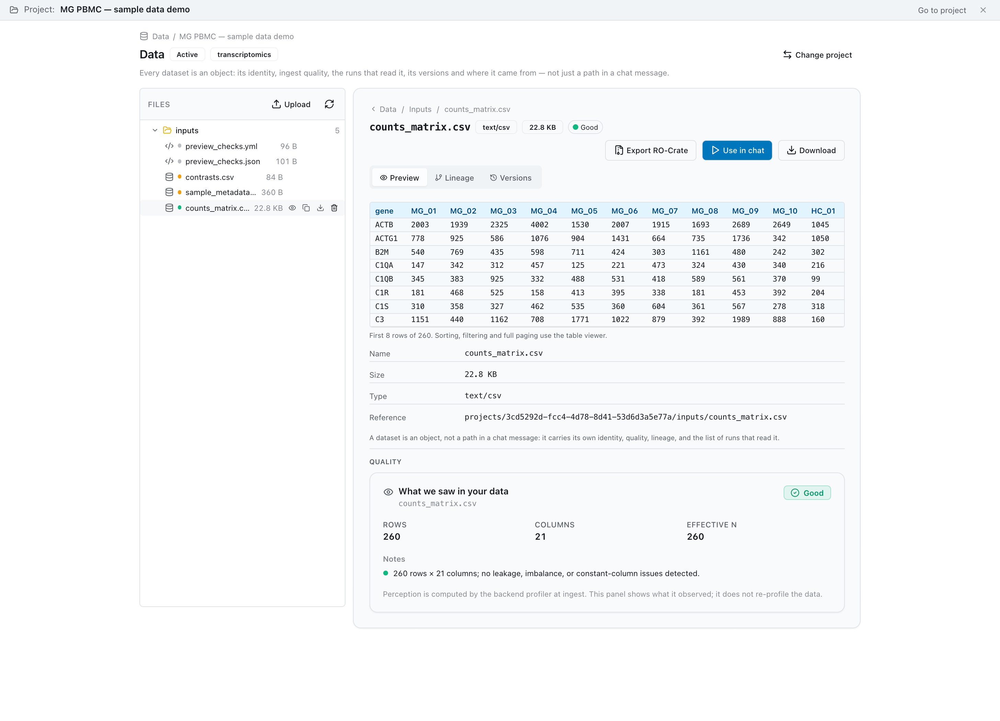
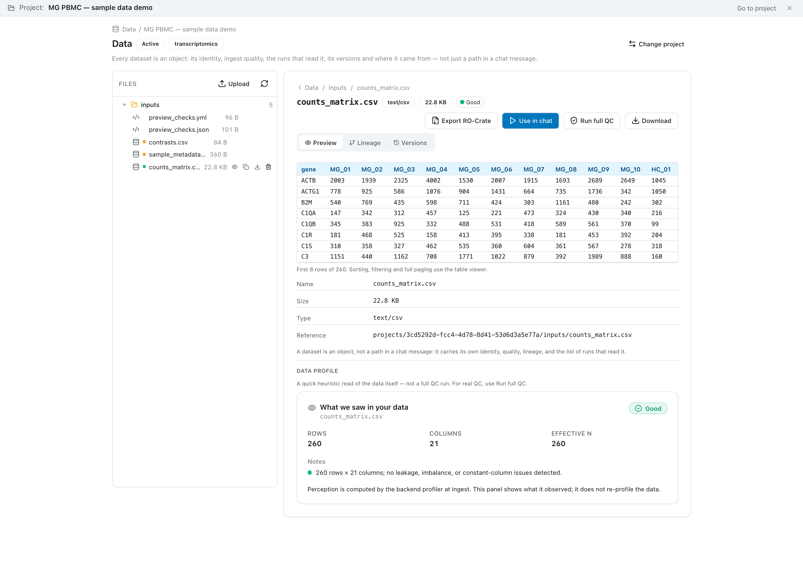

# 教程十 —— 探索你的数据集：元数据、预览、血统与版本

> **适合谁读：** 任何在 BioMate 里有数据的人 —— 一个你上传的文件，或一次运行产生的结果 —— 并且想打开它、读懂它：
> 它*是什么*、它*包含什么*、它*从哪里来*、*什么用过它*、以及它*如何变化过*。不需要编程。读完这一篇，你会知道
> 如何把任何文件作为一个**数据集对象（dataset object）**打开，并读懂它详情视图里的每一个部分 —— 还会确切知道
> 其中哪些部分今天就能用，哪些还在建设中。
> **用时：** 阅读约 9 分钟。
> **它在教程中的位置：** 教程四教你如何*把数据带进来*并检查它的导入质量。教程五教你如何*查看一次运行的结果*。
> 这一篇讲的是**数据集对象本身** —— 那个把一个文件的身份、内容和历史绑在一起的单一详情视图。它不重复如何上传
> （教程四），也不重复如何读一次已完成运行的输出（教程五）；它一直停留在你点开的那个对象上。

---

## 1. 它解决什么问题

一旦你跑过几次分析，一个项目里就会堆满文件：你带进来的数据，以及每次运行写出的结果。一个朴素的文件列表能告诉你
一个名字和一个大小，但它回答不了一个科学家真正会问一个文件的那些问题：

- *这就是那张图所用的那个确切文件吗？*
- *这个结果从哪里来 —— 哪次运行、哪条工作流？*
- *如果我改动或替换这个文件，有哪些分析依赖于它？*
- *自我上次看过之后，有人动过它吗？*

靠人工去回答，这些问题意味着读文件名、翻聊天记录、问同事 —— 而其中每一样都是错误可以藏身的地方。

BioMate 的回答方式，是把每一个文件都作为一个**数据集对象**打开：一个单一的详情视图，承载着这个文件的**元数据**
（它的朴素事实）、真实内容的**预览**、它的**血统**（产生它的那次运行，以及读过它的那些运行）、它的**版本记录**，
以及它的**来源**。你点一次文件；BioMate 关于它所知道的一切，都在这一个地方。

> **一句话概括：** 数据集对象把一个文件从一个僵死的"名字加大小"，变成一个你可以追问的东西 —— 它的内容、它从哪里
> 来、什么用过它、它如何变化过 —— 全都不用离开页面。

---

## 2. 开始前需要了解的几个概念（用大白话讲）

**数据中心（Data hub，`/files`）。** 你的数据所在的地方是**数据中心**（侧边栏 → **Data**）。它分两栏：左边是一棵
**文件树**（你的文件，归在 `inputs/` 和按单次运行划分的输出文件夹下），右边是一个**详情栏**，显示你点开的那一个
文件，以数据集对象的形式打开。数据是**按项目划分**的 —— 你先选一个项目，再浏览它的数据。*（为什么重要：一个项目里
的文件在另一个项目里看不到；如果你找不到某个文件，先确认你是不是在对的项目里。）* 教程四讲了这个布局；这里我们聚焦
右边的详情栏。

**数据集对象。** 当你点一个文件名，右栏就把它作为一个对象打开，带一个**头部**（身份）和六个**标签页**：
**Preview（预览）**、**Quality（质量）**、**Lineage（血统）**、**Consumers（使用方）**、**Versions（版本）**，以及
**Origin（来源）**。*（为什么重要：这些标签页正是本篇教程的全部主题 —— 每一个都回答第 1 节里的一个问题。）*

**元数据（Metadata）。** 一个文件朴素、事实性的描述 —— 它的名字、它的内容类型、它的大小、它存在哪里、以及它是
何时被添加的。*（为什么重要：元数据是你在信任一个文件的其他任何信息之前，用来确认自己看的就是自己以为的那个文件
的方式。）*

**血统与使用方（溯源 / provenance）。** **血统**是*什么产生了*一个数据集的记录（那次运行、工作流和步骤）。
**使用方**是把它作为输入*读取过*的那些运行。两者合在一起，就是它的**溯源** —— 那条让你能说清一个数字是怎么产生的、
以及如果这个文件变了会影响到什么的链条。*（为什么重要：在科学里，你必须能够捍卫一个结果从哪里来；BioMate 替你把
这条链保留着。）*

**版本记录（Version log）。** 一个关于某个数据集的**只追加（append-only）**的笔记列表。"只追加"意味着每一条都是
叠加在最上面添加的，先前的条目绝不会被改写。*（为什么重要：它把*一个数据集变化过*这件事及其原因记录为一条永久的
笔记 —— 第 4.4 节会讲它确切能做什么、不能做什么。）*

**如实的空状态。** 某个标签页里 BioMate 没有记录时，它会老老实实这么说（"还没有运行被记录为读取过这个数据集"），
而不是编一个出来。*（为什么重要：一个你能信任的空状态，比一个编造的猜测更有用。）*

---

## 3. 什么时候用它

- 你想确认一个结果确实来自你以为的那次运行 —— 在你把它放进一篇论文或一份报告之前。
- 你正要替换或重新推导一个文件，想先知道有哪些分析读取过它。
- 你打开了一个旧结果，想看它的内容和它的来源，而不用重跑任何东西。
- 你需要一份可携带的数据集溯源记录，交给一位合作者或一位审稿人。

本篇教程贯穿始终的例子：一张由一次 RNA-seq 运行在类风湿关节炎队列上产生的**差异表达结果表**（`de_results.csv`）
（延续前面几篇教程里 JAK1/RA 那条线索）。对任何文件，步骤都一样 —— 一张上传的实验读数 CSV、一个 FASTQ、一个已
检出变异的 VCF。

---

## 4. 一步步来 —— 读一个数据集对象

打开数据中心（侧边栏 → **Data**），选你的项目，在文件树里点一个文件名。它会在右栏打开。顶部的**头部**让你一眼
看清文件的身份；它下面是那六个标签页。我们按第 1 节那些问题出现的顺序来逐一看。

<!-- CAPTURE route=/files ; state=a project selected, a result CSV (e.g. de_results.csv) clicked open in the right pane ; focus=the whole two-pane Data hub with the dataset object open ; note=展示左边的文件树和右边的数据集对象（头部 + 标签页） -->

*数据中心：点文件树里的任何文件，它就在右边作为一个数据集对象打开，带着它的头部和标签页。*

### 4.1 元数据 —— 朴素的事实（今天就能用）

头部让你不用打开任何标签页，就看到文件的身份：

- **名字**（用等宽字体显示，于是每一个字符都清清楚楚，毫不含糊）；
- **内容类型**（例如 `text/csv`）和**大小**（例如 `2.3 MB`）；
- 一枚**质量标签** —— 良好 / 留意 / 受阻 —— 在导入剖析器读过这个文件之后出现（这就是教程四里那同一个导入检查；
  这里不再深入重复）；
- 一枚**版本计数标记**（例如"2 vers"），当这个数据集有不止一条版本记录条目时出现。

**Preview（预览）**标签页把这些核心事实作为带标签的行再列一遍 —— **Name（名称）**、**Size（大小）**、
**Type（类型）**，以及 **Reference（引用）**（BioMate 用来定位这个文件的存储键或路径）。**Origin（来源）**标签页
补上其余的：**Source（来源）**（`upload` 或 `run_output`）、**Storage ref（存储引用）**，以及它被**添加**的日期。
这里的一切都是从文件记录里读出来的真实字段 —— 没有任何东西是计算或猜测出来的。

<!-- CAPTURE route=/files ; state=dataset object open, header visible ; focus=the dataset object header (name, content-type badge, size badge, quality pill, version chip, action buttons) ; note=展示一个带绿色质量标签、且至少有一个版本（于是版本计数标记会出现）的文件 -->

*头部承载着文件的身份：名称、内容类型、大小、导入质量标签，以及（存在时）一个版本计数 —— 于是你在打开任何标签页
之前，就先读到了它的状态。*

> **如何读它：** 头部一眼就回答了"我看的是不是对的文件，它能不能读？"。如果名称、类型、大小都和你预期的一致，
> 标签是绿的，那么身份就核对通过了。一枚**灰色**或缺失的标签意味着剖析器不读这个文件*类型* —— 它*不是*在说这个
> 文件有问题（完整的质量故事见教程四）。

### 4.2 预览 / 可视化 —— 看真实内容（今天部分可用）

**Preview（预览）**标签页展示的是实际数据，而不只是关于它的事实。对一个**类表格文件**（CSV、TSV，以及剖析器能读
的类似带分隔符的文件），它会把**列和前面若干行**渲染成一张真实的表，并带一句像*"38,214 行中的前 20 行"*这样的
提示，于是你知道这是一扇看向文件的窗，而不是整个文件。这是在你依赖一个结果之前，抓出"拿错文件""分隔符搞错"或
"表头行被当成数据读了"的最快方式。

<!-- CAPTURE route=/files ; state=dataset object open on a CSV, Preview tab active ; focus=the Preview-tab sample table (column headers + first rows) and the "First N rows of M" note ; note=用一张真实的结果 CSV，让各列有意义（例如 gene_id、log2FoldChange、padj） -->

*（待补图：Preview（预览）标签页，把一张结果 CSV 显示为一张"列加若干行"的样本表，下面带着那句"M 行中的前 N 行"
的提示。）*

**把这里预览的范围说清楚**，因为很容易期待它给出比实际更多的东西：

- 数据集对象的 **Preview 标签页对剖析器能解析的文件渲染一张表格样本**（列 + 前面若干行），再加上第 4.1 节里那些
  身份行。这就是这个对象本身所画出的东西。
- 想对一个**图像、一个 CSV 或一个文本文件**快速看一眼而不打开这个对象，**文件树那一行**带一个**眼睛图标**：它把
  一个图像作为图片内嵌预览、把一个 CSV/TSV 作为一张小表、把文本作为可读的若干行预览。
- 那些**丰富的、懂类型的查看器** —— FASTA 和 VCF 阅读器、可旋转的三维蛋白质结构、冷冻电镜切片查看器、渲染出来
  的 HTML 报告 —— 是**教程五里讲的那个运行输出界面**，而不是这个对象的 Preview 标签页。如果你想在完整的查看器里
  打开一个结构或一个变异文件，请走那次运行的输出（教程五）。

> **如何读它：** 用 Preview 标签页一眼确认一张表的形状和列。如果你需要用完整的懂类型查看器去看一个非表格结果
> （一个结构、一个 VCF、一张图），那在那次运行的输出里 —— 这个标签页是对对象本身做的快速表格检查。

### 4.3 血统与使用方 —— 它从哪里来、什么用过它（今天就能用）

这是以数据为核心的那套体验的心脏所在，而且它是可点击的。

**Lineage（血统）标签页 —— 什么产生了这个文件。** 对一个结果文件，BioMate 从它本就追踪的溯源里推导出产生它的
那次运行，并显示：

- **Produced by run（由哪次运行产生）** —— 那次运行的 id，作为一个**可点击的链接**。点它会在工作区里打开那次运行，
  于是你能从一个结果直接走回产生它的那次运行。
- **Workflow（工作流）** —— 跑的是哪条工作流（例如那条 RNA-seq 流程）。
- **Status（状态）** 和 **Step（步骤）** —— 那次运行的状态，以及写出这个文件的那个步骤。

对一个**上传的**文件，这个标签页会如实地说：*"上传的输入 —— 没有上游工作流产生这个数据集。"* 是你做出它的，所以
没有产生它的运行可显示。如果一个文件是由某次运行产生的，但 BioMate 已不再保有那次运行的实时记录，它会显示自己仍
知道的部分，并说*"这次运行的实时溯源已不再保留"*，而不是把这个缺口藏起来。

<!-- CAPTURE route=/files ; state=dataset object open on a run-output file, Lineage tab active ; focus=the Lineage tab showing "Produced by run" as an underlined clickable link, plus Workflow / Status / Step rows ; note=捕捉一个结果文件，让血统有内容可显示（而非一个上传的输入） -->

*（待补图：一个结果文件的 Lineage（血统）标签页 —— "Produced by run"显示为一个可点击的链接，下面是 Workflow、
Status 和 Step 几行。）*

**Consumers（使用方）标签页 —— 什么读取过这个文件。** 这里列出每一个被记录为把这个数据集作为输入读取过的运行。
每一行同样可点击，点开那个使用它的运行。当还没有东西读过它时，这个标签页会说*"还没有运行被记录为读取过这个数据集"*
—— 一个如实的空状态，而不是一片空白。这个标签页还解释了*为什么*这很重要：当使用方被记录在案时，替换一个数据集就
成了一个看得见的决定（你能看到有什么依赖于它），而不是在一个正在运行的分析底下悄悄发生的改动。

<!-- CAPTURE route=/files ; state=dataset object open on a file that has been used as an input, Consumers tab active ; focus=the Consumers tab listing one or more "reads" rows (each a clickable run) ; note=如果所捕捉的文件没有使用方，就改为展示那句如实的空状态，并在图注里说明 -->

*（待补图：Consumers（使用方）标签页，列出读取过这个数据集的那些运行，每一行都可点击去打开那次运行 —— 或者那句
如实的"还没有运行被记录为读取过这个数据集"空状态。）*

**导出 RO-Crate。** 头部还有一个**Export RO-Crate（导出 RO-Crate）**按钮。RO-Crate 是一种标准的、可携带的溯源
清单（一个 JSON 文件），它把数据集连同它的血统、它的使用方、记录在产生它那次运行上的工作流参数，以及任何版本笔记
一起打包。它完全由上面那些真实记录组装而成 —— 某个字段未知时就留空，绝不编造。用它把一份站得住脚的溯源记录交给
一位合作者或一位审稿人。

> **如何读它：** 血统回答"这从哪里来？"，使用方回答"什么依赖于它？"。因为两者都可点击，一个结果永远不是一条
> 死路 —— 你总能走回产生它的那次运行，或走向用过它的那些运行。正是这一来一回，让一个结果变得可追溯。

### 4.4 版本管理 —— 那个只追加的记录（今天部分可用）

**Versions（版本）**标签页列出这个数据集的各个版本。每个数据集永远都有一条 **v1 · current（当前）**，由真实的文件
元数据构建而来。在这之上，你可以**添加一条版本笔记**：输入一句简短的笔记（例如，"修好样本表表头后重新推导"）并点
**Add version（添加版本）**。每一条笔记都成为下一个条目（v2、v3……），带着它的文字、一个时间戳，以及 —— 在已知时 ——
是谁添加的。最新的条目被标为 **current（当前）**。

这个记录严格**只追加**：添加一条笔记绝不会改写或删除先前的条目。它是*一个数据集变化过*这件事及其原因的永久记录。

<!-- CAPTURE route=/files ; state=dataset object open, Versions tab active, with at least one added note so v1 + v2 both show ; focus=the version list (v1 · current / earlier entries with note, author, timestamp) and the "Add a version note" input with its Add version button ; note=展示输入框下方那段只追加的说明文字 -->

*（待补图：Versions（版本）标签页，显示 v1 加上一条被添加的笔记条目，以及"Add a version note（添加一条版本笔记）"
输入框和它的 Add version 按钮。）*

**如实说清它是什么、不是什么**（这是最容易被误读的部分）：

- 这里的一个"版本"是一条**注记**，而不是文件字节的另一个被保存的副本。当你添加一条笔记时，BioMate **不会**对文件
  做写时复制（copy-on-write）。**v1** 背后的字节就是当前的文件。
- 因此**没有对比**（版本之间没有并排 diff），也**没有恢复/回滚**到更早的副本，因为根本没有存着更早的副本供对比或
  恢复。那些是设计好了但尚未建成的 —— 见"如实的限制"。

> **如何读它：** 每当你重新推导或确认签收一个数据集时，用版本记录留下一条持久、带日期的笔记，于是这段历史对下一个
> 读它的人就有了交代。**不要**指望用它把一个文件回滚 —— 它记录历史，但不恢复历史。

### 4.5 访问范围 —— 谁能触及它（今天部分可用）

BioMate 里的数据是**按项目划分**的：一个数据集属于一个项目，要触及它就必须是那个项目的所有者或成员。这在服务器端
是**被强制执行**的 —— 对一个项目文件的请求会对照项目的所有权和成员资格做检查，于是你没法靠猜一个引用去读另一个
项目的数据。对只读成员，编辑类控件（上传、删除）会被隐藏；你可以浏览并打开数据集，但改不了它们。

今天你**不会**看到的，是数据集对象上一枚明确的**范围徽标**（项目 / 共享 / 账户），也没有一个把文件**提升**到共享
或账户级范围的控件。这个对象目前既不显示、也不让你改变它的范围；访问由这个文件所在的是哪个项目、以及你在那里的
角色来决定。

> **如何读它：** 把访问想成"这在哪个项目里，我是所有者还是成员？" —— 正是这一点决定了你能不能打开、能不能编辑。
> 这个对象上还没有一个按数据集划分的共享开关。

---

## 5. 如实的限制 —— 哪些还没建成

这是以数据为核心的那个旗舰功能，所以值得把"这个对象今天能做的"和"它正朝之迈进的那套更完整的设计"之间的差距说精确：

- **版本是笔记，不是副本。** 版本记录是只追加的注记。BioMate 不存一个文件更早的*字节*，所以**版本对比（按单元格
  或按列的 diff）和版本恢复/回滚不可用**。设计里有它们；当前的构建只交付了这个记录。（v1 永远是当前的文件。）
- **没有就地编辑。** 你没法在对象内部编辑一个数据集的内容、并把这次编辑作为一个新版本保存下来。编辑的方式是通过
  一次运行或一次新上传来产生一个新文件。
- **没有范围徽标，也没有提升为共享的控件。** 访问由项目范围和你的角色来强制执行，但这个对象既不*显示*一个项目/
  共享/账户的范围，也没有一个按钮能把一个数据集共享到它所在项目之外、或把它提升到账户级。
- **对象里的预览是表格式的。** Preview 标签页对可解析的表渲染一张"列加若干行"的样本（外加文件树那一行的快速
  图像/CSV/文本预览）。那些完整的、懂类型的查看器 —— FASTA、VCF、三维结构、冷冻电镜密度图、渲染出来的报告 ——
  是那个运行**输出**界面（教程五），而不是这个标签页。
- **血统依赖一条尚存的运行记录。** 当 BioMate 仍保有（或能从存储键重建出）产生它的那次运行时，血统是完整且可
  点击的。当一次很旧的运行的实时记录已经没了时，这个标签页会显示它能显示的部分，并如实说明，而不是伪造一次运行。
- **没有一个"我的全部数据"的单一视图。** 数据是按项目划分的；没有一个跨项目的、囊括你所拥有的每一个数据集的目录。

这些都不是需要去绕过的 bug —— 它们就是如实的当前范围。某项能力不在时，这个对象会老老实实这么说，而不是假装它有。

---

## 6. 下一步去哪儿

| 你想… | 去哪儿 |
|---|---|
| 带入一个新文件并检查它的导入质量 | **教程四 —— 带入你自己的数据** |
| 在完整的、懂类型的查看器里打开一次运行的结果 | **教程五 —— 查看你的结果** |
| 在一个数据集上运行一次分析（**Analyze** 按钮会为此预填） | **教程三 —— 运行一条工作流** |
| 理解结果如何喂给下一轮 | **教程二 —— 模型与闭环** |

习惯是：**把文件作为一个对象打开 → 检查它的元数据和预览 → 追溯它的血统和使用方 → 在你重新推导它时留下一条
版本笔记 → 并且清楚访问是跟着它的项目走的。**

---

## 7. 关键术语

| 术语 | 含义 —— 以及你为什么要在意 |
|---|---|
| **数据集对象（Dataset object）** | 一个文件被作为一个头等公民打开，带一个头部和六个标签页（Preview、Quality、Lineage、Consumers、Versions、Origin）—— 而不只是列表里的一个名字。正是它让你能追问一个文件。 |
| **元数据（Metadata）** | 一个文件的朴素事实：名称、内容类型、大小、存储引用、来源，以及添加日期。你用它确认自己拿的是对的文件。 |
| **预览（对象）（Preview）** | 一个可解析文件的表格样本（列 + 前面若干行），显示在对象里。结构/VCF 等的完整懂类型查看器在那个运行输出里（教程五）。 |
| **血统（Lineage）** | **产生**一个数据集的那次运行、工作流和步骤 —— 显示为一个走回那次运行的可点击链接。一个上传的文件如实地没有血统。 |
| **使用方（Consumers）** | 把一个数据集作为输入**读取**过的那些运行 —— 每一个都可点击。在你改动一个文件前，告诉你有什么依赖于它。 |
| **溯源（Provenance）** | 血统 + 使用方合在一起：那条让你能捍卫一个结果从哪里来、又影响到了什么的链条。 |
| **RO-Crate** | 一份可携带的、标准的溯源清单（一个 JSON 文件），你可以为一个数据集导出它，由它真实的血统、使用方、参数和版本笔记组装而成。 |
| **版本记录（只追加）（Version log）** | 一个关于某数据集的、永久且带日期的笔记列表。记录它*变化过*这件事及其原因。不是一个被存下来的副本 —— 所以今天没有 diff，也没有回滚。 |
| **访问范围（Access scope）** | 触及一个数据集需要你是它所在项目的所有者或成员（在服务器端强制执行）。只读成员能浏览但不能编辑。还没有按数据集划分的共享开关。 |
| **如实的空状态（Honest empty state）** | 某个标签页里 BioMate 没有记录时，它会老老实实这么说，而不是编一个出来 —— 一个你能信任的空。 |

---

_面向进阶用户 / 开发者的配套技术参考：
`docs/user-manual/modules/I05-files-and-dataset-object.md`、`I07-full-step-view-provenance.md`、
`I08-outputs-viewers-interactive.md`。设计参考：
`reference/claude_design/data_centroid_design_v2/spec/04 Files and the dataset object.html`（注：该规格把范围提升
和版本对比/恢复描述为目标设计；本篇教程只记录当前构建已交付的部分）。_
