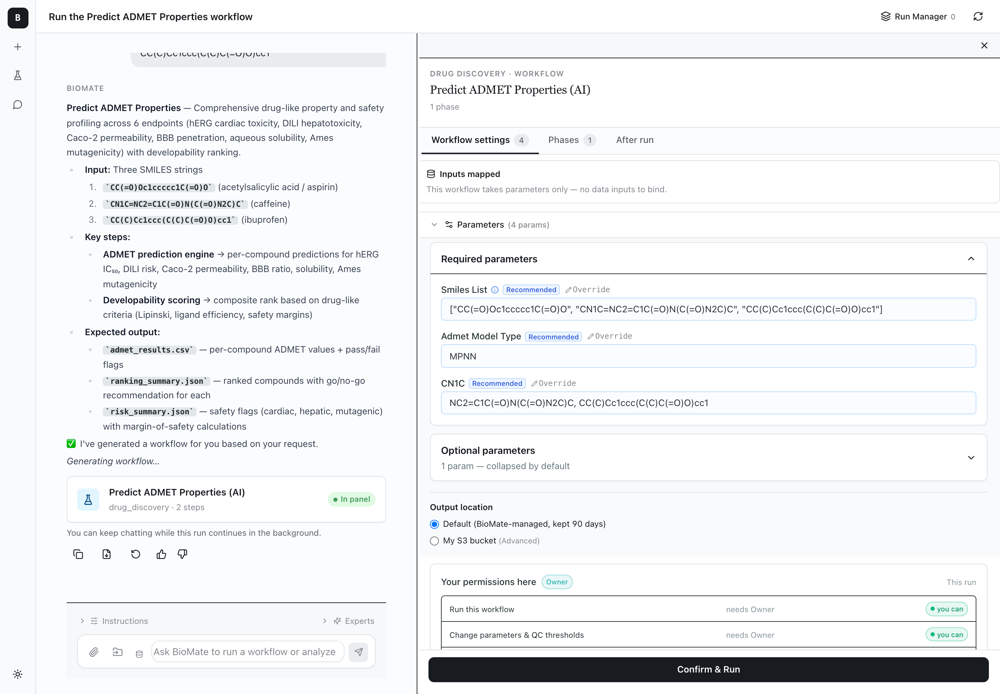
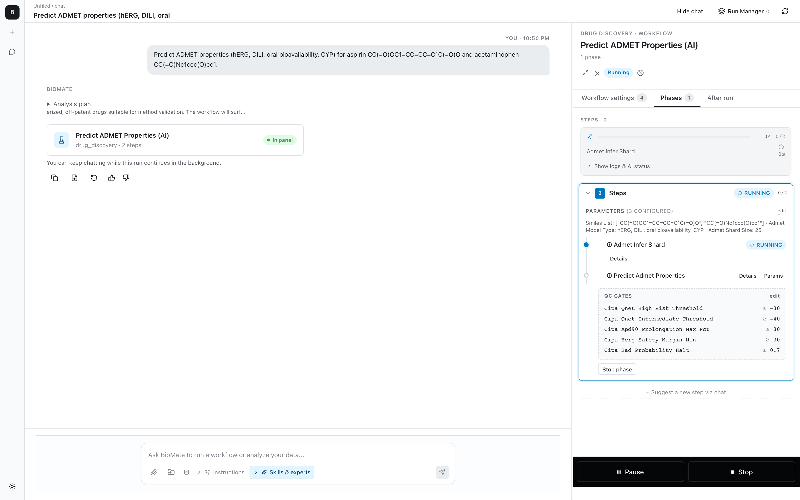
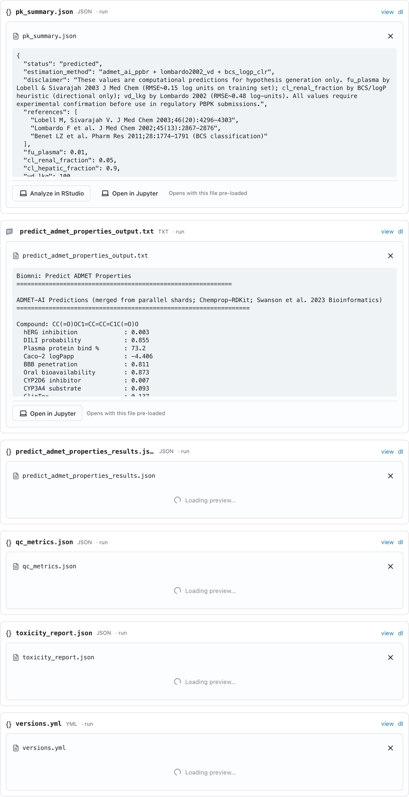
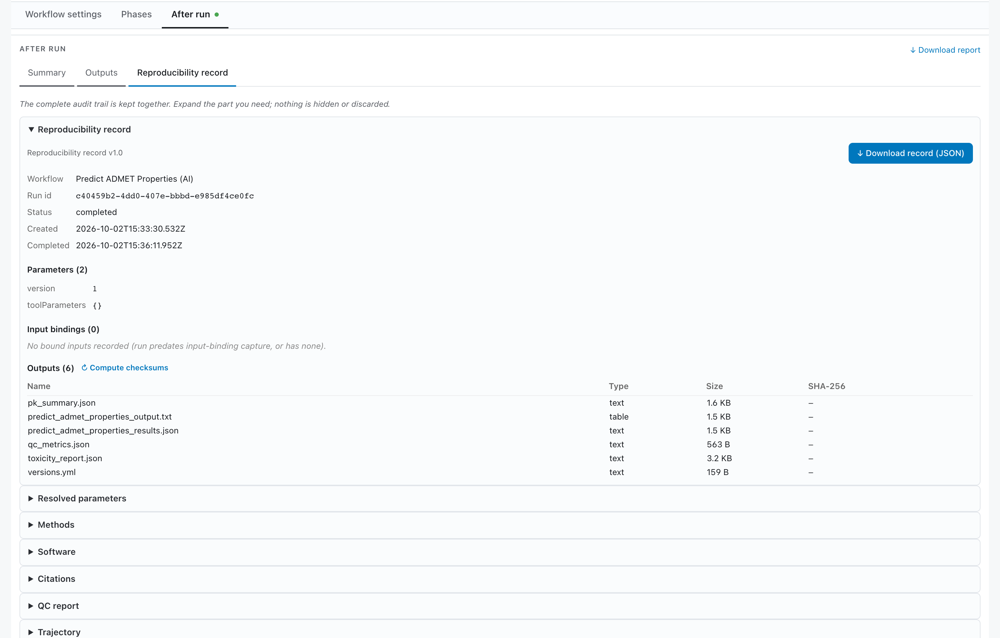

# 教程十一 —— 完整的药物研发流程，端到端走一遍

> **适合谁读：** 任何人 —— 药物化学家、生物学家、项目负责人都行，不需要编程。大多数其他教程只讲一个
> 工具；这一篇讲的是**整段旅程**：从确立一个目标，到设计候选分子、预测性质、拿它们去和靶点的三维结构
> 对接、给幸存者排序、闭合"设计—测试"循环、预测给药剂量，再到读懂最终报告。读完之后你会知道*每个阶段
> 分别由哪一个真实的 BioMate 工作流来完成*、*它们的先后顺序是怎样的*，以及同样重要的 —— *哪些已经被证
> 明、哪些虽然可用但尚未验证、哪些还是已知的空白。*
> **用时：** 阅读约 20 分钟。
> **它在教程中的位置：** 这一篇是把各篇药物发现教程串起来的那张总图。教程一（Design & Generate，设计并
> 生成）是这张图里的第 2 阶段；教程二（模型与闭环）是第 6 阶段；教程三（以及讲工作流面板的 W 系列）讲的
> 是如何运行其中任意单个阶段、并读懂它的报告。要学具体操作，去读那几篇；要看**连贯的端到端全局**，就读
> 这一篇。

---

## 1. 它解决什么问题（为什么单靠一个工具永远讲不完整个故事）

如果你以前只见过 BioMate 预测 **ADMET** 性质（一个分子是否可能安全、是否具备类药性），那你完全有理由问
一句：*其余的部分都在哪儿？* 在别人给你的分子上预测安全性，只是药物研发的一小片。一个真实的研发项目
是一条**流程（pipeline）** —— 一长串首尾相接的阶段，每个阶段回答一个不同的问题，再把结果交给下一个：

- *我到底想做出什么，它必须满足哪些条件？*（确立目标 / framing）
- *我究竟该考虑哪些分子？*（设计 / 生成）
- *它们有类药性、安全吗？*（性质预测 —— ADMET 及更多）
- *它们真的能和靶点结合吗？*（基于结构的评估）
- *其中哪一小撮是综合最佳的折中方案？*（多目标排序）
- *该怎么改进那些落选者、再试一轮？*（闭环）
- *一个人大概需要多大剂量？*（PK / PBPK）
- *我到底发现了什么，又能不能拿出依据？*（报告与可复现性）

一款药物，一支人类团队要花**10～15 年、远超十亿美元**才能开发出来，而其中大部分钱都砸在了那些到后期才
失败的候选分子上。把这些阶段放到计算机上、按顺序跑一遍，目的就是**尽早、尽便宜地把差的候选分子淘汰掉**
—— 在云端计算机上几个小时内完成 —— 这样你真正拿去实验室合成的那少数几个，才最有希望成功。这篇教程就是
唯一一处把所有这些阶段当作一条连贯的流来展示的地方：把每一个阶段都对应到真实执行它的那个 BioMate 工作流
上，并如实说明每个阶段今天能被信任到什么程度。

> **用一个疾病来贯穿整段旅程。** 全程我们都用一个来自自身免疫病的例子：我们想要一个**能阻断 JAK1（一种
> 炎症信号蛋白）的口服小分子**，用于类风湿关节炎 —— 但与现有的 JAK 类药物不同，它要**避开心律风险**
> （即 hERG/QT 效应）。这只是为了把每个阶段讲具体的示例；它不是 BioMate 已报告的某项真实结果。

> **一句话概括：** 药物研发是一条由许多阶段组成的流程，而不是一次预测 —— 这篇教程把每个重要阶段都对应
> 到真实运行它的那个 BioMate 工作流上，并如实标注它被证明到了什么程度。

---

## 2. 开始前需要了解的几个概念（用大白话讲）

有几个概念会在每个阶段反复出现。在这里一次性讲清楚，后面读起来就顺了。

**靶点 vs. 分子。** **靶点**是你想在体内作用的那个东西 —— 几乎总是一种*蛋白质*（这里是 JAK1）。**候选
分子**（或配体 / ligand）是一个*小分子*，你希望它能粘到靶点上、改变靶点的功能。把这两者分清楚很重要：
有些阶段接收的是一个蛋白质，有些接收的是一个分子，还有少数两者都要。

**SMILES。** 一段表示分子结构的短文本代码 —— 也是你在 BioMate 里输入或粘贴分子的标准方式（阿司匹林就是
`CC(=O)Oc1ccccc1C(=O)O`）。这些代码你不用手写；到 **PubChem** 或 **ChEMBL** 这类免费数据库上查一个已知分子，
复制它的 "Canonical SMILES" 即可。（教程一有详细讲解。）

**预测 vs. 测量。** 每一个计算阶段产出的都是一个**预测** —— 一个有依据的估计，而不是实验室的实测。一个好
的预测能告诉你把有限的实验预算花在哪里；它不能替代实验室。BioMate 的设计原则是：当它对某件事**没有**可信
的模型时，它会说*"暂无"*，而不是编一个数字出来。这份如实本身就是重点，而不是一种缺陷。

**同时追求多个目标（多目标）。** 一个有用的药物必须既有活性**又**安全**又**造得出来**又**在体内表现良好
—— 这些目标彼此拉扯（让分子结合得更牢，往往会让它更难溶，诸如此类）。BioMate 把每个目标都**单独放在各自
的列里、各用各的单位**，绝不把它们揉成一个神奇的"综合分数"，因为一揉，一个不安全的分子就可能靠一个好看
的平均值蒙混过关。该如何权衡，由*你*来定。

**闭环（设计—合成—测试—学习，即 DBTL）。** 你永远不可能第一次就拿到完美的分子。可靠的办法是一个循环：
**设计**候选分子 → **合成**（造出）最好的那几个 → 在实验台上**测试**它们 → 从真实结果里**学习** → 再设计
更好的一批。每转一圈叫一**轮（round）**，系统每一轮都会进步。（这整篇都是教程二的主题。）

**质控闸门 / 自动循环（QC gate / auto-loop）。** 有些工作流会在运行途中做一次自动**质量检查**。如果某个结果
没达到阈值（比如预测的心脏安全性比你设的上限还差），运行**不会**悄悄继续下去 —— 它会把这个失败标记出来，
把实测值和要求值一并展示给你，并且对部分工作流还会自动调整一个设置、重新运行。（见教程三和下面的第 6 阶段。）

**本教程使用的如实标签。** 因为这是一张关于真实能力的地图，每个阶段都带有一个直白的判定：
- **已验证（Validated）** —— BioMate 在真实的云端算力上运行它，并且它已对照某个基准或已知答案核验过。
- **可用（尚未在线上验证）（Available, unproven live）** —— 工作流存在并能运行，但某个具体行为还没有在线上
  开发站点上得到确认，或者它需要你自己的数据才有意义。
- **部分 / 空白（Partial / gap）** —— 这个阶段一部分是真实的，另一部分尚未搭建、或尚未接入产品。把话说明白，
  免得你过度依赖它。

---

## 3. 什么时候用它

- 你**刚接触 BioMate 的药物发现这一侧**，想先看看全局，再深入任何单个工具。
- 你在**规划一个项目**，需要知道今天 BioMate 到底能实打实替你做哪些阶段，又有哪些仍然需要实验室、需要你
  上传数据、或需要一位人类专家。
- 你跑过某一个阶段（比如 ADMET），然后问了句*"其余的呢？"* —— 这篇就是其余的部分。
- 你需要向同事、合作方或评审**讲清楚这条流程**，并且带着诚实的边界。

你**不**需要每次都把八个阶段全跑一遍。很多真实项目只用其中几个（例如 设计 → ADMET → 对接 → 排序）。这张
地图只是展示：当你确实需要完整的链条时，它们是怎么连起来的。

---

## 4. 一步步走 —— 八个阶段

下面每个阶段都会告诉你：*它回答什么问题*、*真实执行它的那个 BioMate 工作流*（名称和路径）、*你会怎么运行
它*、*怎么看懂结果*，以及一个如实的**判定**。

> **任意单个阶段怎么运行。** 每一个阶段的操作方式都一样，都在教程三里讲过：在聊天框里用大白话描述目标
> （或者直接点名要用的工作流），核对 BioMate 预填好的参数，点击 **Confirm & run**（确认并运行），看着各
> 阶段推进，再读运行后的报告。这篇教程聚焦的是*每个阶段是干什么的、各阶段之间如何衔接*，而不是重复那些
> 运行操作的细节。

---

### 第 1 阶段 —— 确立目标

**它回答什么：** *我到底在为什么做优化？* 在任何分子出现之前，你先写下**靶点**（JAK1）、**目标**
（牢固结合 JAK1；能口服吸收；对心脏安全），以及**约束条件**（避开某个竞争对手的化学骨架；保持可合成）。
这是一个思考步骤，不是一个工作流 —— 但它是最重要的一步，因为后面每个阶段都会继承这些选择。目标含糊，产出
的候选名单也含糊。

实际操作中，你就是靠**用大白话向 BioMate 描述**来把目标记录下来（"为类风湿关节炎设计一个口服 JAK1 抑制剂，
避开 hERG 心脏风险"），再在 Design & Generate 表单（第 2 阶段）里设定**性质窗口**和**安全偏好**。你在这里
命名的那些目标，会变成第 5 阶段里你用来比较候选分子的那些列；你最在意的那个安全上限（hERG），会变成第 6
阶段里的质控闸门。

<!-- CAPTURE route=/ ; state=chat composer with a plain-English drug-design goal typed, before sending ; focus=composer ; note=显示聊天编排区里已经输入了一个框定好的目标，例如 "design an oral JAK1 inhibitor that avoids hERG cardiac risk"，用来说明第 1 阶段的目标确立 -->
*（待补图：聊天编排区里已经输入了一个用大白话框定好的药物设计目标、尚未发送 —— 用来说明目标是怎么被记录下来的。）*

> **判定 —— 确立目标：不是工作流（始终可用）。** 这是你和人、和聊天一起完成的一个规划步骤。没有什么需要
> 验证的；它只是把下面的一切都铺垫好。

---

### 第 2 阶段 —— 生成 / 设计候选分子

**它回答什么：** *我究竟该考虑哪些分子？* 与其让你手工去画分子（类药分子有约 10⁶⁰ 个 —— 比可观测宇宙里
的恒星还多），BioMate 会围绕一个种子分子**提出**候选分子，并返回一份排好序的候选名单。这是**教程一
（Design & Generate）**的主题 —— 完整的操作演练去读那篇；这里讲的是它在整条流程里处于什么位置、以及背后
真正支撑它的是什么。

**真实的工作流。** BioMate 的目录里有 **REINVENT4 Generative Lead Design**（生成式先导设计，
`nextflow_nfcore/subworkflows/drug_discovery/reinvent4_lead_design/main.nf`）—— 一条五步流程（校验输入 →
生成分子 → 枚举一个基线 → 按 PAINS/Lipinski/新颖性做筛选与排序 → 出报告）。它支持四种设计模式，你用大白话
来选：
- **从头生成（de novo）** —— 从零开始搭建全新的分子，
- **骨架修饰（scaffold decoration）** —— 保留核心，改变核心上的修饰基团，
- **连接子设计（linker design）** —— 把两个片段连起来，
- **骨架跃迁（scaffold hopping）** —— 换到一个*不同的*核心，但它仍应能结合靶点（例如为了绕开专利，或避开
  一个有毒的核心）。

第二个真实的工作流是 **Scaffold Hopping**（骨架跃迁，
`nextflow_nfcore/subworkflows/drug_discovery/scaffold_hopping/main.nf`），它用 RECAP 碎片化 + 匹配分子对分析
来做有针对性的核心替换，并按类药性和合成可及性给新颖骨架排序。

**你会怎么运行它。** 给它一个 SMILES 形式的**种子**分子（从 ChEMBL 查到的一个已知 JAK1 结合物），选一种
模式，设定性质窗口（大小 / 油水倾向 / 极性）以及任何要禁用的化学基团，然后点击生成。你会拿到一份排好序的
候选分子名单，每一个都带有"为什么"的解释，以及与它最接近的那个已知分子。它在一分钟内完成。（完整细节见
教程一 §4–5。）

<!-- CAPTURE route=/design ; state=Design & Generate results showing ranked generated candidates with per-objective columns ; focus=design-results ; note=复用或重拍 T1 的多目标结果视图（i11-3），显示生成的候选分子按各目标排序 -->
*（待补图：Design & Generate 的结果 —— 一份排好序的、生成出来的候选分子名单，每个目标各占一列。参考布局见
教程一的多目标视图。）*

> **判定 —— 设计：端到端可用，但训练好的生成核心是一块已知的空白（GAP）。** Design & Generate 工作流今天就能
> **端到端跑通**小分子，并返回一份排好序、经过安全筛选的候选名单 —— 这一部分是真实的，作为一个*起点*也确实
> 有用。**但要如实说清楚究竟是什么在做生成：** 一个完整**训练好的、靶点条件化的从头生成器**（一个学会了专门
> 发明可能结合*你的*靶点的分子的模型）**尚未搭建** —— 今天这个引擎依靠的是基于规则的枚举和强化学习的脚手架，
> "学习出来的生成器"这个说法把那个训练好的部分说得过头了。请把第 2 阶段的产出当作*供后续阶段去筛选和改进的
> 想法*，而不是已经完工、已针对靶点优化好的设计。多肽和蛋白模式会记录你的设置，但还**不能**产出候选分子
> （屏幕上会这么说）。

---

### 第 3 阶段 —— 性质预测（它有类药性、安全吗？）

**它回答什么：** *在我手上这些分子里，哪些可能被吸收、是安全的、值得费这个劲？* 这就是你可能已经熟悉的那个
阶段 —— 但它有三个各不相同的部分。

#### 3a. ADMET —— 吸收、分布、代谢、排泄、毒性

**它回答什么：** 最核心的安全与行为问题 —— 它会被吸收吗，会不会伤害心脏或肝脏，身体会不会把它清除得太快？
ADMET 代表 **A**bsorption（吸收）、**D**istribution（分布）、**M**etabolism（代谢）、**E**xcretion（排泄）、
**T**oxicity（毒性）。

**真实的工作流（BioMate 的旗舰、也是详细范例）。** **Predict ADMET Properties (AI)**（预测 ADMET 性质，
`nextflow_nfcore/subworkflows/pharmacology/predict_admet_properties/main.nf`）。它用 **ADMET-AI**（Chemprop
图神经网络，Swanson 等人 2023），在来自 ChEMBL 和 TDC 的 200 多万条实验测量数据上训练，从一列 SMILES 预测
**15 个端点**，包括：
- **hERG**（心脏 / 心律风险 —— 我们这个 JAK1 例子最关心的就是它），
- **CYP1A2/2C9/2C19/2D6/3A4** 抑制（药物相互作用风险），
- **Caco-2** 通透性与 **BBB** 血脑屏障穿透（肠道吸收、进入大脑），
- **水溶性**与**亲脂性**，
- **血浆蛋白结合率**、**分布容积**、**半衰期**、**LD50**（急性毒性），
- 以及通过配套工作流预测的 **DILI**（肝损伤）和 **AMES**（致突变性）。

**你会怎么运行它。** 粘贴或附上一列 SMILES（你第 2 阶段的候选名单），确认参数，然后运行。它在 **AWS Batch**
云端工作节点上执行，产出 `admet`、`qc` 和 `toxicity` 三类输出。下面这几张截图来自一次真实的 ADMET 运行 ——
运行前的参数条、带质控闸门的运行中状态、输出，以及可复现记录：

*运行前：ADMET 工作流的参数（你的 SMILES 列表和模型设置）在花掉任何算力*之前*就展示出来、并可编辑 —— 这是
你先把一切核对清楚的机会。*

*运行中：面板显示实时进度，以及将要检查的那些质控闸门（例如 hERG）。如果某个闸门没通过，运行会把实测值连同
阈值一起亮出来，而不是悄悄继续（见第 6 阶段）。*

**怎么看懂结果。** 每个分子一行，每个端点各占一列，有风险的那些会被标出来。拿我们的例子来说，你会先扫一眼
**hERG** 那一列，把任何超过你安全上限的候选分子搁到一边。ADMET 在一个多性质 ADMET 基准（hERG、DILI、AMES、
CYP、Lipinski 五规则）上测得约 **89%**，并配有命名好的质控配置。

> **判定 —— ADMET：已验证（VALIDATED）。** 这是药物发现流程里被证明得最充分的阶段。它在真实的云端算力上
> 运行、有基准测试，也是那个标准的详细范例 —— 开发站点上存在一次真实的、已完成的运行（runId `c40459b2`，
> 在 BioMate 自己的药物研发记录中被引用）。这些预测是估计值，仍然需要实验来确认，而且对非常罕见的化学类型
> 可能泛化得不好 —— 工作流自己也是这么说的。

#### 3b. 理化性质 / 类药性

**它回答什么：** 那些简单、快速的"合理性"性质 —— 大小（**MW** 分子量）、油水倾向（**logP**）、表面极性
（**TPSA**）、氢键供体 / 受体 —— 以及这个分子是否通过 **Lipinski 五规则**（判断一个口服药片是否说得通的一条
经典经验法则）。

**真实的工作流。** **Calculate Physicochemical Properties**（计算理化性质，
`nextflow_nfcore/subworkflows/pharmacology/calculate_physicochemical_properties/main.nf`），配套还有
**Membrane Permeability Prediction**（膜通透性预测，Caco-2 / PAMPA / 外排）。这些是便宜、快速的过滤器，你常常
在那些更重的阶段*之前*就先跑它们，把明显不成药的分子剔除掉。

> **判定 —— 理化性质：可用（available）。** 这是真实的工作流，计算的是标准、定义明确的描述符（基于 RDKit）。
> 算术是精确的；而对结果的解读（例如五规则）是一条指导原则、不是铁律，所以一个刚好落在窗口之外的有潜力分子
> 会被标记，而不是被删掉。

#### 3c. QSAR / 活性预测

**它回答什么：** *这个分子针对我这个特定靶点大概有多强的活性？* **QSAR**（定量构效关系）从一张已知分子的表格
里学习分子结构与某个实测活性（例如 JAK1 pIC50）之间的关系，然后为新分子预测活性。

**真实的工作流。** **QSAR RF Model**（QSAR 随机森林模型，
`nextflow_nfcore/subworkflows/pharmacology/qsar_rf_model/main.nf`）在一个 `smiles,activity` 的 CSV 上做五折
交叉验证训练一个随机森林，并报告 R² 和 RMSE。它内置了一道**质控闸门**：如果交叉验证的 R² < 0.5，结果会被标
记为阻断（一个连自己留出的数据都预测不好的模型是不可信的）；而化合物少于 50 个则会触发一条提示。

**你会怎么运行它。** 你必须提供**你自己的带标签数据** —— 一个把分子和它们的实测活性配对起来的 CSV（来自文献、
ChEMBL，或你自己的实验）。没有带标签的数据，就没有东西可供它学习。

> **判定 —— QSAR：可用（需要你的数据）。** 这个工作流是真实的，也有一道如实的质量闸门，但它的好坏完全取决
> 于你喂给它的活性数据；而针对特定靶点的活性数值，恰恰就是 BioMate 在没有可信模型时会标为*"暂无"*的那类东西
> （见教程一关于活性的如实说明）。当你手上有一套像样的靶点活性数据集时就用它；别指望单凭结构就能得到一个可靠
> 的活性预测。

---

### 第 4 阶段 —— 基于结构的评估（它真的能和靶点结合吗？）

**它回答什么：** 性质预测（第 3 阶段）基本上是就分子本身来看它；这个阶段把**靶点的三维结构**引进来，追问这个
分子在物理上能不能嵌进结合口袋、以及嵌得有多紧。这是你从"有类药性"迈向"真的能结合 JAK1"的地方。三种方法，
成本和精度依次递增：

**（a）分子对接 —— 构象 + 打分。** **Docking AutoDock Vina**（AutoDock Vina 对接，
`nextflow_nfcore/subworkflows/pharmacology/docking_autodock_vina/main.nf`）把每个候选分子放进靶点的结合口袋，
尝试多种朝向（"构象 / poses"），并报告最佳的**结合亲和力**（kcal/mol —— 越负表示结合越紧）和构象几何。你给它
受体结构（JAK1 的一个 PDB 文件）和你的 SMILES 列表。它快到足以给数百个候选分子排序。BioMate 还附带一个
**P0 Docking Validation**（P0 对接验证）工作流，它把一个已知药物重新对接回它的晶体结构里，检查构象是否在真实
构象的 2 Å 以内 —— 这是一次"对接确实在正常工作"的自检。

**（b）相对结合自由能（RBFE / FEP）—— 精确的比较。** **OpenFE Relative Binding Free Energy**（OpenFE 相对结合
自由能，`nextflow_nfcore/subworkflows/drug_discovery/openfe_rbfe/main.nf`）是比较*两个相似分子*的黄金标准物理
方法：它用 GPU 分子动力学上的炼金自由能微扰来计算 **ΔΔG**（结合强度之差，单位 kcal/mol，带误差棒）。你会在
后期用它，针对一小组很接近的类似物，当你需要可靠地知道两个非常相似的候选里哪一个结合得更好的时候。在一个参考
集上，BioMate 的 RBFE 精度落在约 **1.73 kcal/mol** 左右 —— 与已发表的工具相当。

**（c）分子动力学（MD）—— 结合稳不稳？** **AMBER pmemd GPU Molecular Dynamics**（AMBER pmemd GPU 分子动力学，
`nextflow_nfcore/subworkflows/drug_discovery/amber_pmemd_md/main.nf`）和 **GROMACS Protein-Ligand MD + MM-GBSA**
模拟分子随时间在口袋里摆动的过程，用来检查预测出的构象是否*稳定*（而不是一个一碰就散的假象），并用 MM-GBSA
重新给结合打分。这是最贵的一步；你只把它留给少数几个最靠前的候选分子。

<!-- CAPTURE route=/ ; state=docking workflow after-run showing a best pose and binding-affinity score ; focus=docking-outputs ; note=显示一个对接结果：某个靠前候选分子的三维构象视图及其以 kcal/mol 计的结合亲和力 -->
*（待补图：一个对接结果 —— JAK1 口袋里的最佳构象，以及它以 kcal/mol 计的结合亲和力。）*

> **判定 —— 基于结构的评估：已验证（VALIDATED，按成本分级）。** 对接、RBFE/FEP 和 MD 都是真实、经过测试的
> 工作流，在 BioMate 的云端 / GPU 工作节点上运行；GROMACS MD 和 OpenFE RBFE 已在 AWS Batch 上端到端确认过。
> 按成本顺序使用它们：多做对接，少做 RBFE，最后那一小撮才做 MD。这三者都需要靶点的三维结构 —— 如果你没有，
> 先用 Boltz-2 / AlphaFold2 把它预测出来（见教程二"运行一个模型"）。

---

### 第 5 阶段 —— 多目标优化与成药性排序

**它回答什么：** 走完第 2～4 阶段后，你为每个候选分子拿到了好几个互相打架的数值 —— 有活性但不溶、安全但难造。
*其中哪一小撮是综合最佳的折中方案？* 这个阶段把候选分子**同时在相互竞争的多个目标上**排序，并亮出这样一个集合：
在其中你没法在不牺牲另一个目标的前提下改善任何一个目标 —— 这就是**帕累托前沿（Pareto front）**（权衡的边界）。

**今天真实可用的是什么。** 这个阶段看得见、能用的版本，是 **Design & Generate 里的多目标 / 帕累托视图**
（教程一 §5）：每个候选分子是一行，每个目标保留各自的列和单位（绝不混合），被剔除的分子连同原因一起留在
视图里，还有一张权衡图展示前沿，让你可以按照自己最看重什么来挑（比如宁可牺牲分子大小、也要更偏向心脏安全）。
对于**生物制剂**，有一个专门的 **Antibody Developability**（抗体成药性，
`nextflow_nfcore/subworkflows/drug_discovery/antibody_developability/main.nf`）工作流，给聚集倾向、化学易损位点
和 FcRn 结合打分。

**还没接好的是什么（实话实说）。** 一个更深入、更专门的**多目标优化器** —— 一个带期望超体积（帕累托）采集
函数的高斯过程代理模型，它能主动*提出下一批*分子以最大程度地改善所有目标 —— **在 BioMate 的代码里存在，但还
没有接入产品**（没有运行按钮、没有 API、也没有面板）。BioMate 自己的能力评估把它称为药物研发里"最大的一块潜在
能力"。所以今天你拿到的是一份如实的、*需要你自己读的并列排序*；你还**拿不到**一个会替你挑选下一批分子的自动
优化器。

<!-- CAPTURE route=/design ; state=the Pareto / trade-off chart in Design & Generate with the front highlighted ; focus=pareto-chart ; note=显示权衡（帕累托）图：点 = 候选分子，前沿边界 = 最佳折中；交叉引用 T1 -->
*（待补图：权衡（帕累托）图 —— 每个点是一个候选分子，前沿边界是现有的最佳折中方案。参考见教程一 §5。）*

> **判定 —— 多目标排序：部分（PARTIAL）。** 那种**不混合、需要你自己读的排序**是真实的、今天就可用（在
> Design & Generate 里）。而**那个会提出下一批分子的自动化 GP / 帕累托优化器是一块已知的空白** —— 已经写好
> 代码，但还没接入产品。别把 BioMate 说成现在就能自动优化你的分子库；它会如实排序，并把选哪一批的决定留给你
> （以及留给闭环 —— 下一节讲）。

---

### 第 6 阶段 —— 闭环（设计—合成—测试—学习）与质控闸门

**它回答什么：** *我该怎么把一轮设计变成一个持续进步的项目？* 没有哪一遍能直接给出一款成品药。可靠的办法是
**DBTL 闭环**：设计候选分子 → 造出最好的那几个 → 在实验台上测试 → 从真实测量里学习 → 设计更好的一批。这整篇
都是**教程二（模型与闭环）**的主题 —— 操作细节去读那篇；这里讲的是它如何把其他阶段绑在一起，以及那道强制执行
它的自动质量闸门。

**闭环如何把各阶段连起来。** 第 2～5 阶段是"设计"这一环的一轮。你从候选名单里**导出一份订货单（order sheet）**；
化学家（自己的或委托实验室的）把排在前面的分子造出来；实验室测量它们；那些真实的实验数值通过一个**药物发现
战役（campaign）**被反馈回去，用来**重新训练**打分模型 —— 于是下一轮的设计会更准。每转一圈叫一**轮（round）**，
好处会累积：一个跑了三四轮的团队，最终拿到的候选分子会远胜于只设计一次的团队。（教程二 §6 就用同一个 JAK1/hERG
例子，一步步走过这个过程。）

**质控闸门 / ADMET 自动循环。** 在单次运行内部，BioMate 还有一道自动质量闸门。对 ADMET 而言，这道闸门检查
**hERG、DILI、AMES 和五规则**；如果某个候选分子没通过（比如预测的 hERG 风险比你的阈值还差），运行会把它连同
**实测值 vs. 要求阈值**一起标出来，并且对部分工作流还会**调整一个参数（例如一个 logP/MW 过滤器）、自动重跑**，
把每一次补救都记录成一个 前→后 的差异。在 BioMate 的内部测试套件里，这个自动循环在 ADMET、CYP-DDI、对接和 PK
各条线上通过了 **96/96** 个用例。

<!-- CAPTURE route=/ ; state=workflow panel showing a QC gate blocked (measured value vs threshold) and an auto-loop remediation diff ; focus=qc-gate ; note=显示一个被阻断的质控闸门，带实测值 vs 阈值的双数字展示，以及自动循环的 was->now 参数差异 -->
*（待补图：一个被阻断的质控闸门，显示实测值 vs. 阈值，以及自动循环的 前→后 参数改动 —— 即"绝不悄悄放过一个
没通过的检查"这一行为。）*

> **判定 —— 闭环与质控闸门：代码里可用；线上的 ADMET hERG 闸门在 dev 上尚未验证（UNPROVEN）。** DBTL 闭环和
> 那道会自我补救的质控闸门都是真实的设计，内部测试套件也是通过的，而"绝不悄悄越过一个没通过的检查"这条规则，
> 是 BioMate 最核心的可信特性之一。**但要如实说清楚：** 这道 **ADMET hERG 质控闸门还没有被确认真的会在开发
> 站点上的一次线上运行中触发**（这是一个已知的待解决问题 —— 在一次 dev 端到端运行中，这道闸门没能在窗口内
> 出现）。请把这个自动循环当作一个*设计*来看，它已验证、但它在 dev 上的线上触发仍在确认中，而不是把它当作今天
> 就有保证的线上行为。

---

### 第 7 阶段 —— PK / PBPK 建模（一个人大概需要多大剂量？）

**它回答什么：** 一个结合得好、看上去安全的分子，仍然得在合理的剂量下、在体内达到合适的浓度。**PK**（药代
动力学）讲的是身体随时间如何处置药物；**PBPK**（基于生理的 PK）是一个机制性的、逐器官的模型，用来预测人体
暴露 —— 常常是从动物数据外推 —— 这样你就能推算出一个**首次人体剂量**。

**真实的工作流（一条链）。** BioMate 的 **PBPK Simulation — Allometric Scaling & Special Populations**
（PBPK 模拟 —— 异速放大与特殊人群）链（`pbpk_renal_impairment_chain`）运行三个相连的步骤：
1. **异速放大（Allometric scaling）** —— 从临床前动物数据（大鼠 / 小鼠 / 犬）估计人体 PK 参数，
2. **PBPK 模拟** —— 一个带器官特异性清除的房室模型（可选一个肾 / 肝损伤子模型，用于特殊人群给药），
3. **虚拟患者队列（Virtual patient cohort）** —— 在一个模拟人群上做蒙特卡洛采样，以刻画个体差异。

它接收你的临床前 PK 数据和理化性质（以 CSV 形式），输出人体 PK 预测、一个虚拟人群分布，以及一份剂量建议简报
—— 这正是监管 PBPK 材料（FDA/EMA）所要求的格式。

**怎么看懂它。** 关键读数是每个房室的 **Cmax**（峰浓度）、**AUC**（总暴露量）和**半衰期**，加上推算出的人体
剂量。BioMate 的 PBPK 在一个临床 PK 数据集上测得约 **98.5%**，并对照一个 108 个药物的参考集做了验证 —— 这是在
一次正式审计修复了两个严重的 ODE 错误（一个肺—血质量守恒错误，以及异速放大里的一个方差错误）之后做到的 ——
这是"先把根因修掉，再重新跑基准"这条纪律的一个好例子。

<!-- CAPTURE route=/ ; state=PBPK after-run showing a concentration-time curve (Cmax/AUC) and projected human dose ; focus=pbpk-outputs ; note=显示一条 PBPK 血浆浓度-时间曲线，标出 Cmax/AUC，以及首次人体剂量推算 -->
*（待补图：一条 PBPK 血浆浓度—时间曲线，标出 Cmax/AUC，以及推算出的首次人体剂量。）*

> **判定 —— PK/PBPK：已验证（VALIDATED，带一条数据边界）。** 这条 PBPK 链是真实的、有基准、也符合监管格式。
> 请注意这条如实的边界：那个*纯计算*的推算（异速放大、PBPK、虚拟队列）是 BioMate 能替你跑的，但**群体 PK 模型
> 拟合（nlmixr2）和非房室分析需要真实的体内或临床 PK 数据**，那要由你上传 —— BioMate 运行模型，它没法凭空生成
> 试验数据。

---

### 第 8 阶段 —— 读懂结果与可复现记录

**它回答什么：** *走完所有这些阶段，我到底发现了什么，又能不能证明我是怎么得到它的？* 上面每个阶段都会产生一次
运行，带有同样的三标签页**运行后报告** —— 这是**教程三**和**教程 W2（运行后面板）**的主题；完整细节去读那两篇。
在端到端的流程里，它正是让整段旅程**站得住脚**的那个东西：为了一篇论文、一项专利或一次 IND 申报，你能准确展示
出是哪个工作流、哪些参数、哪些软件版本和哪些输入产生了每一个数字。

三个标签页：
- **Summary（摘要）** —— 大白话的发现，关键数字直接取自输出文件（而且每个数字都能点回它所来自的那个文件）。
  关键在于：如果 BioMate 读不到输出文件，它会**把发现"按下不表"并如实说明**，而不是编造一段摘要 —— 这份如实
  本身就是特性。
- **Outputs（输出）** —— 运行产生的每一个文件，按产生它的步骤归类（ADMET 运行的 `admet`、`qc`、`toxicity`
  文件；对接的构象和打分；PBPK 的曲线）。每个文件你都能查看、下载或保存。
- **Reproducibility record（可复现记录）** —— 完整的审计记录：运行编号、时间戳、参数、每个输出及其类型、大小
  和一个按需生成的 **SHA-256 校验和**，再加上可展开的方法（Methods）、软件版本、引文和质控报告。一键就能把整份
  记录下载成 JSON。

*输出：每个文件都归在产生它的步骤之下 —— 这是看清每个阶段到底产出了什么最直观的视图。*

*可复现记录：参数、软件版本、输出、校验和（按需计算）和引文 —— 这份完整、可下载的说明，正是让结果站得住脚
的依据。*

> **判定 —— 报告与可复现性：已验证（VALIDATED）。** 这个三标签页报告和可下载的可复现记录都是真实的，上面展示
> 的就是一次真正的 ADMET 运行。那份如实的发现行为（读不到输出时宁可按下不表、也不编造）是刻意为之、用来建立
> 信任的行为，不是一个 bug。

---

## 5. 一览流程全貌

| # | 阶段 | 它回答什么 | 真实的 BioMate 工作流 | 判定 |
|---|---|---|---|---|
| 1 | **确立目标** | 我在为什么做优化？ | （规划步骤 + 聊天 / Design 表单） | 始终可用 |
| 2 | **设计 / 生成** | 该考虑哪些分子？ | REINVENT4 Generative Lead Design；Scaffold Hopping | 端到端可跑；**训练好的从头生成器 = 空白** |
| 3a | **ADMET** | 安全且能吸收？ | Predict ADMET Properties (AI) | **已验证**（运行 `c40459b2`） |
| 3b | **理化性质** | 有类药性（Lipinski/logP）？ | Calculate Physicochemical Properties | 可用 |
| 3c | **QSAR** | 对我的靶点有活性？ | QSAR RF Model | 可用（需要你的带标签数据） |
| 4 | **基于结构** | 它能和靶点结合吗？ | Docking AutoDock Vina；OpenFE RBFE；AMBER/GROMACS MD | **已验证**（按成本分级） |
| 5 | **多目标排序** | 综合最佳的折中？ | Design & Generate 帕累托视图；Antibody Developability | **部分**（优化器未接入） |
| 6 | **闭环 + 质控闸门** | 改进并再试一轮？ | DBTL 战役；ADMET 自动循环 | 代码里可用；**线上 hERG 闸门在 dev 上尚未验证** |
| 7 | **PK / PBPK** | 人体剂量是多少？ | PBPK 异速放大链 | **已验证**（群体 PK 需上传体内数据） |
| 8 | **报告与记录** | 我发现了什么；能否证明？ | 运行后报告 + 可复现记录 | **已验证** |

---

## 6. 如实的边界 —— 你该有怎样的预期

- **这是计算机上的初筛，不是一款药。** 每个阶段产出的都是*预测*，为的是在进实验室之前先把范围缩小。即便一份
  候选名单闯过了全部八个阶段，它离一款药物也还有许多年、许多实验的距离。价值在于**起步更聪明、失败更便宜**，
  而不是跳过实验室。
- **训练好的生成核心才是真正的那个洞。** 第 2 阶段能端到端跑通、给你一份筛选过的起始名单，但一个训练好的、
  靶点条件化的从头生成器**尚未搭建**。别指望开箱就得到新颖的、已针对靶点优化好的分子 —— 该期待的是*供下游去
  筛选和改进的想法*。
- **自动化的多目标优化器已经写好、但还没接上。** 你拿到的是一份如实的、不混合的、需要你自己读的排序（第 5
  阶段）；你还**拿不到**一个会提出下一批分子的优化器。
- **ADMET hERG 质控闸门的线上触发在 dev 上尚未得到确认。** 这个自动循环是一个已验证的设计，内部测试套件也通过
  了，但它在开发站点上的线上行为仍在确认中。在你依赖它来做运行途中的把关之前，请留意这道闸门是否真的出现在
  运行中的面板里。
- **有些阶段需要*你的*数据。** QSAR 需要一个带标签的活性 CSV；群体 PK / NCA 需要真实的体内或临床 PK 数据；闭环
  需要把真实的实验台测量结果通过一个战役反馈回来。BioMate 运行模型 —— 它没法凭空生成数据。
- **活性要么如实报告、要么干脆不报。** 在 BioMate 缺少可信的靶点特异性模型的地方，它会把一个结合 / 活性数值
  标为*"暂无"*，而不是编一个出来。这是刻意为之的。
- **多肽和生物制剂这边更薄。** 小分子这条路是最完整的；多肽 / 蛋白设计会记录设置、但还不能生成候选分子，而生物
  制剂的覆盖（双特异性、成药性）是部分的。

---

## 7. 接下来去哪儿

| 你想要… | 去哪儿 |
|---|---|
| 深入学习设计 / 生成候选分子（第 2 阶段） | **教程一 —— Design & Generate（设计并生成）** |
| 理解闭环和模型（第 5～6 阶段） | **教程二 —— 模型与闭环** |
| 学习如何运行任意单个工作流、并读懂它的报告（第 3～8 阶段） | **教程三 —— 运行工作流并读懂报告** |
| 看工作流面板的各种状态（运行前、运行中、质控闸门） | **教程 W1 —— 运行前与运行中的工作流面板** |
| 详细读懂运行后报告（Summary / Outputs / Reproducibility） | **教程 W2 —— 运行后面板** |
| 带上你自己的数据（SMILES 列表、活性 CSV、PK 数据） | **教程四 —— 带上你自己的数据** |
| 探索并预览每个阶段产出的输出数据集 | **教程十 —— 探索你的数据集** |

养成这个习惯：**确立目标 → 设计 → 预测性质 → 拿去和结构对接 → 给幸存者排序 → 闭合循环 → 推算剂量 → 读报告
并留存记录。** 不是每个项目都需要全部八个阶段 —— 但当某个项目确实需要时，这就是各阶段如何衔接、以及今天你能
信任其中哪些的全貌。

---

## 8. 关键术语

| 术语 | 含义 —— 以及你为什么要在意 |
|---|---|
| **靶点 vs. 候选分子** | 靶点是你作用的那个蛋白质（JAK1）；候选分子是你希望能结合它的那个小分子。不同阶段接收其中之一、或另一个、或两者。 |
| **SMILES** | 表示分子结构的一段短文本代码；到 PubChem/ChEMBL 上查到后粘贴即可。 |
| **ADMET** | 吸收、分布、代谢、排泄、毒性 —— 最核心的安全与行为预测（hERG、CYP、DILI、Caco-2、BBB、溶解度、AMES）。 |
| **hERG** | 一个心脏离子通道；阻断它有诱发危险心律改变（QT 延长）的风险。本例贯穿始终的那条安全上限。 |
| **Lipinski / 五规则** | 一条判断口服药片是否说得通的经验法则（大小、油水倾向、氢键）—— 是指导原则，不是铁律。 |
| **QSAR** | 一个从已知分子里学习"结构→活性"、再为新分子预测活性的模型；好坏完全取决于它的数据。 |
| **分子对接（Docking）** | 把分子放进靶点口袋里，估计一个结合构象和打分（kcal/mol）。快；能给很多分子排序。 |
| **RBFE / FEP** | 炼金自由能微扰 —— 对两个相似分子做精确的物理比较（ΔΔG ± 误差）。慢；后期只用于少数几个。 |
| **分子动力学（MD）** | 模拟分子在口袋里运动，用来检查结合是否稳定并重新给它打分。最贵的一步。 |
| **多目标 / 帕累托** | 同时优化相互竞争的多个目标，分开展示；帕累托前沿就是现有最佳折中方案的集合。 |
| **DBTL / 闭环 / 轮** | 设计 → 合成 → 测试 → 学习 → 再设计；每转一圈是一轮，系统每一轮都会进步。 |
| **质控闸门 / 自动循环** | 运行途中的一次自动质量检查，绝不悄悄放过一个失败；对部分工作流它会修正一个设置并重跑。 |
| **PK / PBPK** | 身体随时间如何处置药物；PBPK 是机制性的、逐器官的模型，用来推算人体剂量。 |
| **可复现记录** | 可下载的审计记录 —— 参数、软件、输出、校验和 —— 让结果站得住脚。 |
| **"暂无"（Not available）** | BioMate 在缺少某个数值的可信模型时给出的如实标签 —— 展示它、而不是展示一个编造的数值。 |

---

_面向进阶用户 / 开发者的配套技术参考：药物研发覆盖地图见
`docs/20260417_DRUG_DEVELOPMENT_COVERAGE_ANALYSIS.md`，如实的能力评估见
`docs/20260908_BIOMATE_THREE_PARTS_PHARMA_HOSPITAL_DRUGDEV.md`（第 3 部分）。各阶段的模块参考见
`docs/user-manual/modules/`，以及 I11（Design & Generate）/ I10（Models）两份配套文档。_
