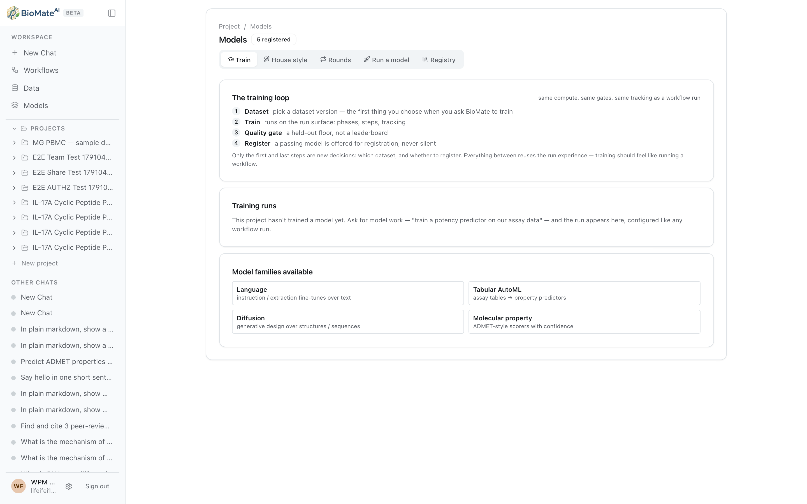
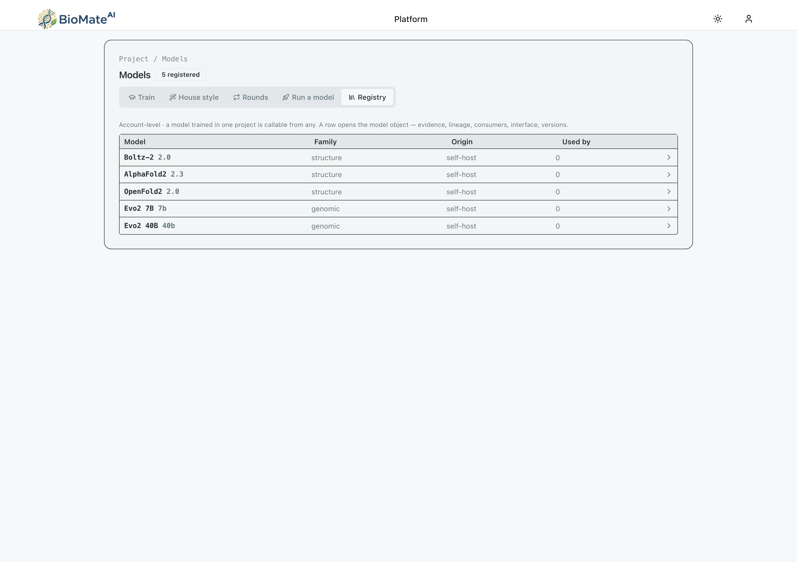
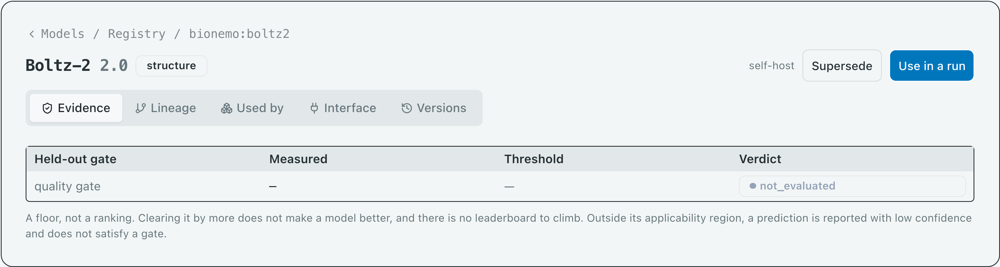
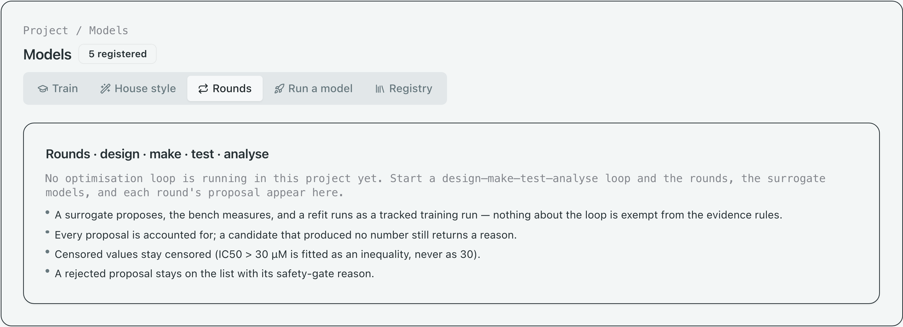

# 教程二 —— 模型与闭环（BioMate 是怎么越用越聪明的）

> **适合谁读：** 任何人 —— 不需要编程，也不需要机器学习背景。读完这一篇，你会明白这里说的"模型"是什么、
> 用模型能做的四件事，以及最重要的 —— **闭环**：真实的实验结果是如何教会 BioMate 在每一轮里设计出更好的
> 分子的。
> **用时：** 阅读约 10 分钟。
> **建议先读：** 教程一（Design & Generate）讲的是候选分子从哪里来；这一篇讲的是 BioMate 如何从这些分子
> 之后发生的事情中*学习*。

---

## 1. 它解决什么问题（为什么模型很重要）

在教程一里，BioMate 提出并给候选分子排了序。而要把它们排好，它必须*预测*每个分子的一些情况 —— 比如
"它和我们的靶点结合得有多强？""它会不会对心脏或肝脏有毒？""它溶解性好不好？"。**模型**就是做这些预测的
那部分。可以把它想成可复用的、学来的专业经验：一旦一个模型从数据里学到了某种规律，任何项目都可以直接
向它要一个预测，而不必每次都去做一个又慢又贵的实验。

依赖预测，会带来两个问题：

1. **可信度。** 一个预测只有在你知道这个模型*有多好*、以及它在*什么范围内*可信时才有用。一个从未被检验过
   的模型，可能给出看似很自信、实则错误的答案 —— 如果你问它的分子和它学过的东西相差很远，这种风险就更大。
2. **是否跟得上现实。** 你真实的实验结果才是事实。一个从不根据你的新测量结果更新的模型，会慢慢偏离现实。

**模型（Models）** 这个区域同时解决这两点。它把每个模型都当作一个可审视的**对象**来呈现（你能看到它是谁
做的、有多好、被用在哪些地方），它也是**闭环**的所在地 —— 也就是把你真实的实验结果反馈回去、让下一轮设计
更好的那个循环。继续用教程一里类风湿关节炎的例子：如果你在实验台上测试了一批 JAK1 候选分子，这些测量结果
就能教会模型，使它*下一批*提议更准。

> **一句话概括：** Models 是 BioMate 存放可复用预测器、并从你真实实验结果中学习的地方 —— 这样平台每一轮都
> 更准，而不是停滞不前。

> **为什么这很重要（两个层面）。**
> - **对一个药物项目 / 从商业角度：** 模型是从*你的*测量结果中学习的，而这些结果只保留在你的工作空间里，
>   绝不会被用来训练公用模型。每一轮都在为你团队自己的知识库添砖加瓦，这些积累始终留在你这边。
> - **对患者 / 转化医学：** 更好、更安全的候选分子，是更好药物的起点。目前，闭环是从**实验室（台式）测量**
>   中学习的；用来自患者或临床的读数来引导它，是 BioMate 正在努力的方向，还不是现有功能。

---

## 2. 开始前需要了解的几个概念（用大白话讲）

**模型 = 可复用的、学来的专业经验。** 它接受一个输入（一个分子、一段蛋白质序列），返回一个预测（一个分数、
一个 3D 结构）。有些模型是**预训练**的 —— 由学术界在大型公开数据集上构建；另一些是**定制**的 —— 在*你的*
数据上训练，用来给*你这类*分子打分。

你会看到几个按名字出现的预训练模型（都是开放的、学术界构建的；BioMate 托管它们，你可以直接使用）：
- **AlphaFold2** 和 **OpenFold2** —— 从蛋白质序列预测其 3D 形状。
- **Boltz-2** —— 既能预测蛋白质 3D 形状，*也能*预测一个蛋白质和一个小分子是怎么结合在一起的。
- **Evo2** —— 一个关于 DNA / 基因组序列的模型。

**模型是一个对象，而不是一张排行榜。** 这是 BioMate 的核心理念，也关乎可信度。BioMate 不把模型放到排行榜上
比名次（那会诱使人去钻空子），而是把每个模型当作一个有据可查的对象来展示：
- **证据（Evidence）** —— 它在一场公平测试中表现如何，对照一个必须达到的质量**底线**（见下文）；
- **溯源（Lineage）** —— 是哪些数据、哪一次运行产生了它；
- **被谁使用（Used by）** —— 有哪些分析依赖它（这样你能看出改动它会影响到什么）；
- **版本（Versions）** —— 每个版本都被保留，而不是被覆盖。

**一道质量"底线"，并经过公平检验。** 一个模型必须先越过一道最低质量线，才会被信任。这条线是在一份**留出
测试集（held-out test）**上测量的 —— 也就是模型训练时*没见过*的数据，所以分数不会因为模型只是把训练样本
背了下来而虚高。（就像用学生没见过的题目来判卷，而不是让他背诵课本。）越过这条线越多，并不会换来更高的
名次 —— 没有排行榜可爬。而如果一个模型还没被测量过，BioMate 会说**"暂未评估（not evaluated）"**，而不是给
一个编造的分数。

**越过底线，并不代表全部。** 一个好的底线分数，意味着模型在*和它学过的数据相似的*测试数据上足够准确。但它
对*你这个具体*分子是否可信，还取决于**适用域（applicability domain）**—— 也就是这个模型学过的那类输入。如果
你问它一个远在适用域之外的东西，它应该降低自己的置信度，而不是假装知道。（举例：一个在小分子激酶抑制剂上
训练出来的模型，被要求给一个多肽打分时，会报告低置信度，因为多肽和它学过的东西毫不相像。）把一个超出适用域
的预测当作可靠，是导致做了一批本来就不可能成功的实验的常见原因。

**用模型能做的四件事**（Models 界面上的四个"轨道"）：
- **运行预训练模型（Run a pre-trained model）** —— 立刻用一个现成的公开模型做预测。这叫**推理（inference）**
  （用一个已经训练好的模型做预测，而不改动它）。不会训练任何属于你的东西。
- **训练（Train）** —— 用你的数据构建一个新的定制模型（例如一个针对你靶点的打分器）。
- **适配 / "风格（House style）"** —— 通过学习你所做的修改，把 BioMate 的*文字输出*温和地调成你团队的习惯。
  不会悄悄改动任何东西 —— 每条学到的规则都会展示出来，而且可以关掉。*（这关乎 BioMate 报告的文字风格，而不
  是某个分子的科学内容。）*
- **优化 / "轮次（Rounds）"** —— 即**闭环**，以轮次的形式展示（见第 3 节和第 6 节）。

**闭环（本教程的核心）。** 药物发现不可能一次做成。可靠的改进方式是重复一个循环：**设计 → 合成 → 测试 →
学习 → 再设计。** BioMate 提出分子（设计），你把排在前面的拿去实验台合成并测试（合成与测试），测量结果被反馈
回去更新模型（学习），改进后的模型再提出更好的下一轮。这个循环的每一圈，就是一**轮（round）**。

> **关于目前能跑什么的如实说明。** 两个轨道可以做实际工作：**运行模型（Run a model，推理）** 和 **模型库
> （Registry，浏览并复用模型）**。**训练（Train）** 和 **轮次（Rounds）** 是*监控视图* —— 它们向你展示训练
> 任务和运行中的闭环（这些是通过一个更大的药物发现战役 / campaign 来启动的），本界面上没有"开始"按钮，在任务
> 或闭环运行起来之前，它们会显示清晰的空状态。此外，在开发站点上，预测蛋白质结构可能返回一个带清晰标记的
> **占位结果**（标为 `stub`），这是在那套"重型"结构预测服务未接入时出现的 —— 所以在信任一个预测结构之前，
> 请先看是否有这个标记。

---

## 3. 什么时候用它

- **复用一个模型** —— 学术界（或另一个项目）已经构建好的，例如在针对某个蛋白质做设计之前先预测它的 3D 形状。
- **把实验结果反馈回去**，让下一轮设计更好（闭环）。
- **在依赖一个预测之前，先判断它可信到什么程度**（打开模型对象，读它的证据和适用域）。

---

## 4. 一步步操作 —— 浏览并复用一个模型

最有用的第一步，是先审视一个模型，这样你才清楚自己在信任什么。

*Models 界面，顶部是各个轨道，以及它所涵盖的模型族。*

1. **打开 Models**（在主界面，或访问 `/models` 页面）。
2. **进入 Registry（模型库）标签** —— 这里列出你账户下可用的所有模型（第 2 节点过名的那些学术界模型，加上你
   团队注册过的任何定制模型）。

*模型库：每一行是一个模型（名称、族、来源、被多少分析使用）。在一个项目里训练的模型，可以在任何别的项目里调用。
点击某一行会打开它的对象视图，见下图。*

*打开一个模型（这里是 Boltz-2），会以对象形式展示它：证据、溯源、被谁使用、接口、版本。*

3. **打开一个模型**查看它的对象视图。**证据（Evidence）**标签会显示质量底线 —— 测得的分数、要求的底线，以及
   判定结果。（这里显示 "not evaluated"，如实表示这一层还没有测量过它 —— 而不是藏起了一个数值。）屏幕上的
   说明讲得很直白：*这是一道底线，不是一个排名。*
4. **看看其他标签** —— **溯源（Lineage）**（是什么产生了它）、**被谁使用（Used by）**（有什么依赖它）、以及
   **版本（Versions）**（它的完整历史）。你就是靠这些来决定一个模型在使用前值不值得信任的。
5. **复用它** —— 点 **"Use in a run"（用于一次运行）**，把这个模型带入一次分析。

要立刻做一个预测，就用 **Run a model**：选一个领域（结构 / 基因组 / 化学），粘贴一个输入（结构领域就是一段
蛋白质单字母序列），然后运行。记住上面那条如实说明：在开发站点上，结构预测结果可能是一个带标记的占位结果，
直到那套重型预测服务接入为止。

---

## 5. 如何看懂结果

- **质量底线**（在模型对象里）：一个*通过*的模型，在与它学过的数据相似的测试数据上足够准确。一个标为
  **"暂未评估"**的模型，在这里还没被测量过 —— 对它的预测要格外谨慎。
- **它对*你这个*分子是否可信**，取决于适用域，而不只是底线。如果一个预测被标为低置信度，通常意味着你的输入
  与模型的训练数据不像 —— 要把这个预测当作未经证实的（类似于把一种药"超适应症"使用：超出了它被验证过的范围）。
- **界限值仍然保留为界限值。** 如果一项实验只能报告"活性大于 30 µM"（因为化合物太难溶、测不到更高），BioMate
  会把它保留为"大于 30"，绝不会悄悄替换成数字 30。保留这些如实的界限，能防止模型学到一个错误的精确值。
- **被剔除的提议仍会显示。** 在闭环视图里，一个被安全检查剔除的候选分子仍会连同原因一起显示 —— 这样你总能看到
  闭环本来想做什么、以及它为什么被拦下。

> **提醒：** 一个 `stub` / 占位结果，是对一个答案*形状*的演示，而不是真实的预测。读任何数值之前，先确认有没有这个
> 标记。（它只会出现在那套重型模型服务未接入的环境里。）

---

## 6. 闭环的实际运作（把前后串起来）

*Rounds 视图是闭环（设计 · 合成 · 测试 · 分析）的所在地。这是它在尚无任何闭环运行时的样子：它说明了之后会出现
什么，并列出了闭环的几条如实原则 —— 每个提议都会被交代清楚、界限值保留为界限值、被剔除的候选分子连同原因一起
保留。一旦一个设计—合成—测试闭环在某个战役里运行起来，各轮次及其提议就会填充到这里。*

下面是完整的循环，把教程一和这一篇连起来：

1. **设计（Design）** —— Design & Generate（教程一）提出并给候选分子排序。
2. **合成与测试（Make and test）** —— 你把名单导出为一份订货单；化学家合成排在前面的分子，实验室对它们进行测量。
3. **学习（Learn）** —— 真实测量结果被反馈回去，模型在**合并后的数据**（它原本已知的 + 新结果）上被**重新训练
   （retrained）**。随后 BioMate 在它*没有*训练过的数据上重新检验它。因为每一轮都在刻意探索新的化学空间，这项
   检验表明的是模型*跟得上*新数据 —— 而不是一个可以一路往上爬的分数。

   *反馈在实际中是怎么操作的：* 对每个分子，实验室记录它的编号和测得的**实验值（assay value）**及单位。（assay
   就是一项活性的实验测试 —— 例如 IC50、结合强度，或某一浓度下的抑制百分比。）如果测试只能报告一个界限 ——
   比如"大于 30 µM"，因为化合物太难溶、测不到更高 —— 这个界限会被原样保留，绝不替换成数字 30。这些结果是通过一个
   **药物发现战役（drug-discovery campaign，更大的云端工作流）**返回的，而不是通过 Models 界面上的某个按钮 ——
   所以在真实项目里，通常由战役负责人或一位生物信息学同事来完成这一步。
4. **再设计（Design again）** —— 改进后的模型给下一轮候选分子打分时会更准。

每一圈就是一**轮（round）**，Rounds 视图就是你监控它的地方 —— 它会显示至今为止的各轮次，以及每一轮提出的候选
分子及其判定。好处会随着轮次增多而累积：跑了三四轮的团队，最终得到的候选分子远好于只设计一次的团队 —— 而且
BioMate 会记录每一次测量，所以你能看到真实的进步，而不必在没有证据的情况下相信这套系统。

**一个用于说明的临床例子（类风湿关节炎）。** 假设你想要一个既能避开心律风险（QT 间期延长，与 hERG 通道有关）、
又能避开现有 JAK 类药物那种全类别感染风险的 JAK1 抑制剂。第一轮提出一批候选分子，但安全检查标记出其中两个有预测
的 hERG 风险；实验台证实了这一点，这些结果教会了模型。到了后面某一轮，排在最前的候选分子通过了心脏安全检查，同时
仍保持对 JAK1 的选择性。*（这是一个用于说明闭环应如何运作的例子，并非 BioMate 已报告的真实结果。）*

> **谁做什么：** **科学家**决定名单并研读证据；**实验室**合成并测量分子；临床医生或生物学家通常提供验证过的靶点，
> 以及现实中要规避的安全问题。BioMate 的职责是：提出、学习，并把它的依据亮出来。

---

## 7. 关键术语

| 术语 | 含义 —— 以及你为什么要在意 |
|---|---|
| **模型（Model）** | 可复用的、学来的专业经验，用来预测某样东西（一个分数、一个结构），省去每次都做实验。 |
| **预训练模型** | 学术界在公开数据上构建、你可以直接使用的模型（AlphaFold2、Boltz-2、Evo2）。 |
| **定制模型** | 在*你的*数据上训练、用来给*你这类*分子打分的模型。 |
| **推理（Inference）** | 用一个模型做预测，而不改动这个模型。（"Run a model" 做的就是推理。） |
| **重新训练（Retraining）** | 用新结果更新一个已有的模型 —— 它保留已知的，再加上新数据。 |
| **模型对象** | 把模型呈现为一组可审视的事实 —— 证据、溯源、被谁使用、版本 —— 而不是排行榜上的一个条目。 |
| **留出测试 / 底线** | 在模型*没有*训练过的数据上测量的一道质量线，所以分数无法虚高。通过只代表"在相似数据上足够准确"，不是名次。 |
| **"暂未评估"** | 如实的标签，表示这里还没测量过它的质量 —— 而不是藏了一个数值。 |
| **适用域（Applicability domain）** | 模型学过的那类输入；超出之后，预测会带着低置信度（当作未经证实来对待）。 |
| **闭环 / 轮次** | 设计 → 合成 → 测试 → 学习 → 再设计 的循环；每一圈是一轮，模型每轮都在进步。 |
| **占位结果（Stub）** | 当某套重型模型服务未接入时返回的、带清晰标记的演示结果 —— 不是真实的预测。 |

---

_面向进阶用户 / 开发者的配套技术参考：`docs/user-manual/modules/I10-models.md`。_
