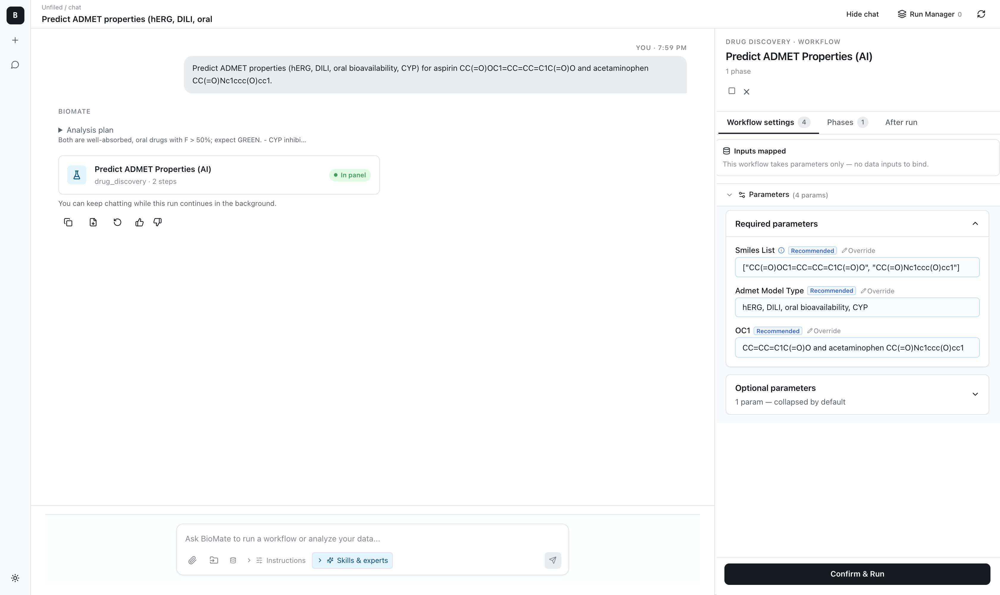
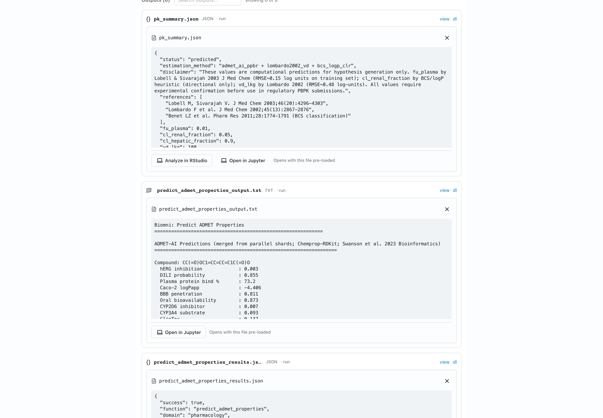
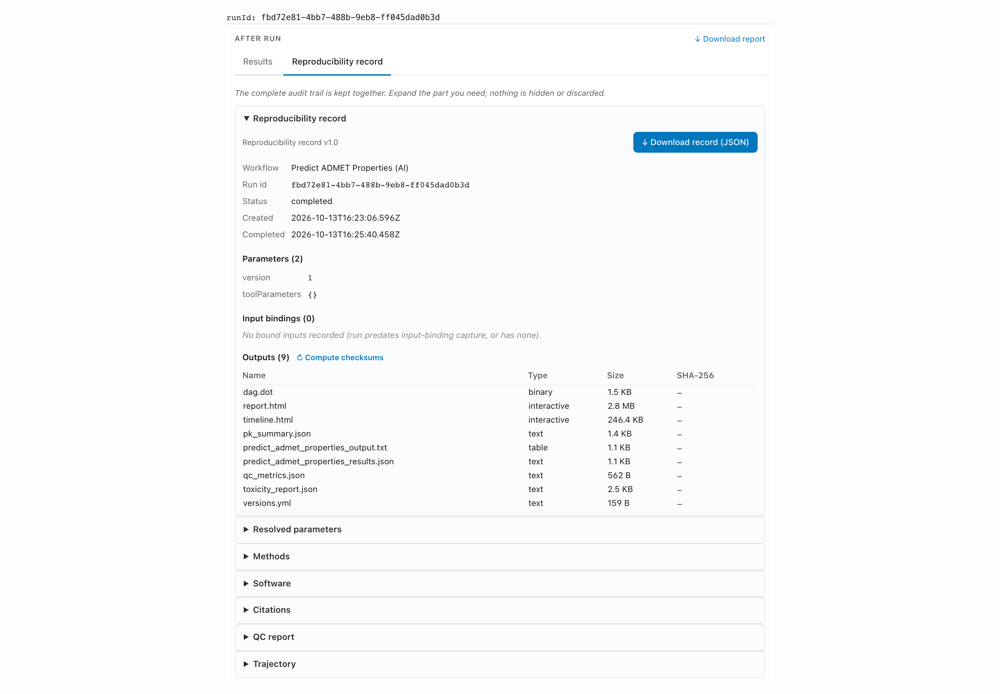

# 教程三 —— 运行工作流并读懂报告

> **适合谁读：** 任何人 —— 不需要编程。读完这一篇，你会知道如何在 BioMate 中运行一个经过验证的多步分析、
> 如何把自己的数据交给它，以及如何读懂它产出的报告 —— 输出文件、审计记录，以及每一步做了什么。
> **用时：** 阅读约 10 分钟；运行本身视分析而定，从几分钟到几小时不等。
> **它在教程中的位置：** 教程一设计分子，教程二从实验结果中学习。这一篇是日常的中间环节：运行一个现成的
> 分析流程，并拿回可信的结果。

---

## 1. 它解决什么问题

大多数真实的分析都不是一步就能完成的 —— 而是一条**流程（pipeline）**：一连串步骤，每一步接收一个输入、做一件事，再
把输出交给下一步。例如，设计一款体内 CAR-T 疗法，要检查靶点在各组织中的安全性、选择并检查递送载体、检查
细胞之间相互攻击的风险，最后组装构建体 —— 这几步必须按顺序进行。自己动手，就意味着手动把各个工具连起来、
记录版本和设置，还得指望日后能原样重复这些步骤。

BioMate 里的**工作流（workflow）**，就是这样一条已经测试好、连接好的流程。你用大白话描述你想做什么、附上
你的数据，BioMate 就在云端计算机上运行整条流程，并返回一份**报告** —— 结果、每一个输出文件，以及它们是
如何产生的记录。

> **一句话概括：** 工作流替你运行整条测试好的流程，并连同"它是如何得到结果的"完整记录一起交回 —— 这样无论
> 是在论文里、在监管申报中，还是日后向团队说明，你都能把这个结果解释清楚、拿得出依据。

---

## 2. 开始前需要了解的几个概念（用大白话讲）

**工作流。** 为某项特定工作做好、并经过测试的流程 —— 例如体内 CAR-T 共同设计，或一次 RNA-seq 分析（比较两
组样本之间哪些基因发生了变化），又或变异检测（找出基因组里的 DNA 差异）。你不用去组装它，直接运行即可。
*（这里说的"验证过 / 测试过"，是指每一步都用的是已发表、成熟的方法 —— 并不代表结果在临床上已被证明。）*

**阶段与步骤。** 一个工作流被组织成若干**阶段（phase）**（大的环节），每个阶段由一个或多个**步骤（step）**
（具体的工具）组成。在 CAR-T 的例子里，阶段是 *图谱安全性 → LNP 趋向性 → 自相残杀检查 → CAR 构建体组装*：
- **图谱安全性（Atlas safety）** —— 检查靶点（这里是 CD19）是否也出现在*健康*组织上，而不只是肿瘤上。这是
  CAR-T 最核心的安全问题（即"在靶、脱瘤"的风险：命中的是正确的靶点，但该靶点也存在于肿瘤之外的健康组织上）。
- **LNP 趋向性（LNP tropism）** —— 检查递送载体（一种脂质纳米颗粒，LNP）是否真的到达*正确的*细胞 —— 这里是
  T 细胞 —— 而不是跑到肝脏里（LNP 默认容易在肝脏聚集）。
- **自相残杀检查（Fratricide check）** —— 检查这些被改造的 T 细胞会不会*互相*攻击；当靶点也出现在 T 细胞
  自身上时就会发生这种情况。（对 CD19 而言，这并不会发生 —— CD19 不在 T 细胞上 —— 所以流程会跑这项检查，
  并预期它通过。）
- **CAR 构建体组装（CAR construct assembly）** —— 组装最终的设计。

**参数（你设定的输入）。** 运行前，工作流带有一组**参数（parameters）** —— 也就是告诉它该怎么做的设置
（对 CAR-T：靶点、适应症、递送细胞）。BioMate 会填入合理的默认值，并在任何东西开始运行*之前*把每个值都展示
给你，让你核对或修改。

**用你自己的数据。** 你在设置运行时附上自己的文件（在编排区 / Composer 里，或从存放你文件的"数据"区）。不同工作流接收
不同的输入 —— 蛋白质用序列文件（**FASTA**）、RNA-seq 用原始测序读段（**FASTQ**）、测量数据用表格（**CSV**）、
药物设计用一列分子代码（**SMILES**）。BioMate 会把你的文件对接到相应的参数上。

**质控闸门 / 自动循环（QC gate / auto-loop）。** 有些工作流会在运行途中做自动**质量检查**。如果某个结果没达到
阈值，运行会暂停，并把实测值和要求值一起展示给你 —— 对部分工作流，它还会建议一个新设置、并自动重跑那一步。
**它绝不会悄悄越过一个没通过的检查** —— 这是 BioMate 最重要的可信特性之一。

**运行后报告（after-run report）。** 运行结束后，BioMate 会打开一份带两个标签页的报告 —— **Results（结果）**
（顶部是大白话发现，下面每个输出文件就地内嵌预览、可搜索）、**可复现记录（Reproducibility record）**（完整
的审计记录：一份把参数、软件、结果都保存下来、以便日后核查的完整留痕）。

**校验和（SHA-256）。** 一个文件的短"指纹"，任何人都能据此核验自己拿到的是不是完全相同的那个输出。在 BioMate
里，这些指纹是**按需生成**的（你点击"Compute checksums"）。

---

## 3. 什么时候用它

- 你有一项标准分析要跑（RNA-seq、变异检测、某个药物发现设计流程等），又不想自己去把那些工具拼起来。
- 你需要**站得住脚**的结果 —— 能在投稿、监管申报或评审中解释清楚、有理有据的结果。
- 你想要一份完整、可分享的、关于结果如何产生的**记录**。

---

## 4. 一步步操作

1. **用大白话提出要求。** 在聊天框里描述你的目标 —— 例如 *"为 DLBCL 共同设计一款体内 CD19 CAR-T，用 LNP 把它
   递送到 T 细胞。"* BioMate 会识别出正确的、经过验证的工作流，并在右侧打开它的面板。*（如果它选错了、或什么都
   没出现，就换种说法，或者直接点名你想要的分析。）*
2. **附上你的数据并核对设置。** 如果这项分析需要你自己的数据，就在这里附上你的文件（例如一个 FASTQ、CSV、
   FASTA 或 SMILES 文件）。然后核对参数 —— 例如确认靶点和适应症就是你想要的。这是你在任何算力被花掉*之前*、
   看清到底会发生什么的机会。
3. **确认并运行。** 点击 **Confirm and run**。BioMate 会在云端计算机上运行整条流程。
4. **看着它运行。** 在 **Phases（阶段）** 标签页里，每个阶段会实时地从*等待中*→*运行中*→*已完成*。如果触发了
   质控闸门，运行会暂停并弹出一条消息，显示实测值和要求值；按屏幕上的指示操作即可（BioMate 会告诉你是该调整
   某个设置还是继续）。
5. **读报告。** 运行完成后，打开 **After run（运行后）** 这一节，读那两个标签页（见第 5 节）。

*一次已完成的运行：顶栏显示工作流（一次体内 CAR-T 共同设计）、它的 4 个阶段，以及一个绿色的 "Completed"
（已完成）徽标。三个板块标签 —— Workflow settings（工作流设置）· Phases（阶段）· After run（运行后）—— 让你
分别查看配置、逐阶段的进度，以及报告。"Run again" 可重新运行。*

---

## 5. 如何读懂报告

运行后报告有两个标签页。

**Outputs（输出区，在 Results 标签页）—— 每个输出文件就地内嵌预览、可搜索。**

*Outputs 部分（Results 标签页内）列出运行产生的每一个文件并就地内联预览、可搜索 —— 这里是四个阶段共 11 个文件（例如来自图谱
安全性阶段的 `atlas_safety.json`、来自 LNP 阶段的 `lnp_tropism.json`、以及来自最终组装的 `cart_construct.fasta`
（一个序列文件）和 `design_report.txt`）。文件类型也会标出（FASTA = 序列，JSON = 结构化数据，TXT = 文本，
YML = 软件版本记录）。名为 `phaseA_…` 的步骤对应某个阶段；那串短代码（如 `1e2dca6c`）是最终组装步骤的内部
编号 —— 没有阶段名的文件就来自它。你可以查看或下载每个文件、把全部打包成 ZIP 下载、在 Jupyter 笔记本里打开，
或保存到某个项目。*

这是看清**每一步输入/输出**最直观的界面：每个输出都归在产生它的步骤之下，于是你能从头到尾追溯整条流程。

**Reproducibility record（可复现记录）—— 审计记录。**

*可复现记录是对这次运行的完整、可下载的说明：它的编号、状态、时间戳、记录在案的参数，以及每个输出及其类型、
大小和一个 SHA-256 校验和（在你点击 **Compute checksums** 生成指纹之前，显示为"–"）。可展开的分节里有方法
（Methods）、软件版本、引文、质控报告，以及完整的决策轨迹。（这一次运行是较早的，所以它的"输入绑定"显示为
未记录 —— 更新的运行也会在这里记下输入文件。）一键 "Download record (JSON)" 就能把整份记录拿去用于论文或申报。*

**Summary（摘要）—— 大白话的发现。** 正常情况下，Summary 会把输出整理成一段简短、好读的说明，关键数字直接
取自输出文件（而且每个数字都能点回它所来自的那个输出）。关键在于：这些发现是**从真实的输出文件生成的** ——
所以如果 BioMate 读不到这些文件，它会**把发现"按下不表"并如实说明，而不是编造一段摘要。** 这份如实正是它的
特性；下面这张截图展示的，正是在一次输出无法访问的运行上出现的这种行为。

*如实行为的实例：这次运行已完成、并产生了 11 个文件，但它的输出读不到，于是 Summary 把发现按下不表并说明
原因 —— 它不会编造结果。（"RUN ORIGINAL" 徽标标记的是未经编辑的原始记录；你对报告所做的任何编辑都会另存，
原件永不被覆盖。）在正常运行中，这个标签页会显示上面所述的那些发现。*

---

## 6. 每一步的输入与输出，以及结果意味着什么

把这几个标签页合起来看，你就能追踪任何一个结果：**Phases** 标签页显示每个阶段的输入和设置；**Outputs** 标签页
显示每个步骤产出了什么、归在该步骤之下；**Reproducibility record** 则把参数、软件、输出和校验和整合进一份可下载
的文件。正是这种可追溯性，让你能够对每一个结果给出解释和依据，而不只是说一句"运行完了"。

> **这对整个项目意味着什么（以 CAR-T 为例）。** 这个工作流是一个*计算机模拟的设计辅助* —— 它为一个临床前的
> 推进/不推进（go/no-go）决策提供依据（例如：CD19 是否足够安全、值得在这个构建体里继续推进，递送是否精准
> 命中），并交给你一份说明*为什么*的、站得住脚的记录。它是一次计算预测，**不是患者数据，也不是临床结果。**
> （注：体内 CAR-T —— 通过 LNP 在患者体内改造细胞 —— 是更难、也更不成熟的一种治疗方式；目前已获批的 CAR-T 大多
> 是在体外改造细胞后再回输。这也正是为什么这里的 LNP 递送与安全性检查如此重要。）

---

## 7. 关键术语

| 术语 | 含义 —— 以及你为什么要在意 |
|---|---|
| **工作流（Workflow）** | 一条做好、测试好、你直接运行的多步流程（你不用组装它）。"测试好" = 用的是成熟方法，不是临床证明。 |
| **阶段 / 步骤** | 大环节 / 其中的单个工具；各自接收输入、产生输出。 |
| **参数（Parameters）** | 工作流运行时所用的设置（如靶点、适应症）；运行前会展示给你核对。 |
| **质控闸门 / 自动循环** | 运行途中的自动质量检查，可暂停并建议修正 —— 绝不会悄悄放过一个没通过的检查。 |
| **运行后报告** | 带两个标签页的结果视图：Results、Reproducibility record。 |
| **输出（Outputs）** | 运行产生的每个文件，按产生它的步骤归类。 |
| **可复现记录 / 审计记录** | 一份把每个参数、工具版本和输出都保存下来、以便日后核查或重复的完整记录；可整份下载。 |
| **校验和（SHA-256）** | 文件的指纹，任何人都能据此核验拿到的是不是完全相同的输出；按需生成。 |
| **RUN ORIGINAL（原始记录）** | 一次运行产出的未经编辑的记录；你的编辑另存，绝不覆盖原件。 |

---

> **关于目前你会看到什么的如实说明。** 上面这次运行（一次体内 CAR-T 共同设计）确实在开发站点上端到端地完成了，
> 产出了 11 个输出文件和一份完整的可复现记录。在同一个环境里，Summary 的**发现被按下不表**，因为输出文件读不到
> —— BioMate 如实报告了这一点，而没有编造摘要（这是预期的行为）。Outputs 和 Reproducibility-record 两个标签页
> 从这次运行的记录中填充，已在上面完整展示。*（中文界面的截图将在中文 UI 上线后补拍。）*

_面向进阶用户 / 开发者的配套技术参考：`docs/user-manual/modules/`（运行分析、输出与查看器、报告与可复现性）。_
