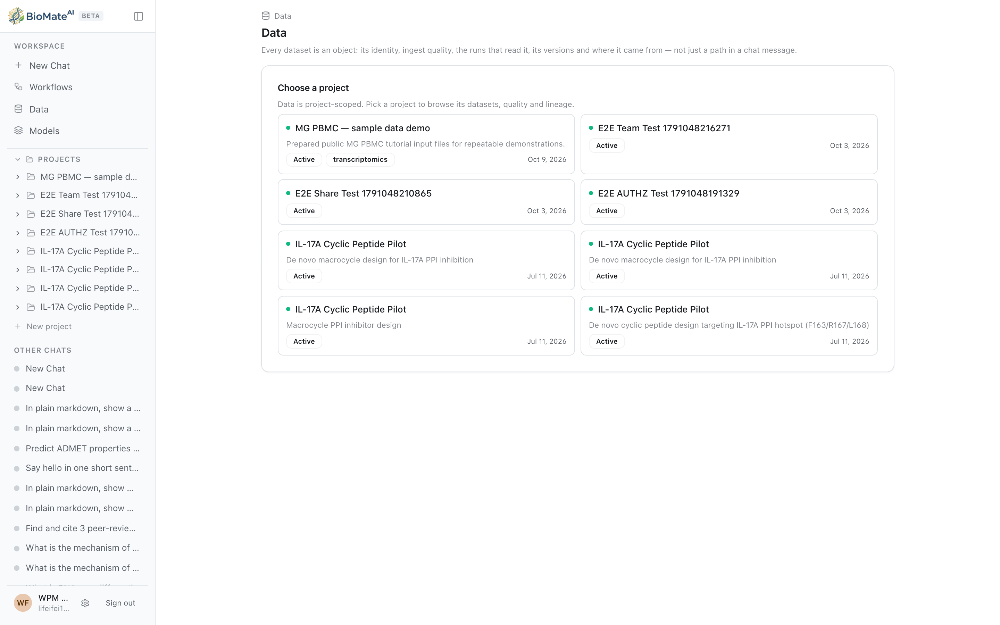
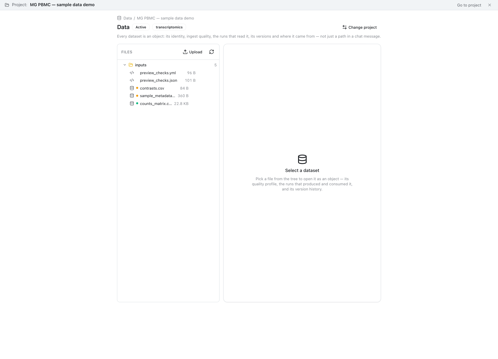
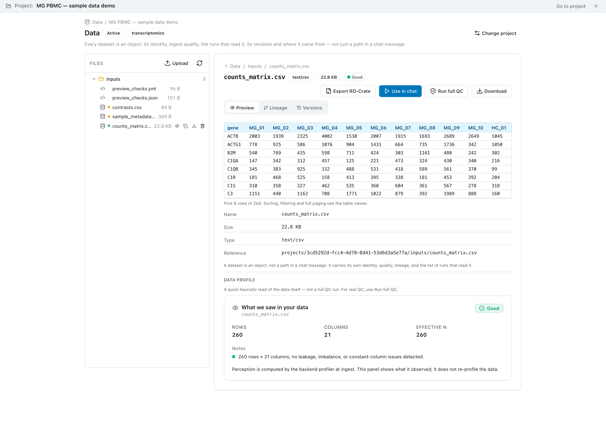

# 教程四 —— 带入你自己的数据

> **适合谁读：** 任何手头有自己数据文件的人 —— 测量数据、测序读段、一张表格 —— 并且想让 BioMate 在这些数据上
> 处理这些数据。不需要编程。读完这一篇，你会知道如何把一个文件带进 BioMate、BioMate 会把它变成什么、如何判断它是否
> 干净到可以分析，以及它随后如何进入一次真实的分析。
> **用时：** 阅读约 8 分钟；上传一个文件只需几秒。
> **它在教程中的位置：** 教程零讲了入口和第一个问题。这一篇是任何有自己数据的人的下一步 —— 也是教程三里每一次
> 分析所依赖的东西。

---

## 1. 它解决什么问题

一次分析的好坏，取决于进入它的数据；而大多数真实问题都从同一句话开始：*"我有这些文件 —— 然后呢？"* 手工来做，
把数据准备好就意味着记清哪个文件是哪个、检查它能读取且没有明显损坏、并在日后还记得某个结果是从哪来的。正是这种
手工记录，最容易出错。

BioMate 把**你的数据当作一切围绕的中心**。当你带进一个文件时，BioMate 不只是存一份副本 —— 它把这个文件打开成一个
**数据集对象（dataset object）**：一个单一的、有名字的东西，承载着它的*类型*、一次*质量*检查，以及它的*血统*
（它来自哪里、又被什么用过的记录）。之后的每一步 —— 一次分析、一个结果、一份报告 —— 都指回这同一个对象，于是你
随时都能回答"这到底是从什么得来的？"。

> **一句话概括：** 你把一个文件带进来一次；BioMate 把它变成一个带质量检查和溯源记录的数据集对象，之后用到它的
> 一切都指回这同一个对象。

---

## 2. 开始前需要了解的几个概念（用大白话讲）

**数据中心（Data hub）。** 你的数据所在的地方是**数据中心**（侧边栏 → **Data**，位于 `/files`）。它分两栏：左边是
**文件树**（你的文件，分组列出），右边是**详情栏**（你点开的那个文件，作为一个对象打开）。数据是**按项目划分的**
—— 它属于某个项目，所以你先选一个项目，再看它的数据。*（为什么重要：一个项目里的文件在另一个项目里是看不到的。
如果你找不到某个文件，先确认你是否在正确的项目里。）*

*数据中心，实况截图：这个两栏布局里，每个文件都成为一个你可以打开的数据集对象。*

**数据集对象 —— 文件不只是文件。** 当你点开一个文件时，它会作为一个**数据集对象**打开，把 BioMate 关于它所知道的
一切集中在三个标签页里：真实数据的**预览（Preview）**（里面还有一份快速的**数据概览（Data profile）**和文件的朴素
事实）、**血统（Lineage）**标签页（什么产生了它、什么读取过它、它从哪里来），以及一份**版本（Versions）**记录。
*（为什么重要：正是这一点，让一个结果能追溯回它所用的那个确切输入。）*

**质量 —— 这个文件干净到可以用来跑了吗？** BioMate 会对可读取的文件快速跑一遍**剖析器（profiler）**，用一个词
给出判定：**良好（Good，绿）**、**留意（Watch，黄）**或**受阻（Blocked，红）**。你会在数据集头部看到这个标签，更
详细的内容则在"预览"标签页里的**数据概览（Data profile）**一节。*（为什么重要：它能在你花时间和金钱去分析*之前*，
就抓出一个无法读取或严重失衡的文件。）* 还有第四种状态，**灰色**，意思是**"未检测"——而不是"不好"**（见第 5 节）。
这份快速判读是启发式的，并不是一次真正的质控运行 —— 当你想对文件跑一次完整的质控工作流时，请用**运行完整质量检查
（Run full QC）**按钮（见第 5 节）。

**血统 / 溯源（provenance）。** **溯源**是关于一个数据集来自哪里、又被什么读取过的记录。*（为什么重要：在科学里，
你必须能说清一个数字是怎么产生的；BioMate 替你保存这份记录，于是一个结果在论文或评审中是站得住脚的。）*

**你会遇到的文件类型。** 不同的工作用不同的文件格式。你不用转换它们 —— 带来 BioMate 预期的那个文件，它会识别类型：
- **CSV / TSV** —— 一张测量数据表（有行有列），例如实验读数或基因计数。
- **FASTQ** —— 原始测序读段（测序仪的输出），用于 RNA-seq 和基因组工作。双端（paired-end）测序会有两个文件
  （R1 和 R2）；两个都要带上。
- **FASTA** —— 纯文本形式的生物序列（一个蛋白质或一段 DNA）。
- **VCF** —— 一份遗传变异清单（在基因组中发现的差异）。
- **图像** —— 例如显微图片或图表。

---

## 3. 什么时候用它

- 你有自己的文件（一张结果表格、测序读段、序列），想让 BioMate 来分析它们。
- 你想在投入一次分析*之前*，先确认一个文件干净、可读取。
- 你需要一个日后能解释清楚的结果 —— 与计算所依据的那个确切输入绑定在一起。

---

## 4. 一步步来 —— 把你的数据带进去

我们用一个简单示例：一张你想分析的**测量数据 CSV**（一张表）—— 比如教程一里 JAK1 抑制剂的实验读数 CSV，或是一个
类风湿关节炎队列的 RNA-seq 读段。对于 FASTQ、FASTA 或 VCF，步骤都是一样的。

1. **选中（或打开）一个项目。** 在侧边栏进入 **Data**。选择数据所属的项目 —— 数据中心会显示那个项目的文件。
   *（如果你还没有项目，先建一个；数据总是放在某个项目里。）*
2. **把文件带进去。** 在文件树上，把你的文件**拖进来**，或点 **Upload（上传）**。你上传的文件会归在一个
   **`inputs/`** 文件夹下；一次运行的结果会出现在它们各自的、按工作流和日期标注的单次运行文件夹里，这样你能把不同
   的运行区分开。
3. **看那个质量圆点。** 每个文件行上都有一个小小的**质量圆点** —— 绿（良好）、黄（留意）、红（受阻），或灰（未
   检测）。在 BioMate 读过文件之后它就会出现。对一个 CSV，它通常片刻之间就会变绿或变黄。一个 FASTA 会显示**灰色**
   圆点 —— 这是剖析器不读取的一种类型，并不是问题（见第 5 节）。

*文件树：你的上传归在 `inputs/` 下，运行输出在各自的文件夹里，每行都带着一个质量圆点。*

**在一个问题里使用文件的两种方式。** 你并不总是要先去数据中心。在聊天的**编排区（Composer，消息框）**里，你可以：
- 用**回形针****从你的电脑附上一个文件** —— 适合一次性的快速上传。
- 用**数据库图标****指向 BioMate 已经持有的数据** —— 这样就不用重复上传一个已经在你项目里的文件。

*（为什么有两种方式：回形针用于此刻还在你笔记本上的文件；数据库图标用于已经在你工作区里的数据。两者最终都成为
同一种数据集对象。）*

---

## 5. 如何读懂一个数据集对象

点一个文件名，它就在右栏打开。**头部**显示名称、内容类型、大小，以及 —— 在剖析器跑完之后 —— 一个**质量标签**和一个
**版本计数**，于是你一眼就能看清它的状态。它还带有四个操作：**导出 RO-Crate（Export RO-Crate）**、**在对话中使用
（Use in chat）**（把这个数据集附到对话里，让你的下一个问题在它之上运行）、**运行完整质量检查（Run full QC）**（对
它跑一次真正的质控工作流 —— 见下文），以及**下载（Download）**。

*数据集头部：身份（名称、类型、大小），加上 良好 / 留意 / 受阻 质量标签和版本计数。*

头部下方是**三个标签页**：**预览（Preview）**、**血统（Lineage）** 和 **版本（Versions）**。

- **预览（Preview）** —— 真实数据的头几行以表格形式呈现（不用下载），随后是文件的朴素事实（名称、大小、类型、存储
  引用），最后是一节**数据概览（Data profile）**。*这是最快能抓出"拿错文件、用错列分隔符、或某一行其实并不是表头"
  的方式 —— 在你运行之前先读它。*
  - **数据概览（Data profile）** —— 质量标签背后的细节，作为"预览"里的一节呈现（不再是单独的"质量"标签页）。它是对
    **数据本身的一次快速启发式判读 —— 并不是一次完整的质控运行**：对一张表，是多少行多少列、**有效样本量（effective
    N）**（真正可用的样本量，当数据存在相关或不均衡时，它可能小于行数）、类别均衡，以及关于泄漏或恒定列的提示；对测序
    读段，它显示的则是读段数、读长，以及平均碱基质量（Phred），而不是行列。*判定来自 BioMate 读取你的数据，而不是凭空
    猜测。* 若需一次真正的质控运行，请用下方的**运行完整质量检查（Run full QC）**按钮。
- **血统（Lineage）** —— 对一个结果文件，是产生它的那次运行、工作流和步骤（一个上传的文件会如实地说"没有上游工作流
  产生它"—— 是你做的，不是某次运行）。这个标签页里还有**使用方（Consumers）**（读取过这个数据集的那些分析 —— 如果还
  没有，它会老老实实地这么说，而不是显示一个空的猜测）和文件的**来源（Origin）**（它是上传的还是某次运行产生的、它的
  存储引用，以及它是什么时候加入的）。
- **版本（Versions）** —— 一份日志，你可以在里面加注释（"修正表头后重新导出"）。它记录的是数据*曾经*变过、以及为什么
  变，*而不是*一个可回退的备份。

**运行完整质量检查 —— 一次真正的质控工作流，而非启发式判读。** 头部的**运行完整质量检查（Run full QC）**按钮会通过
BioMate 的引擎对数据集跑一条真正的质控流水线（例如对测序数据用 FastQC + MultiQC，或该领域的质控）。点击它会打开对话，
并**把这个数据集附上、预填一条质控请求**，由你审阅后发送；随后 BioMate 会选定质控工作流、以这个文件为输入运行它，并把
报告呈现给你 —— 这与轻量的**数据概览（Data profile）**不同，后者只是描述导入剖析器已经看到的东西。

**如何读这个质量判定：**
- **良好（绿）** —— 可读取、没有明显问题；可以继续。
- **留意（黄）** —— 可用，但有值得看一眼的地方（例如对 FASTQ，平均读段质量偏低）。在依赖它之前先读提示。
- **受阻（红）** —— BioMate 没能正确读取这个文件。在把它送去分析之前先修好它。
- **灰色（未检测）** —— BioMate 不剖析这种*类型*的文件，所以它对此**不作任何判断**。灰色意味着"没有做过检查"，
  而绝不是"不好"。（剖析器读取表格、VCF 和 FASTQ；其他类型保持灰色。）

> **需要知道的一点：** 这个质量标签是一次**导入检查** —— 它看的是文件刚进来时的样子。它与分析*过程中*运行的质控
> 闸门是分开的（那些在教程三里讲）。一个受阻的文件意味着"进来时就读不了"，所以先把它修好。

---

## 6. 从数据到一次分析

一旦一个数据集进来了、它的质量看起来也没问题，你使用它的方式就和 BioMate 里其他一切一样：在聊天里描述你想要的
分析，并引用这个数据集（附上它，或用数据库图标指向它）。BioMate 会匹配正确的工作流、向你展示已填入你文件的设置，
并且只有在你确认之后才运行 —— 正是**教程三（运行工作流并读懂报告）**里的那套流程。结果文件会作为**新的数据集对象**
回来，每一个都带着自己的血统，指回产生它的那次运行（而那次运行又记录了你起始的输入）—— 于是从你的上传到最终结果
的整条链路，都是可追溯的。

> **谁做什么。** 你把文件带进来并检查它的质量；BioMate 剖析它、运行你确认过的分析，并记录溯源。运行什么由你掌控；
> 记录由 BioMate 保存。

---

## 7. 如实的限制 —— 你该有的预期

- **质量剖析只覆盖特定文件类型。** BioMate 剖析带分隔符的表格（CSV/TSV/TXT）、VCF 和 FASTQ。其他类型照常上传、
  照常能用，但会显示一个**灰色**圆点，因为没有跑过剖析 —— 并不是因为它们不好。
- **版本是一份日志，不是撤销。** 加一个版本记录的是一个数据集*曾经*变过、以及为什么变；它不会保存一份你可以回退
  到的副本。它是一份记录，不是备份。
- **数据按项目划分。** 一个文件属于一个项目，在另一个项目里看不到。今天还没有一个"我在所有项目里的全部数据"的
  统一视图。
- **血统以文本显示产生它的运行，而非链接。** 你能读到是哪次运行产生了一个文件，但目前还不能从这里直接点进那次
  运行（请从它的聊天里打开）。
- **确切的格式与大小规则，** 请见数据模块参考（`docs/user-manual/modules/I05-files-and-dataset-object.md`）——
  本教程不去复述它无法保证的限制。

---

## 8. 下一步去哪儿

| 你想… | 去哪儿 |
|---|---|
| 提出你的第一个问题 | **教程零** |
| 在你刚带进来的数据上运行一次分析 | **教程三** |
| 设计新分子 | **教程一** |
| 在一轮轮实验中从结果里学习 | **教程二** |

习惯是：**把文件带进来 → 检查它的质量 → 在一个问题里引用它 → 运行（经你确认）→ 得到能追溯回它的结果。**

---

## 9. 关键术语

| 术语 | 含义 —— 以及你为什么要在意 |
|---|---|
| **数据中心（Data hub）** | 你的数据所在的两栏界面（侧边栏 → **Data**）：左边文件树，右边数据集详情。按项目划分 —— 选择拥有该数据的项目。 |
| **数据集对象（Dataset object）** | 一个文件被当作头等公民打开，承载它的类型、质量、预览、血统、使用方和版本记录 —— 而不只是一份存起来的副本。正是它让一个结果能追溯回它的输入。 |
| **质量（良好 / 留意 / 受阻 / 灰色）** | 对你文件的一次导入检查：绿=没问题，黄=看一眼提示，红=读不了（修好它），灰=未检测（不作判断，*不是*"不好"）。它显示为头部标签，详细内容在"预览"里的**数据概览**一节。 |
| **数据概览（Data profile）** | 对文件的一次快速启发式判读（形状、有效样本量、类别均衡、泄漏/恒定列提示），作为"预览"标签页里的一节呈现 —— 并不是一次完整的质控运行。 |
| **运行完整质量检查（Run full QC）** | 头部的一个按钮，通过 BioMate 引擎对数据集跑一条真正的质控工作流（例如 FastQC + MultiQC）；它会打开对话，把数据集附上并预填一条质控请求，由你审阅后发送。 |
| **有效样本量（Effective N）** | 真正可用的样本量，当数据相关或不均衡时，它可能小于原始行数。告诉你你的数据实际支撑得起多少。 |
| **血统 / 溯源（Lineage / provenance）** | 一个数据集来自哪里、又被什么用过的记录。让你能解释并捍卫一个数字是怎么产生的。 |
| **使用方（Consumers）** | 记录在案、读取过这个数据集的那些分析。没有时如实留空。 |
| **版本（Versions）** | 一份只追加的日志，记录一个数据集变更的注释 —— 记录*它变过*以及为什么，而不是一个回退点。 |
| **`inputs/` 文件夹** | 你上传的文件在文件树里分组所在之处；运行结果各自待在按单次运行划分的文件夹里。 |

---

_面向进阶用户 / 开发者的配套技术参考：
`docs/user-manual/modules/I05-files-and-dataset-object.md`、`I02-composer-talking-to-biomate.md`、
`I06-running-an-analysis.md`。_
