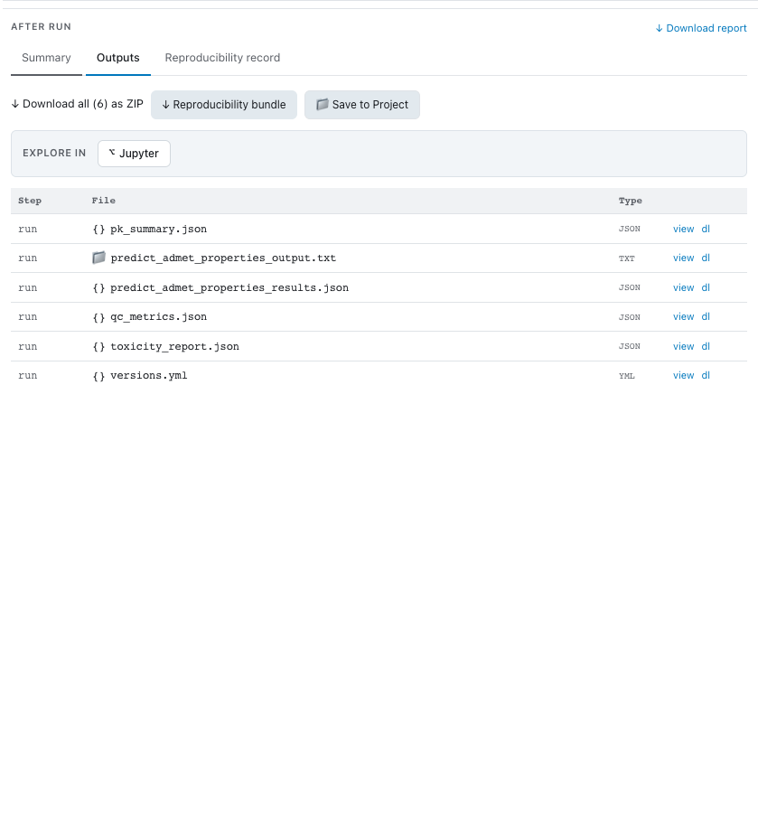
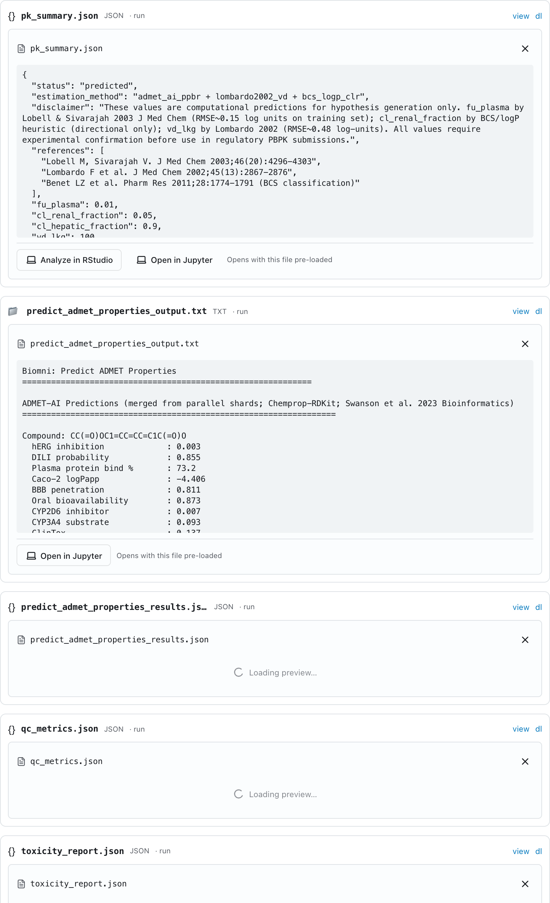

# 教程五 —— 查看你的结果：输出、预览与交互式工具

> **适合谁读：** 任何跑完一次分析、想真正*看一看*它产出了什么的人 —— 图、表、序列、结构 —— 而不用下载任何
> 东西、也不用装软件。不需要编程。读完这一篇，你会知道 BioMate 如何在页面里直接展示每一种输出、如何快速分辨
> 一个好结果和一个出错的结果，以及可选的交互式工具该在什么时候用。
> **用时：** 阅读约 8 分钟。
> **它在教程中的位置：** 教程三教你*运行*一条工作流并读它的报告。这一篇更深入报告里的**输出** —— 如何打开并
> 读懂每一个单独的结果文件。教程四讲的是*进去*的数据；这一篇讲的是*出来*的结果。

---

## 1. 它解决什么问题

一次分析可能产出几十个文件 —— 一张图、一张结果表、一份变异清单、一个预测的蛋白质结构。过去要看其中任何一个，
都得先把文件下载下来、再用某个桌面程序打开，既慢又得离开平台。更糟的是，一个出错的结果（空白的图、把表头当成
数据读进去的表）光看文件名往往显得没问题 —— 你只有真正*看到*内容时才会发现。

BioMate 几乎把每一个结果都**在页面里**渲染出来：你点一个文件，它就作为一张图片、一张可排序的表、一段可读的
序列，或一个可旋转的三维结构打开，就在你阅读的地方。下载是例外，而不是常规 —— 而且因为每个预览读的是**真实
文件**，你看到的就是真实结果，而不是一份过时的副本。

> **一句话概括：** BioMate 把每个结果文件内嵌地展示出来 —— 以它本来的图、表、序列或结构形式 —— 让你无需下载、
> 也无需离开页面，就能读懂并核查一个结果。

---

## 2. 开始前需要了解的几个概念（用大白话讲）

**输出标签页（Outputs）。** 一次运行结束后，它的文件会出现在运行后报告的**输出**标签页里（就是你在教程三见过的
那份报告）。每一行显示**是哪个步骤产生了这个文件**、**文件名**、它的**类型**，以及两个操作 —— **查看**（内嵌打开）
和**下载**。*（为什么重要：文件按产生它的步骤分组，于是你能把任何结果追溯回它所来自的那个阶段。）*

**内嵌查看器（Inline viewer）。** 点**查看**会在一个**内嵌查看器**里打开文件 —— 一个内建在页面里的阅读器，会为
那种文件类型选对展示方式（图片用图片显示、表格用网格显示，等等）。*（为什么重要：你就地读结果，而不用下载它再
去找一个能打开它的程序。）*

**预览就是真实文件，不是副本。** 每个内嵌查看器读取的，和下载链接给你的是同一个存储文件 —— 不存在一个可能过时的
单独“预览”版本。*（为什么重要：一个显示得与真实文件不同的预览，比没有还糟；BioMate 通过读取真实字节来避免这一点。）*

**发现与它的输出相连。** 大白话**摘要**里的一个数字（例如一个结果值，像“log2 倍数变化 = 2.4”，衡量一个基因变化
了多少）是一个**实时链接**，指回它所来自的那个确切输出文件 —— 点它，BioMate 就打开那个文件。*（为什么重要：每一个
关键数字都是你能打开并核查的证据，而不是一个与来源脱节的数字。）*

---

## 3. 什么时候用它

- 一次运行结束了，你想看它的图和表，而不只是摘要。
- 你想**核查**一个结果 —— 图到底渲染出来了吗？表的列对不对？—— 在你信任它或分享它之前。
- 你想打开某一个特定的输出（一个结构、一份变异清单）并仔细读它。

---

## 4. 一步步来 —— 打开一个结果

1. **打开这次运行的报告。** 从一次已完成的运行，打开 **After run（运行后）** 这一节，进入**输出（Outputs）**
   标签页（教程三讲了怎么到这里）。
2. **按步骤找到文件。** 每一行都标有产生它的步骤，于是你能直接去你关心的那个阶段（例如画图的步骤，或最终结果
   的步骤）。
3. **点“查看”。** 文件会在一个浮层里内嵌打开，并以适合它类型的方式显示（见第 5 节）。只有当你想把原始文件放到
   自己电脑上时，才改用**下载**。

*输出标签页：运行产生的每一个文件，每行都带着产生它的步骤，以及一个**查看** / **下载**操作。点**查看**就内嵌
打开文件。*

*一次真实运行的输出（来自教程三的那次体内 CAR-T 共同设计），按步骤分组 —— 这里是四个阶段共 11 个文件。这是看清
“每一步产出了什么”最直观的视角，也是打开其中任何一个的起点。*

---

## 5. 打开每一种文件时它长什么样

BioMate 会识别文件类型并内嵌渲染。你不用转换任何东西 —— 打开文件，它就以正确的方式显示出来：

- **图像**（PNG、JPG、SVG）—— 图本身，可点击放大。PDF（Bioconductor 常用于出版级图）会渲染成一整页清晰的页面。
- **表格**（CSV、TSV、JSON）—— 一个**可排序的网格**。BioMate 自动识别列分隔符并显示前面若干行。*这是最快能
  抓出“拿错文件”或“表头行被误当成数据”的方式。*
- **序列**（FASTA、FASTQ）—— 每条记录连同它的长度，显示前面若干条。
- **变异**（VCF）—— 一张变异表，带标准列（染色体、位置、参考、变异……）。
- **注释**（BED、GFF、GTF）—— 一张特征表，带该格式对应的正确列。
- **三维结构**（PDB、mmCIF）—— 一个**可旋转的三维模型**，你可以转动它、改变样式。对一个*预测的*结构（例如来自
  AlphaFold/ESMFold），它还会在模型旁展示一张 **pLDDT 置信度图** —— 一个衡量预测把握有多大的每残基指标（见下方
  提示）。点图上的某个残基，会在三维视图里高亮它。（对一个实验测得的晶体结构，则不会画这张图 —— BioMate 不会把它的
  温度因子当成置信度分数来呈现。）
- **冷冻电镜密度图**（MRC/MAP）—— 一个沿三个轴切片的查看器。
- **报告**（HTML，例如 MultiQC）—— 渲染为一个安全的、只读的页面。
- **日志 / 文本** —— 可读的文本，带一个“显示最后若干行”的开关。

任何 BioMate 无法在浏览器里渲染的东西（某些大型二进制文件）只提供**下载** —— 这是一个如实的兜底，而不是一个坏掉的
预览。**比对文件（BAM）就是这样一种情况：** 目前还没有内嵌的基因组浏览器轨道，所以一个 BAM 是以下载的形式提供
（或者在已配置的环境里，以一个交互式工具的形式），而不是在页面里预览。

<!-- CAPTURE route=/ (completed run → Outputs → click "view" on a table and on a PDB structure) ; state=an inline table viewer open, and separately an inline 3-D structure with its pLDDT chart ; focus=step-output-preview overlay ; note=show (a) a sortable table preview with the "showing N of M rows" note, and (b) a 3-D structure with the pLDDT confidence chart beside it -->
*（待补图：一张以可排序网格内嵌打开的表格；以及一个以三维展示、旁边带 pLDDT 置信度图的预测结构。）*

> **提示 —— 按颜色读置信度，而不是只看一个数字（针对预测结构）。** 在一张 pLDDT 图上，约 90 以上是很高置信
> （主链定义清晰），70–90 是可信，50–70 是偏低，而 50 以下往往是无序区域。要看结构在*哪里*可信，而不只是看一个
> 总体分数。

---

## 6. 如何快速分辨一个好输出和一个出错的输出

打开文件也是你核查它的方式。几个快速的判读：

- **渲染出来的图 vs 空白的图。** 一张打开后是空的或全白的图，通常意味着画图步骤没有数据、或悄悄失败了 ——
  在你信任这次运行之前，值得去看一眼那个步骤的日志。
- **列正确的表。** 如果表的第一行显示的是你真实的列名，说明文件解析正确；如果“数据”看起来像是重复的表头，说明
  分隔符或表头被读错了。
- **“显示 M 条中的 N 条”。** 预览是**有意截断**的 —— 表格显示前 200 行、变异前 100 条、序列前 20 条记录、日志
  最后 80 行 —— 每个都带一句明确的“显示 M 条中的 N 条”。那句话意味着这个预览是一扇窗，而不是整个文件；它从不
  被悄悄截断。要看全部，就下载它。
- **如实的“无数据”。** 领域图表查看器（例如一条冷冻电镜 QC 曲线）在文件为空或损坏时会显示“无数据”，而不是画出
  一个假结果。一个“无数据”是信息，不是故障。

> **为什么这很重要：** 大多数出错的结果是靠*看*抓出来的，而不是靠读一个状态徽标。内嵌预览的全部意义，就是让这
> 一看只需几秒。

---

## 7. 保存与分享你的发现

除了一次看一个文件，输出标签页还让你：

- **打包下载为 ZIP** —— 把每个输出放进一个压缩包。
- **下载一个可复现打包** —— 在别处重跑这次分析所需的配置、命令脚本、日志和软件版本（它与教程三的可复现记录相配）。
- **保存到项目** —— 把输出复制进一个项目，在那里它们成为头等的**数据集对象**（带质量、血统和版本 —— 正是教程四
  里的那种数据集对象）。这就是一个结果如何成为下一次分析的输入。

---

## 8. 交互式工具（RStudio / Jupyter / CellxGene）—— 如实的范围

除了读一个结果，BioMate 还能提供**交互式环境** —— 一个完整的 RStudio 会话、一个 Jupyter 笔记本，或一个 CellxGene
浏览器 —— 用于在你读完结果*之后*、自由编写代码地探索。下面是如实的范围，因为这里很容易期待过高：

- **它们不是主路径。** 上面的内嵌查看器已经覆盖了读取和核查一个结果。交互式工具只用于你想针对输出运行自己代码
  的时候。
- **它们必须被配置好，没配置时按钮会隐藏。** BioMate 会检查这些工具是否在你的环境里装好了；如果没有，“在 RStudio
  / Jupyter / CellxGene 中打开”的按钮就**根本不出现**，而不是给你一个会失败的东西。
- **在开发站点上目前它们没有被配置** —— 所以你在那里看不到这些按钮。用内嵌查看器读结果，想要本地的原始文件就
  **下载**。这是预期行为，不是 bug。
- **它们不会自动加载你的数据。** 启动一个会打开一个*空*会话；BioMate 会给出快速上手代码和文件路径，但你要自己把
  输出加载进去。别指望你的结果表已经在 R 工作区里加载好了。

> **再一条如实说明（单细胞）。** BioMate 对 `.h5ad`/`.loom` 文件有一个应用内的单细胞摘要（一张带聚类和标记基因的
> UMAP 图），但它只有在流程在数据旁边写出了一个小的摘要文件时才会画出来。在单细胞流程端到端地产出那个文件之前，
> 对一次真实运行请预期下载/交互式的兜底，而不是应用内的 UMAP。（确切的、当前的支持情况，见输出模块参考。）

---

## 9. 下一步去哪儿

| 你想… | 去哪儿 |
|---|---|
| 运行你正在查看其输出的那次分析 | **教程三** |
| 把一个保存的输出变成下一次分析的输入 | **教程四** |
| 读懂整份报告（摘要 / 输出 / 可复现） | **教程三** |
| 在一轮轮中从结果里学习（闭环） | **教程二** |

习惯是：**打开输出标签页 → 内嵌查看文件 → 读它（并核查它）→ 保存或分享重要的部分。**

---

## 10. 关键术语

| 术语 | 含义 —— 以及你为什么要在意 |
|---|---|
| **输出标签页（Outputs）** | 运行后报告里列出运行产生的每个文件的部分，按产生它的步骤分组，每个都带**查看**和**下载**操作。 |
| **内嵌查看器（Inline viewer）** | 内建在页面里的阅读器，把文件按它本来的样子展示（图、表、序列、结构……），于是你不用下载、也不用离开 BioMate。 |
| **预览读的是真实文件** | 内嵌视图显示的是真实存储的字节，而不是一份单独的副本 —— 所以预览不会与真实结果产生偏差。 |
| **pLDDT** | 一个*预测*蛋白质结构的每残基置信度分数（0–100）；按颜色/区域读，而不是看一个总体数字。约 90 以上很高，70–90 可信，50 以下常为无序。 |
| **“显示 M 条中的 N 条”** | 预览是有意截断的（前若干行 / 后若干行）；这句话告诉你它是一扇窗，不是整个文件。要全部就下载。 |
| **可复现打包** | 一个可下载的包，含配置、脚本、日志和软件版本 —— 足以在别处重跑这次分析。 |
| **保存到项目** | 把输出复制进项目，让它们成为数据集对象（质量、血统、版本）—— 从一个结果通往下一次分析输入的桥梁。 |
| **交互式工具（RStudio/Jupyter/CellxGene）** | 用于临时探索的可选代码环境；只在已配置处显示（开发站点今天没有），而且打开时是空的 —— 数据要你自己加载。 |

---

_面向进阶用户 / 开发者的配套技术参考：
`docs/user-manual/modules/I08-outputs-viewers-interactive.md`、`I07-full-step-view-provenance.md`、
`I09-reports-and-reproducibility.md`。_
