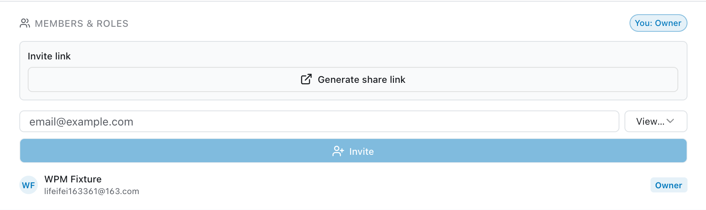

# 教程七 —— 项目、常驻指令与协作

> **适合谁读：** 任何工作跨越不止一次坐下、或不止一个人的人 —— 主持一轮筛选项目的 PI、做着一篇论文分量分析的
> 博士后、要把结果分享给合作者的实验室。不需要编程。读完这一篇，你会知道什么是**项目（project）**、如何给
> BioMate 一份它在每次对话里都会读到的**常驻指令（standing instructions）**，以及如何按合适的访问级别把项目
> **分享**给同事。
> **用时：** 阅读约 9 分钟；搭一个项目只需一两分钟。
> **它在教程中的位置：** 教程零教的是单次对话及其入口；教程四教的是把你的数据弄进来。这一篇讲的是那个把许多
> 对话、许多文件、许多人装在一起的容器 —— 当一次对话不够用时，你就打开它。

---

## 1. 它解决什么问题

真实的研究从来不是一个问题。它是几周里的几十次对话、一个装文件的文件夹、好几次运行 —— 而且往往不止一个人。
如果只用一个个光秃秃的对话来做，会出三个问题：

- **你每次都要把同样的背景重打一遍。** "这是小鼠肝脏。""双端、反义链。""我们用 GRCh38。" 每开一个新对话都
  从零开始，于是你再说一遍，而只要有一次忘了说，分析就会悄悄出错。
- **你的计划和笔记会滚走不见。** 一次运行在检验的那个假设、你为什么选了这个阈值而不是那个 —— 都埋在旧的
  对话记录里，日后谁也找不到。
- **分享是要么全有、要么全无。** 你想让一位合作者能*看*结果，但不能删掉整个项目；或者让一位博士后能*运行*
  分析，但不能管理还有谁有权限。一个裸链接做不到这些。

一个**项目**把这三件事都解决了。它是一条研究主线的容器 —— 它的文件、它的对话、它的运行，以及**BioMate 每次
和你对话时都放在心上的背景**。单次对话是一场谈话，而项目是围绕许多场谈话的**常驻记忆**，外加一种按既定访问级别
把人请进来的方式。

> **一句话概括：** 项目让你把背景只说*一次*，之后每次对话都继承它；它把你的计划和笔记和数据放在一起；它还让你
> 把工作分享给同事，每个人都只能做其角色允许的事 —— 不多，也不少。

---

## 2. 开始前需要了解的几个概念（用大白话讲）

**项目是一个容器，不是一次对话。** 它装着许多对话、你带进来的文件（教程四）、你启动的运行（教程三），以及三类
书面背景：**常驻指令（standing instructions）**、**计划 / 假设（plans/hypotheses）** 和 **笔记（notes）**。
你从侧边栏的 **Projects（项目）** 栏打开项目页面。

**活动项目（active project）—— 对话怎么"知道"自己身处某个项目里。** 同一时间只能有一个项目是**活动项目**。当它是
活动项目时，你新开的每一次对话都会自动继承它的常驻指令 —— 你不必先打开项目页面。BioMate 会跨页面刷新记住你的
活动项目。*（为什么重要：把项目设一次，这一整天你就不用再重打背景了。）*

**常驻指令（standing instructions）—— BioMate 每次都会读的背景。** 这是助手在**项目里的每一次对话**都会读到的
指示：你的物种和基因组版本、你的实验设计、你们的惯例（"一律用 GRCh38""我们偏好 edgeR 而不是 DESeq2"）。项目
页面的卡片把话说得很直白：*"由助手在本项目的每一次对话中读取。"* *（为什么重要：这是最省时间的一招 —— 把你
懒得重复的背景，放进这唯一的一处。）*

**笔记（notes）—— 给你看的，不给 AI 看。** 一条**笔记**是纯人类可读的自由文字。卡片上写着*"仅你可见 —— 助手
不会读取。"* 它是给人看的便利贴；BioMate 绝不会据此行动。*（为什么重要：这是一条有意划下的安全线 —— 见第 4 节的
那个坑。如果你想让 AI 用上某样东西，它必须是一条常驻指令，而不是一条笔记。）*

**计划 / 假设（plans / hypotheses）—— 运行可以引用的那个"为什么"。** 一个**计划**记录某项工作要检验的目标
（以及可选的假设），它是一个被保存下来的对象，而不是对话里滚走的一行字。日后一次运行可以回指它所依据的那个
计划。

**角色（roles）—— 谁能做什么。** 当你分享一个项目时，每个人会拿到一个**角色**。BioMate 实际发布的角色，由弱到
强是：

- **Viewer（查看者）** —— 读取项目、它的文件和运行；下载文件。不能改动。
- **Editor（编辑者）** —— Viewer 能做的一切，外加编辑项目内容（常驻指令、标签）、上传和删除文件、创建计划、
  添加笔记。不能管理成员，也不能删除项目。
- **Owner（所有者）** —— 一切：编辑、运行、管理成员及其角色、更改项目状态、归档或删除项目、分享项目，以及把
  所有权移交给别人。

> **关于角色名称的一点说明（设计稿 vs 实际发布）。** 你可能会在 BioMate 的设计材料里看到一套*四*角色的说法 ——
> **Viewer / Contributor / Reviewer / Owner**。而今天实际发布的产品用的是*三*个：Viewer、**Editor**（设计稿里的
> "Contributor"）和 Owner。目前**没有一个单独的 "Reviewer" 角色**。这一点在*如实的限制*里会再提一次，免得你
> 一直在找一个并不存在的控件。

**禁用，而非隐藏。** 这是 BioMate 在项目页面上真正遵循的一条设计原则：一个你的角色用不了的控件，会**灰显并标出
它所需要的角色**（"需要 Owner"），而不是从屏幕上抹掉。*（为什么重要：一个消失的按钮和一个坏掉的产品难以区分；
一个带角色标签的禁用按钮，恰好告诉你该去找谁。）*

---

## 3. 什么时候用它

- 你的工作跨越不止一次坐下，而你已经厌倦了把同样的背景重打进每一个对话。
- 你想把一个假设、一份计划或一个决定记在数据旁边 —— 而不是弄丢在对话的回滚记录里。
- 你想请一位合作者进来**查看**结果，或请一位同事进来**运行**分析，但又不想把删掉一切的钥匙交出去。
- 你要把一摊工作交接给别人，需要干净利落地转移所有权。

如果你是一个人在处理一个快速的小问题，就不需要项目 —— 一个独立对话（教程零）足矣。等工作或团队壮大了，再动用
项目。

---

## 4. 一步步来

我们用一个贯穿全文的例子：一个研究**类风湿关节炎**的实验室有一个 **RNA-seq** 项目（小鼠肝脏、双端、反义链），
PI 希望一位博士后在里面运行分析，而一位临床合作者只需要查看结果。

### 4a. 创建项目并设好它的常驻指令

1. **创建项目。** 在侧边栏的 **Projects（项目）** 栏里，点 **New project（新建项目）**。给它起个名字
   （必填）—— 例如 *"RA liver RNA-seq"* —— 想的话再加一句简短描述。你也可以在这里就先写上它的常驻指令，或者
   以后再加。
2. **从 Projects（项目）栏打开项目。** 它的页面会显示几张卡片：**Standing instructions（常驻指令）**、
   **Notes（笔记）**、**Plan / hypothesis（计划 / 假设）**，以及（更靠下的）**Members & roles（成员与角色）**。
3. **在 Standing instructions（常驻指令）卡片里写下你的常驻指令**并保存。就本例而言：
   *"小鼠肝脏。双端、反义链（dUTP）。比对到 GRCm39。偏好 edgeR 而非 DESeq2。报告 log2 倍数变化，FDR < 0.05。"*
   卡片会提醒你，这些是*"由助手在本项目的每一次对话中读取"*的。

<!-- CAPTURE route=/projects?project=<id>&tab=files ; state=project page with Standing instructions card filled (mouse-liver/paired-end/GRCm39) and the Notes card below it empty ; focus=Standing instructions card + its "Read by the assistant on every chat in this project" subtitle, and the Notes card's "Private to you — not read by the assistant" subtitle ; note=把两张卡片上下叠在一起展示，让"AI 会读 vs 仅人类可见"这条信任边界在一张图里看清 -->

4. **把它设为活动项目**（打开项目就会替你做这件事）。从此以后，你在这个项目里新开的每一次对话都会继承那些
   指令 —— 你不用再重打"小鼠肝脏、双端"了。

> **怎么确认指令真的生效了。** 当你在一个项目对话里发送消息时，编排区会显示一个**指令计数标记（instructions
> chip）**—— 上下文里常驻指令条数的一个小计数。点它就能看到清单。如果一次运行里某个参数的来源显示为
> **inherited（继承）**，那就说明它来自你写下的某条常驻指令 —— 也许还是几周前写的。那是系统在明明白白地告诉你，
> 是什么塑造了这次运行。

### 4b. 记一份计划，并留一条私人笔记

5. **添加一份计划（可选）。** 在 **Plan / hypothesis（计划 / 假设）** 卡片里，填一个 **Goal（目标，必填）** 和一个
   可选的 **Hypothesis（假设）** —— 例如目标*"找出区分 RA 肝脏 flare（活动期）与 managed（控制期）的基因"*，
   假设*"干扰素响应基因在 flare 期上调"*。日后一次运行可以引用这份计划，报告便能说清它当时在检验什么。（创建
   计划需要 Editor 或 Owner 权限。）
6. **添加一条笔记（可选）。** 在 **Notes（笔记）** 卡片里，随手写点*给人看的*东西 —— "等新一批样本到了再重跑
   一次"。记住：**一条笔记绝不会改变 BioMate 的行为。**

> **坑 —— 笔记对 AI 是隐形的。** 如果你把*"用新的参考基因组"*写成一条**笔记**，还指望助手会照着做，它不会 ——
> 按设计，笔记只给人看。要把行为层面的指引放进 **Standing instructions（常驻指令）** 里。有一个
> **"Promote to instruction ↑（提升为指令）"** 操作，会把一条笔记的文字复制进常驻指令里；那一次明确的点击，是
> 一条笔记的内容*唯一*能抵达助手的途径。

### 4c. 把项目分享给同事

打开项目页面上的 **Members & roles（成员与角色）** 面板。你自己的角色会显示为一个 **"You: <角色>"** 徽标，
让你随时知道自己在这里能做什么。添加人有两种方式（都**仅限 Owner**）：

7. **按邮箱邀请。** 输入对方的邮箱，选一个角色 —— **Viewer（查看者）** 或 **Editor（编辑者）** —— 然后邀请。
   *（对方必须已经有一个 BioMate 账号；如果没有，BioMate 会提示"No user found with that email（没有找到使用
   该邮箱的用户）"，而不是无声无息地失败 —— 请先让对方注册。）* 对我们的例子来说：把博士后邀为 **Editor**，把
   临床合作者邀为 **Viewer**。
8. **或者生成分享链接。** 点 **Generate share link（生成分享链接）**，铸出一个带指定角色的网址。任何人打开它
   并接受，就以那个角色被加进来。你可以**复制**它、更改它的角色，或**撤销（revoke）**它来让它失效。

<!-- CAPTURE route=/projects?project=<id>&tab=files ; state=Members & roles panel open as Owner — invite-by-email input, share-link generate/copy/revoke controls, and a member list with a postdoc (Editor) + collaborator (Viewer) each with a role dropdown ; focus=the "You: owner" badge, the role dropdowns, and the "Make owner" transfer control on a member row ; note=以 OWNER 身份截图，这样所有仅限 Owner 的控件才会完整可见且可用 -->

9. **日后更改或移除成员。** 作为 Owner，每一行成员都有一个**角色下拉框**（把某人在 Viewer↔Editor 之间切换）和
   一个移除操作。任何非 Owner 的成员都可以自己**退出（leave）**一个项目。要把项目整个交出去，就对某位成员用
   **Make owner（移交所有权）** —— 这会把他提升为 Owner，并把你降为 Editor（一次不可逆的移交，所以 BioMate 会
   先向你确认）。

### 4d. 查看你自己的权限 —— 禁用，而非隐藏

10. 在项目页面上，**"Your permissions here（你在这里的权限）"** 卡片会列出你能做和不能做的事，每一行都标着它
    所需的角色，并给出一句朴素的 **"you can（你可以）" / "you cannot（你不可以）"** 结论 —— 这是由你*真实的*、
    服务端分配的角色驱动的，不是猜的。一位 Viewer 会看到那些仅限 Owner 的行（如"管理成员与角色"）标着
    **"needs Owner · you cannot（需要 Owner · 你不可以）"**，而不是一片空白。这正是*禁用，而非隐藏*原则的实际
    体现：你总能看到一个被锁住的操作需要什么，于是知道该去找谁。

<!-- CAPTURE route=/projects?project=<id>&tab=files ; state=project page viewed AS A VIEWER (log in as the collaborator) so the "Your permissions here" card shows owner-only and editor-only rows marked "you cannot" with the required role ; focus=the RolesCard rows — "Read & download files · you can", "Run analyses & edit project content · needs Editor · you cannot", "Manage members & roles · needs Owner · you cannot" ; note=务必以 Viewer（而非 Owner）身份截图，否则每一行都会显示"you can"，禁用而非隐藏这个要点就丢了 -->
*（待补图：以 Viewer 身份看到的 "Your permissions here（你在这里的权限）" 卡片 —— 那些仅限 Owner 和仅限
Editor 的行被清清楚楚标着"you cannot"，并带上各自所需的角色，从不隐藏。）*

---

## 5. 如实的限制 —— 你该有的预期

- **实际发布三个角色，不是四个。** BioMate 的设计材料描述了四个角色 —— Viewer、**Contributor**、**Reviewer**、
  Owner —— 但今天发布的产品是*三*个：Viewer、**Editor** 和 Owner。设计稿里的"Contributor"就是发布版的
  **Editor**（添加文件、编辑参数、启动运行）。目前**没有一个单独的 "Reviewer" 角色**：越过一道质量门、或者对
  一次审批签字放行，今天都还没有挂接到一个独立的项目角色上。如果你在别处读到 Contributor 或 Reviewer，就把
  它们分别对应为 Editor 和"暂未实现"。
- **一张权限卡片是实时的；另一张只是占位。** *项目页面*上的 **"Your permissions here（你在这里的权限）"** 卡片
  是真的 —— 它反映你实际的、服务端分配的角色。另有一张长得很像的权限卡片出现在**一次运行的工作流面板
  （Settings 标签页）**里；那一张是一个**静态的设计占位**—— 无论你是谁，它永远显示"Owner"、每一行都允许
  （甚至还列着一行"Invite a reviewer（邀请一位审阅者）"）。真正的权限以项目页面那张卡片为准，不要信运行面板
  里那张。
- **常驻指令只在单个项目内生效。** 不存在一条账号级或跨项目的常驻指令能到处通用。如果你想让同样的背景在两个
  项目里都有，就得在每个项目里各设一遍。
- **技能与专家（Skills & experts）既能按对话选，也能按项目存。** 你可以在某次对话的编排区里切换 **技能与专家
  （Skills & experts）**包；*而且*项目的「说明（Instructions）」标签页现在也有一个按项目的 **"技能与专家"** 开关，
  它会把选中的包为整个项目存下来。项目里的各次对话会继承这些常驻指令、输出要求以及选中的技能 —— 编排区的选择会
  以项目设置为初始值。（当没有可用的包时，编排区的技能与专家选择器会如实地空着。）
- **笔记不经提升绝不会抵达 AI。** 这是按设计如此，但值得再说一遍：行为层面的指引应放进 Standing instructions
  （常驻指令）里。一条笔记只有在你明确点了 **Promote to instruction ↑（提升为指令）** 之后，才会影响助手。
- **被邀请者必须已经有一个 BioMate 账号。** 按邮箱邀请找的是一个*已存在*的用户；它不会给一个陌生人发注册邀请。
  请让新合作者先注册。
- **协作可能是付费套餐功能。** 在较低的套餐上，邀请成员、更改角色、分享链接和移交所有权可能会被挡住，并提示
  **"Team plan required（需要 Team 套餐）"**。读取和单人项目工作不受影响。（确切的套餐规则见计费 / 分级参考。）
- **别人的项目返回的是"未找到"，而不是"拒绝访问"。** 如果你没有访问权限，BioMate 会返回一个朴素的 **404**，
  甚至不会确认这个项目存在 —— 这样你就无法去试探那些没邀请你的项目。
- **删除一个项目不会毁掉你的对话。** 删除会移除项目的计划、笔记和知识，但与之关联的对话会以独立对话的形式
  留存下来。**Archiving（归档，一种可逆的软删除）** 才是你只想把一个项目收起来时的稳妥选择。

---

## 6. 下一步去哪儿

| 你想… | 去哪儿 |
|---|---|
| 提出你的第一个问题（不需要项目） | **教程零** |
| 把你自己的数据带进一个项目 | **教程四** |
| 在项目里运行一次分析 | **教程三** |
| 查看并读懂一次运行的结果 | **教程五** |
| 完整的技术规则（角色、端点、门） | `docs/user-manual/modules/I04-projects-instructions-collaboration.md` |

习惯是：**创建项目 → 把它的常驻指令写好一次 → 在继承这些指令的对话里工作 → 按合适的角色分享 → 完事后移交或
归档。**

---

## 7. 关键术语

| 术语 | 含义 —— 以及你为什么要在意 |
|---|---|
| **项目（Project）** | 一条研究主线的容器 —— 它的文件、对话、运行和常驻背景。从侧边栏的 **Projects（项目）** 栏打开。工作跨越许多对话或许多人时就用它。 |
| **活动项目（Active project）** | 当前处于上下文里的那个项目；每一次新对话都继承它的常驻指令。BioMate 会跨刷新记住它 —— 设一次即可。 |
| **常驻指令（Standing instructions）** | 助手在**项目里的每一次对话**都会读到的指示（物种、版本、惯例）。放你懒得重复的背景的唯一一处。 |
| **笔记（Note）** | 仅人类可读的自由文字，**助手绝不读取**。是给人的便利贴，不是给 AI 的指令 —— 想让 AI 用上就提升它。 |
| **提升为指令（Promote to instruction）** | 把一条笔记的文字复制进常驻指令的那个明确操作。一条笔记的内容抵达助手的唯一途径。 |
| **计划 / 假设（Plan / hypothesis）** | 一份保存下来的记录，记着一次运行要检验的目标（以及可选的假设），让报告能引用它当初要证明什么。创建需要 Editor 或 Owner。 |
| **Viewer（查看者）** | 能读取项目并下载文件。不能改动。 |
| **Editor（编辑者）** | 能编辑内容、上传 / 删除文件、创建计划、运行分析。不能管理成员或删除项目。（即设计稿里的"Contributor"。） |
| **Owner（所有者）** | 能做一切，包括管理成员、分享、归档 / 删除，以及移交所有权。 |
| **禁用，而非隐藏（Disabled, not hidden）** | 一个你用不了的控件，BioMate 会把它灰显并**标出所需的角色**，而不是移除它 —— 这样权限限制就不会被误认成功能缺失。 |
| **分享链接 / 邀请（Share link / invite）** | 两种仅限 Owner 的加人方式 —— 一个带角色铸出的网址（可复制 / 撤销），或一封发给已有 BioMate 用户的邮件邀请。 |
| **移交所有权（Transfer ownership）** | "Make owner" 把一位成员提升为 Owner，并把你降为 Editor —— 一次不可逆的交接，会先确认。 |

---

_配套技术参考（面向进阶用户 / 开发者）：
`docs/user-manual/modules/I04-projects-instructions-collaboration.md`。已对照发布的代码核验：
`pages/project-detail.tsx`、`components/roles-verify.tsx`、`server/project-routes.ts`、
`components/app-sidebar.tsx`，以及设计规范 `data_centroid_design_v2/spec/00 Foundations and the
cold start.html` §0.14。_
