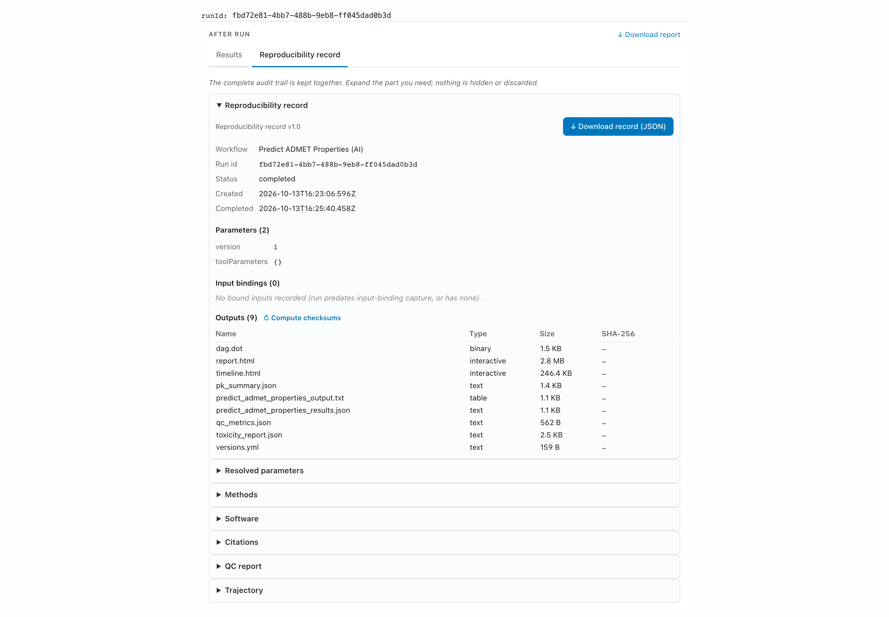

# 教程八 —— 把报告当作可编辑的文件，以及导出它们

> **适合谁读：** 任何在 BioMate 里跑完一次分析、如今需要*改一改*报告措辞、给这些改动留一份干净的历史、或者按
> 对方期望的文件格式把报告交出去的人。不需要编程。
> **用时：** 阅读约 8 分钟。
> **它在教程中的位置：** 教程三教你运行一条工作流并读它的报告；教程五教你打开每一个结果文件。这一篇是再往前
> 一步：报告不是一张冻住的图 —— 其中一部分是一份**可编辑的文档**，你可以修订它、把它存成一个个版本，而整份
> 报告都可以**导出**带走。

---

## 1. 它解决什么问题

一次跑完的运行会给你一份报告，但报告在它刚出现的那一刻，很少就是定稿。你也许需要把某条提醒说得软一点或硬一点
（"要明说有些批次数值是估算的"）、为期刊审稿人重写方法段落，或者删掉一节重复的内容。而当你分享结果时，另一头
的人想要的是一个文件 —— 一份能读的文档、一份能核查的机读记录，或者一个让他们自己重跑分析的打包。

手动做这件事 —— 把文字拷进一个文字处理软件、在那里编辑、再弄不清哪个是哪个版本 —— 恰恰是错误钻空子的地方。
你最后攒下三份略有不同的副本，却没有一份记录能说清这次运行到底产出了什么。

BioMate 让这件事保持诚实。运行的**原始报告绝不会被覆盖**：它作为"这次分析产出了什么"的固定记录被保留下来。
在此之上，**方法报告（methods report）** 是一份可编辑的文档 —— 你就地修订它，每一次保存都成为一个新**版本**，
与原始报告并排存放。而当你想把报告带走时，BioMate 会以一小套真实、定义明确的格式导出它。

> **一句话概括：** 你报告的原始版本作为这次运行的记录固定不变，而你把一份工作副本编辑成一个个干净的版本，并
> 按你要分享的那个人真正需要的格式导出它。

---

## 2. 开始前需要了解的几个概念（用大白话讲）

**运行后报告（recap，回顾教程三）。** 一次运行结束时，BioMate 会显示一份带两个标签页的报告：**Results（结果：
顶部是大白话发现，下面每个输出文件就地内嵌预览、可搜索）** 和 **Reproducibility record（可复现记录，审计轨迹）**。这一篇
主要落在两个地方：报告顶部那些下载按钮，以及可复现记录里那个 **Methods（方法）** 小节 —— 它就是你能编辑的
部分。

**不可变的运行原始版本。** BioMate 把运行的第一份、未经编辑的报告标记为**运行原始版本（run original，标为
v0）**。它永远不变 —— 你编辑时不变，你保存时也不变。*（为什么重要：几个月后，当你必须拿出这次分析到底报告了
什么时，那份未经改动的原始版本还在。你的编辑是摆在它旁边，而不是盖在它上面。）* 你会在 Summary（摘要）上看到
一个 **"Run original（运行原始版本）"** 徽标，写着：*"这是本次运行产出内容的未编辑记录。你编辑过的报告会与它
并排保存；这份原始版本绝不会被覆盖。"*

**手动编辑。** 在 **Methods（方法）** 小节里，一个 **✎ Edit（编辑）** 按钮会把报告文字在一个内建的文档编辑器里
打开（就是用于法规文档的那个编辑器）。你直接在里面打字改动。*（为什么重要：你就在文字所在的地方修订它，而不是
导出、在别处编辑、再导回来。）*

**版本（Versions）。** 当你点 **⤴ Save version（保存版本）** 时，你编辑后的文字会被存成一个**新版本**（v1、
v2，依此类推）。列表会按从旧到新的顺序列出每一个版本，其中 **v0** 被标为 **"immutable run original（不可变的
运行原始版本）"**。*（为什么重要：你做的任何事都不会删掉更早的文字。如果某次编辑错了，更早的版本 —— 以及原始
版本 —— 都还在。）* 保存是**服务端优先**的：版本会随运行一起存储。如果连不上服务器，BioMate 会退而把你的编辑
以一个 Markdown 文件下载给你，这样你永远不会丢掉它。

**导出（Export）。** 与编辑分开，报告可以用几种真实格式**下载** —— 一份可读的文档、一份机器可核查的记录，以及
一个可重跑的打包。这些在第 5 节讲，并给出一份"有什么、没有什么"的确切清单。

**报告住在哪里。** 报告属于它的**运行（run）**，而运行属于它所来自的那个**对话会话（chat session）**。要在
日后取回一份报告、它的各个版本及其记录，就重新打开那个对话会话。*（为什么重要：这里没有一个单独的"文档"文件夹
让你去翻找 —— 报告始终附着在产生它的那次运行上。这意味着什么，见"如实的限制"。）*

---

## 3. 什么时候用它

- 一次运行跑完了，报告内容没问题，但**措辞**需要打磨 —— 一条更清楚的提醒、一段为审稿人重写的方法、一节删掉的
  重复内容。
- 你需要为这些编辑留一份**干净的历史**，让原始版本不受触动，这样你就能展示运行到底产出了什么、相对于你修订了
  什么。
- 你需要把报告**交给某个人** —— 一位共同作者、一位审稿人、一位要重跑分析的同事 —— 作为一个他们能打开或能核查
  的格式的文件。

---

## 4. 一步步来 —— 编辑报告

1. **打开这次运行的报告。** 从一次已完成的运行，打开 **After run（运行后）** 这一节（教程三讲了怎么到这里）。
2. **进入 Methods（方法）小节。** 打开 **Reproducibility record（可复现记录）** 标签页并展开 **Methods（方法）**。
   这是报告里可编辑的部分。*（Summary 摘要和记录本身被保留为这次运行的固定账目；方法段落的文字才是那份工作
   文档。）*
3. **点 ✎ Edit（编辑）。** 方法文字会在一个页内编辑器里打开。直接做你的改动 —— 换个说法、把一段缩短、加一条
   提醒。此时还什么都没保存。
4. **点 ⤴ Save version（保存版本）。** 你的编辑会被存成一个新版本（例如"已保存为版本 v1"）。**运行原始版本
   （v0）** 不受触动，仍在列表里。你可以再编辑、再保存；每一次保存都会添加一个版本。
5. **查看版本列表。** 在工具栏下方，**Report versions（报告版本）** 列表会显示 v0（不可变的运行原始版本）和你
   保存过的每一次编辑，连同其日期。这就是你的编辑历史。

<!-- CAPTURE route=/ (completed run → After run → Reproducibility record → Methods, Edit mode on) ; state=a completed run with the methods editor open and at least one saved version below ; focus=[data-testid="methods-tab"] ; note=展示 (a) ✎ Edit（编辑）/ ⤴ Save version（保存版本）工具栏、(b) 可编辑的正文，以及 (c) "Report versions（报告版本）"列表，其中有标为"immutable run original（不可变运行原始版本）"的 v0 和一个 v1 编辑 -->
*（待补图：编辑模式下的方法报告 —— ✎ Edit（编辑）/ ⤴ Save version（保存版本）工具栏、可编辑的文字，以及
"Report versions（报告版本）"列表，显示标为"immutable run original"的 v0 和一个已保存的 v1。）*

*Summary（摘要）上的 "RUN ORIGINAL（运行原始版本）" 徽标：本次运行产出内容的未编辑记录。你编辑的任何报告都会
作为一个新版本与它并排保存 —— 原始版本绝不会被覆盖。（这是教程三里的同一次运行。）*

---

## 5. 一步步来 —— 导出报告

下载按钮位于 **After run（运行后）** 这一节的顶部，以及 **Outputs（输出）** 和 **Reproducibility record
（可复现记录）** 两个标签页里。下面是每个按钮究竟给你什么，以及真实的文件格式：

| 你想要… | 你得到什么 | 格式 | 按钮在哪里 |
|---|---|---|---|
| **一份可读的综述**，用来分享或粘进草稿 | 一份文档，把摘要、参数、方法、QC 事件、软件和引用缝合在一起 | **Markdown**（`.md`） | **↓ Download report（下载报告）**（After run 顶部） |
| **一份机器可核查的记录** | 可复现记录（标识、参数、输入绑定、带校验和的输出） | **JSON** | **↓ Download record (JSON)（下载记录）**（可复现记录标签页） |
| **在别处重跑所需的一切** | 配置、命令脚本、日志，以及软件版本文件 | **ZIP** | **↓ Reproducibility bundle（可复现打包）**（输出部分） |
| **一次性拿到全部结果文件** | 运行产出的每一个输出 | **ZIP** | **↓ Download all as ZIP（打包下载为 ZIP）**（输出部分） |
| **只要方法小节本身** | 单独的方法综述 | **纯文本**（`.txt`） | **Download methods report（下载方法报告）**（在工作流面板上） |

有几点值得知道：

- **Download report（下载报告）** 的 Markdown 文件是多数人做综述时想要的那一个：它很全（每个标签页都在一个
  文件里），用任何文本或 Markdown 编辑器都能打开。它保存为 `biomate-run-<run id>.md`。
- 每一次下载都**带着 run id（运行编号）**，所以别人笔记本上的一份副本，总能追溯回它所来自的那次运行。
- 当你**保存一个编辑过的方法版本**（上面第 4 步）且服务器可达时，那个版本会随运行一起存储。如果连不上服务器，
  同一个操作会转而**把你的编辑以一个 Markdown 文件下载下来** —— 一个如实的兜底，好让编辑永不丢失。

<!-- CAPTURE route=/ (completed run → After run) ; state=a completed run ; focus=[data-testid="afterrun-download-report"] ; note=展示 After run 面板顶部的"↓ Download report（下载报告）"按钮，以及（输出部分里）"↓ Reproducibility bundle（可复现打包）"+ "↓ Download all as ZIP（打包下载为 ZIP）"按钮 -->
*（待补图：导出按钮 —— After run 面板顶部的"↓ Download report（下载报告）"，以及输出部分上的
"↓ Reproducibility bundle（可复现打包）" / "↓ Download all as ZIP（打包下载为 ZIP）"按钮。）*

*Reproducibility record（可复现记录）标签页：标识、参数，以及输出表，配有 "↓ Download record (JSON)（下载记录）"
提供机读副本。（SHA-256 校验和会显示为"–"，直到你按需计算它们 —— 见教程三。）*

---

## 6. 如何读懂你导出的东西

- **Markdown 报告（`.md`）。** 这是给人看的综述。它内嵌了真实的分析结果文字和真实的 QC 表，并以一段可复现说明
  收尾，列出所用的参数和软件版本。用它来写草稿、方法段落，或一份可分享的摘要。
- **JSON 记录。** 这是给核查者用的，不是给读者看的 —— 一个程序（或一位细心的审稿人）可以读到确切的参数、输入
  绑定和输出清单，并核验校验和。当一个结果必须被审计时就用它。
- **可复现打包（`.zip`）。** 这是"你自己重跑"的那个包：配置和脚本，而不只是文字。当一位合作者需要在他自己的
  机器上复现这次分析时就用它。

> **为什么要这样拆分。** 一份没有参数和输出的综述是不可复现的，而一堆脚本的打包是读不了的。BioMate 有意把两者
> 都给你，而不是用一个文件假装自己两样都是。

---

## 7. 如实的限制（在你期待更多之前先读这一段）

这些是产品今天真实存在的缺口，在这里挑明，而不是埋起来：

- **"让 BioMate 帮我改这段"（一种带接受 / 拒绝差异对比的对话式编辑）尚未为运行报告实现。** 设计是有的 ——
  你会用大白话提出要求，BioMate 会连同理由提出一个改前 / 改后的修改，你再**接受（Accept）**或**拒绝（Reject）**
  它 —— 但它在本产品里**没有接通**。今天的报告编辑就是**手动编辑 + 保存版本**而已。没有"提出差异、接受或拒绝"
  的报告文字编辑流程，数据文件也没有单元格级的差异对比。（如果你在某个设计样稿里见过它，那是被推迟的
  Spec-12 愿景，不是已发布的行为。）
- **只有部分导出格式是真实可用的。** 通用报告路径可导出 **Markdown、JSON、纯文本和 ZIP**（第 5 节表格里的那些
  格式）。普通运行报告**不提供 PDF、DOCX 和 HTML 导出**。（DOCX 转换只存在于 IND 报告流程里，而那个流程在本
  产品里是关闭的 —— 所以在这里就把 DOCX/PDF/HTML 当作*不提供*。）
- **报告目前还不会作为一个独立文件出现在项目的文件列表里。** 它和**它的运行及对话会话**住在一起 —— 重新打开
  那个会话，就能取回报告、它的各个版本及其记录。你*可以*把运行的**输出文件**保存到一个项目里（教程五的"保存
  到项目"），在那里它们会成为数据集对象，但可编辑的报告文档本身仍附着在运行上。
- **校验和是按需计算的。** 记录里的 SHA-256 列会显示"–"，直到你请求 BioMate 去计算它（见教程三）。一个横杠
  意味着"还没算哈希"，而不是"损坏了"。

> **为什么这份诚实对你有用。** 如果你围绕一个 DOCX 导出来规划一次投递，或指望在一个文档文件夹里找到报告，你
> 会在很晚才撞墙。现在就知道它真实的样子 —— Markdown/JSON/ZIP、手动编辑加版本、报告与它的运行同住 —— 能让你
> 据此做好规划。

---

## 8. 下一步去哪儿

| 你想… | 去哪儿 |
|---|---|
| 先去运行一条工作流并读它的报告 | **教程三** |
| 打开并核查每一个单独的输出文件 | **教程五** |
| 把一个保存的输出变成下一次分析的输入 | **教程四** |
| 深入理解可复现记录和校验和 | **教程三** / 模块 `I09` |

习惯是：**就地编辑方法 → 保存版本（原始版本安然无恙）→ 导出你读者需要的格式。**

---

## 9. 关键术语

| 术语 | 含义 —— 以及你为什么要在意 |
|---|---|
| **不可变的运行原始版本（Immutable run original，v0）** | 这次运行产出内容的未编辑报告；绝不被覆盖。你的编辑保存在它旁边，所以你总能拿出原始版本。 |
| **编辑（手动）（Edit, by hand）** | ✎ Edit 按钮在一个页内编辑器里打开方法报告；你直接改文字，然后保存。 |
| **保存版本（Save version）** | 把你的编辑存成一个新版本（v1、v2……），与运行一起保留。服务端优先；离线时退回到一个 Markdown 下载，所以编辑永不丢失。 |
| **报告版本（Report versions）** | 报告由旧到新的历史：v0（不可变原始版本）加上每一次保存的编辑，带日期。什么都不会被删。 |
| **下载报告（Markdown）（Download report）** | 一份完整的 `.md` 文件，把每个标签页（摘要、参数、方法、QC、软件、引用）缝合起来 —— 给人看的综述。 |
| **下载记录（JSON）（Download record）** | 机读的可复现记录 —— 用于审计和校验和核验，不是用来读的。 |
| **可复现打包（ZIP）（Reproducibility bundle）** | 配置、脚本、日志和软件版本 —— 足以在别处重跑这次分析。 |
| **让它帮你改（对话式差异）（Ask-to-edit, chat diff）** | 一个*设计了但未实现*的流程：你提出一个改动，再接受 / 拒绝一个被提议的差异。今天还不能用于运行报告 —— 编辑就是手动编辑加保存版本。 |

---

> **关于你今天会看到什么的如实说明。** 可编辑的方法报告、带不可变 v0 原始版本的版本历史，以及 Markdown / JSON /
> ZIP / 纯文本下载，这些都是真实的、已接通的。而"让 BioMate 帮我改这段"的接受 / 拒绝差异流程、通用报告的
> PDF/DOCX/HTML 导出，以及报告作为一个独立文件出现在项目文件列表里 —— 这些都**没有**实现，它们在第 7 节里被
> 挑明，而不是被暗示成已有。

_配套技术参考（面向进阶用户 / 开发者）：
`docs/user-manual/modules/I09-reports-and-reproducibility.md`（报告、版本、下载、校验和）、
`I08-outputs-viewers-interactive.md`（输出与查看器）。_
