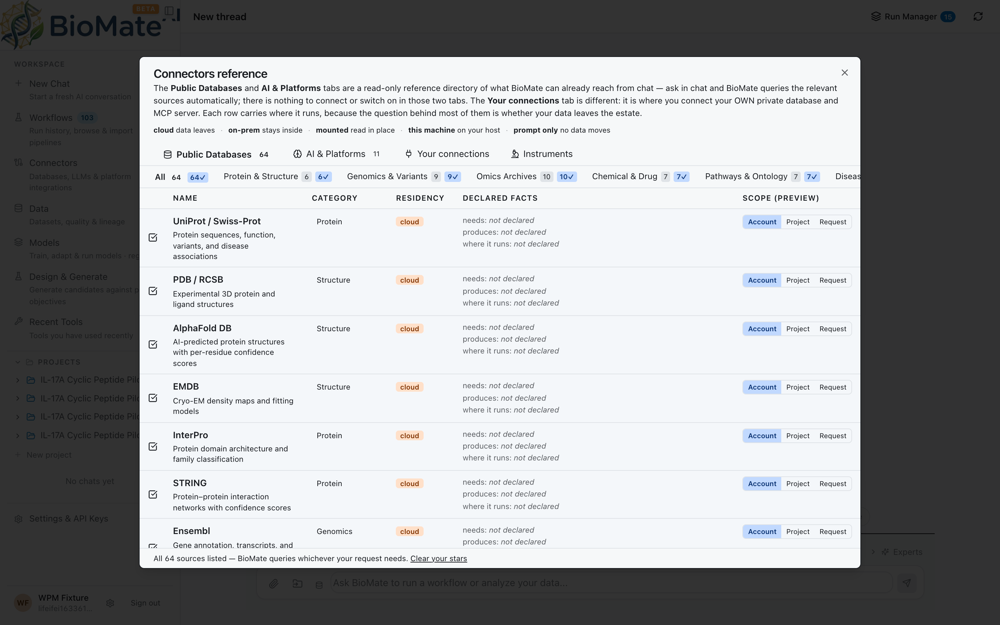

# 教程九 —— 连接数据源与工具

> **适合谁读：** 任何想让 BioMate 触及自己上传文件*之外*的人 —— 一个公共科学数据库、你自己实验室的*私有*
> 数据库，或者一台外部工具服务器 —— 并且想在任何数据发生流动*之前*，就弄清楚这些数据会去往何处。浏览那些
> 已经可触及的内容不需要编程；接入你自己的数据库或工具服务器，也只是填一张简短的表（一个只读的数据库登录，
> 或一个服务器地址）。实验室和医院里的**仪器**是另一类连接，有它自己专门的教程 —— 见**教程六**；这一篇讲的
> 是除此之外的一切。
> **用时：** 阅读约 10 分钟。
> **它在教程中的位置：** 教程四讲了如何手动带入单个文件。这一篇是更大的图景：**连接器（Connectors）**对话框 ——
> 你在这里看到工作区接入的每一个外部来源，也在这里接入你自己的来源。

---

## 1. 它解决什么问题

真实的科研问题，很少能只靠一个上传的文件就回答。要回答*"这个变异已知是否致病？"*，BioMate 需要 ClinVar；要问
*"这个化合物的生物活性如何？"*，它需要 ChEMBL；而有时候答案就在**你自己**的系统里 —— 一个藏在防火墙后、存着临床
结果的 Postgres 数据库，或是你团队自己搭的一台工具服务器。为每一个问题手动把这些一一接上，既慢又容易出错 ——
更糟的是，你可能会搞不清**自己的数据到底有没有离开本机构**。

BioMate 用一个统一的地方解决这件事 —— **连接器（Connectors）**对话框 —— 它为每一个外部来源回答同一个问题：
*这个工作区接入了什么，我的数据会不会流出我的地盘？* 那些公共科学数据库是**本来就可触及的**（你不需要去"开启"
它们）；你自己的数据库或工具服务器，则填一张简短的表来接入；而且**每一行都写明它在哪里运行**，于是在把敏感数据
指向它*之前*，你就能先核查数据驻留情况。

> **一句话概括：** 连接器是那个唯一的界面，展示 BioMate 能触及的一切 —— 它已经在替你查询的公共数据库，加上你
> 自己接入的数据库和工具服务器 —— 而且每一行都带着一枚朴素的"我的数据会流出吗？"徽标。

---

## 2. 开始前需要了解的几个概念（用大白话讲）

**它在哪里。** 从应用侧边栏的**连接器（Connectors）**按钮打开它，会弹出一个全屏对话框，标题是
**"Connectors reference（连接器参考）"**。*（为什么是一个界面：每一种连接 —— 数据库、工具服务器、仪器 —— 背后
的问题都是同一个：我们接入了什么，它能不能用？）*

**两类标签页：只读参考 vs. 可写。** 这是最需要先搞懂的一点，因为它能避免一个常见的误会（"我点了一个数据库 ——
我是不是把它连上了？"）。

- **只读参考标签页** —— *Public Databases（公共数据库）* 和 *AI & Platforms（AI 与平台）*。它们是 BioMate 已经
  能从聊天里触及的内容的一份**目录**。这里**没有什么可连接或开启的**。你在聊天里提问，BioMate 就会自动去查询你的
  问题所需的那些来源。
- **可写标签页** —— *Your connections（你的连接）*。这是**你真正接入东西的唯一地方**：你自己的私有数据库，或你
  自己的工具（MCP）服务器。
- **Instruments（仪器）** —— 第四个标签页，完全由**教程六**覆盖（测序仪、酶标仪、云实验室平台）。本篇不再重复。

**数据驻留（residency）—— 我的数据会不会离开本机构？** 每一行都带着一枚**数据驻留**徽标，无一例外。一共有五种
取值，在对话框顶部有一个图例说明：
- **cloud（云端）** —— 一次查询会离开你所在机构自己的系统（所有公共数据库都是云端；一个托管的大模型也是云端）。
- **on-prem（本地部署）** —— 留在你的网络内部（你自己的私有数据库）。
- **mounted（挂载）** —— 就地读取，从不复制。
- **this machine（本机）** —— 从不离开本机（例如一个自托管的 Ollama 模型）。
- **prompt only（仅提示词）** —— 它只是指令文本；没有数据流动。

*（为什么重要：对于患者数据或任何受限数据，数据驻留正是你要负责的那件事。它出现在每一行上，于是你能在接入*之前*
就核查 —— 一枚空白的徽标比一枚错误的徽标更糟，所以 BioMate 宁可显示"未声明"，也不去瞎猜。）*

**声明的事实，而非一个猜测。** BioMate 不会硬把每个连接器塞进某个类别，而是每一行只陈述几条**事实**：它**需要**
什么（例如"API 密钥"）、它**产出**什么、以及它**在哪里运行**。某个来源若没声明某条事实，对应的单元格就老老实实
以斜体写着**"未声明（not declared）"**，而不是编一个出来。

**只读就是只读。** 当你接入自己的数据库时，BioMate 对它只会运行**只读**查询（它读取；它绝不写入或改动你的数据）。
你提供一个**只读登录账户**，这样在你那一侧也强制执行了这条规则。*（为什么重要：你可以放心地接入一个正在运行的
生产数据库，不用担心 BioMate 会改动它。）*

**接入前先预览。** 一个连接绝不该用它拉进来的东西给你一个意外。设计上的规则是：在任何东西被接入*之前*，你就
**先看到被发现了什么** —— 对一台工具服务器来说，它的那些工具会**列出来让你审阅**，然后 BioMate 才会使用它们。
*（为什么重要：先接入、再解释，那不叫连接 —— 那是一团乱账配一张收据。）*

---

## 3. 什么时候用它

- 你想弄清 BioMate 在回答问题时会**借助哪些公共数据库**（并确认你依赖的某个来源在覆盖范围内）。
- 你的答案依赖于存在某个数据库里的**你自己**的数据（临床结果、一个内部的化合物登记库），而你想让 BioMate 在聊天里
  查询它。
- 你团队跑着一台**工具服务器**（一台 MCP 服务器），你想让 BioMate 的助手能够调用它的工具。
- 在把受限数据指向任何来源之前，你需要**核查数据驻留**情况。

---

## 4. 一步步来 —— 按连接的种类分

### 4a. 浏览公共数据库（只读 —— 没有什么要开启）

<!-- CAPTURE route=/ ; state=Connectors dialog open on the "Public Databases" tab, residency legend visible, several database rows with cloud badges and the Scope column ; focus=databases-tab ; note=展示顶部四个标签页、数据驻留图例、几行来源（UniProt / ClinVar / ChEMBL）及其 cloud 徽标，还有"Scope (preview)"列 -->

1. **打开 连接器 → Public Databases。** 侧边栏 → **连接器（Connectors）**；对话框就在这个标签页上打开。
2. **读这份目录。** 你会看到几十个来源，按子标签页分组（蛋白质与结构、基因组与变异、组学档案库、化学与药物、
   通路与本体、疾病与临床、文献，等等）。每一行给出一句话描述和一枚 **cloud** 徽标 —— 因为每一个都是远程的公共
   服务，所以一次查询会离开你所在机构的系统去触及它。
3. **你要做的就这么多 —— 没有什么要连接的。** 你的聊天问题需要用到其中哪些，BioMate 就已经会去查询哪些。你**不用**
   一个一个把它们打开。

**关于那些复选框和"Scope"列 —— 读一读这段，它能避免一个真实的误解。** 点击一行只是**把它收藏为你自己的参考**。
那颗星是一个**保存在你浏览器里的个人视图筛选器** —— 它**不会**启用、禁用或限制 BioMate 去查询什么。同样，
**Scope（scope，范围）预览**控件（Account / Project / Request，账户 / 项目 / 请求）**今天也只是信息性的**：它记录
一个偏好，但**没有任何机制去强制执行它** —— BioMate 仍然会查询你的请求所需的那些公共来源。页脚把这点说得很直白
（"不会改变 BioMate 查询什么"）。*（为什么要把这点挑明：一个复选框通常意味着"开/关"。这里它不是，而误以为它是，
会给你一种已经把某个来源锁定在内或锁定在外的虚假安全感。）*

### 4b. AI & Platforms（AI 与平台，同样是只读参考）

<!-- CAPTURE route=/ ; state=Connectors dialog on the "AI & Platforms" tab, rows for Anthropic Claude / Ollama / Slack with per-row residency badges and "needs" facts ; focus=ai-tab ; note=展示 Claude（cloud，需要 API 密钥）、Ollama（this machine）和一行消息类平台，带"声明的事实"列 -->
*（待补图：AI & Platforms（AI 与平台）标签页 —— Claude（cloud，需要 API 密钥）、Ollama（this machine），以及
一行消息类平台，带"声明的事实"列。）*

这个标签页列出 BioMate 可以使用的那些**大模型提供方**（Anthropic Claude、Google Gemini、OpenAI GPT，以及自托管的
**Ollama**），外加若干平台与消息类入口（ChatGPT actions、Cursor、Coze、Slack、Telegram、微信 / 飞书）。这里的数据
驻留是**按行**区分的：一个托管模型是 **cloud（云端）**，而 Ollama 是 **this machine（本机）**（从不离开本机）。

**它只是参考 —— 你不在这里配置这些。** 页脚也这么说：消息机器人、IDE（MCP）接入、以及 GPT-action 接入，都是在
它们各自的工具里或通过 BioMate 的 MCP 安装流程来设置的，而不是在这个面板里。用这个标签页来**查看** BioMate 暴露
了什么、以及每个选项在哪里运行。

### 4c. 你的连接 → 接入一个私有数据库（一个真实、可用的流程）

这是**你真正能接入的两样东西**里的第一个。当答案存在你自己的数据库里时就用它 —— 例如一个存着实验读数的内部
Postgres 数据库 —— 而你想让 BioMate 在聊天里从中读取。

<!-- CAPTURE route=/ ; state=Connectors dialog on "Your connections" tab, "Private databases" sub-tab, the "Add a private database" form filled with example values and the on-prem badge visible ; focus=private-db-form ; note=展示表单各字段（名称、driver=PostgreSQL、host、端口 5432、数据库、只读用户、密码）、卡片标题上的 on-prem 徽标，以及"Test connection"+"Save connection"按钮 -->
*（待补图："Add a private database（添加一个私有数据库）"表单 —— 名称、driver、host、端口、数据库、只读用户、
密码，带 on-prem 徽标和 Test / Save 两个按钮。）*

1. **打开 连接器 → Your connections → Private databases。**
2. **填写连接表单。** 每个字段，以及它的值从哪里来：
   - **Connection name（连接名称）** —— 一个你一眼能认出的标签，例如*"临床结果库"*。
   - **Driver** —— **PostgreSQL**（今天支持的数据库类型）。
   - **Host** —— 数据库服务器的地址，例如 `db.internal.example.org`（去问管理你数据库的人）。
   - **Port（端口）** —— 网络端口；输入框建议 **5432**（Postgres 的常用端口），你可以保留或改掉。
   - **Database（数据库）** —— 那台服务器上的数据库名，例如 `clinical`。
   - **User（只读角色）** —— 一个**只能读**的登录账户。*创建一个只读角色，或向别人索要一个*（例如
     `biomate_readonly`）；这就是**读取范围** —— 它决定了 BioMate 能看到哪些表。
   - **Password（密码）** —— 这个只读角色的密码。它在**静态存储时加密，并且在这里绝不会回显给你**（保存后的连接
     只显示"密码已设置"，绝不显示那个秘密本身）。
3. **测试连接。** 点 **Test connection**。BioMate 会打开一个短暂的只读连接，运行一条无害的 `SELECT 1`。绿色 = 它
   触及了数据库并且能读；红色 = 它读不了，并把原因显示出来。*（在保存之前，先把原因修掉 —— host 错了、端口被挡、
   密码不对。）*
4. **保存连接。** 连接被保存，现在就**对 BioMate 聊天可用了**；它会出现在下方的 **Your database connections（你的
   数据库连接）**里，你随时可以删除它。

**读取范围 —— BioMate 能用它做什么、不能做什么。** 因为你提供的是一个**只读**角色，BioMate 跑的每一条查询都是
只读的；它改不了你的数据。那个角色被授予的权限就是边界 —— BioMate 只能查询这个角色被允许看到的那些表。把角色
管得越窄，BioMate 的范围就越窄。

**查询内容及其运行时刻为何重要（可复现性）。** 一个私有数据库通常是**实时的** —— 它的内容会随时间变化。当
BioMate 从中取出一个答案时，那个答案反映的是**查询运行那一刻**的数据库。设计意图是：这样一次取数会被记录为一个
数据集对象，其来源注明**这条查询和它运行的时刻**，于是后来的读者能确切地分辨*是哪一个快照*产生了某个数字 —— 并
能看出今天重跑会不会给出同样的答案。*（为什么重要：一个取自不断变化的数据库的结果，只有在你能说出它是何时取得的
时候，才站得住脚；相隔一周的两次运行，给出不同结果可能是完全合理的。）*

### 4d. 你的连接 → 添加一台 MCP 服务器（一个真实、可用的流程）

你能接入的第二样东西。一台 **MCP 服务器**是一种标准的方式，用来把一组**工具**暴露给 AI 助手调用。如果你的团队跑
着一台，就在这里添加它，让 BioMate 的助手能在聊天里使用它的工具。

<!-- CAPTURE route=/ ; state=Connectors dialog on "Your connections" tab, "MCP servers" sub-tab, the "Add an MCP server" form with name / transport / URL / auth header, and below it a registered server row showing discovered tool badges ; focus=mcp-form ; note=展示表单（transport SSE/HTTP 下拉框、URL、可选的 auth header），以及一行已保存的服务器，把它发现的工具列成一个个小徽标 -->
*（待补图："Add an MCP server（添加一台 MCP 服务器）"表单 —— 名称、transport、URL、可选的 auth header —— 以及
一行已保存的服务器，把它发现的工具列成一个个徽标。）*

1. **打开 连接器 → Your connections → MCP servers。**
2. **填写表单：**
   - **Server name（服务器名称）** —— 一个标签，例如*"实验室工具 MCP"*。
   - **Transport（传输方式）** —— **SSE** 或 **HTTP (streamable，可流式)**。*（只支持**远程**服务器；本地的
     "stdio" 命令式服务器被刻意**不允许**，因为在宿主机上启动一条任意命令会是一个安全漏洞。）*
   - **Server URL（服务器地址）** —— 服务器的地址，例如 `https://mcp.example.org/sse`。
   - **Auth header（认证头，可选）** —— 如果服务器需要，例如 `Authorization: Bearer …`。它在**静态存储时加密**，
     并且绝不回显。
3. **添加服务器 —— 并审阅它的能力。** 当你添加它时，BioMate 会执行 MCP 握手并**发现这台服务器的工具**，把它们的
   名字列在那一行已保存的服务器上。这就是工具服务器的**接入前先预览**那一步：**在你依赖它们之前，你就确切看到
   它贡献了哪些工具。** 如果握手一个工具都没找到，那一行会老老实实写着**"没有发现工具（no tools discovered）"**，
   而不是暗示它添加了什么。
4. **管理它。** 服务器会出现在 **Your MCP servers（你的 MCP 服务器）**下；随时可删。它的工具随后就能被 BioMate
   助手在聊天里调用。

### 4e. 把一个目录作为数据源添加（就地索引 vs. 复制进来）—— 是概念，暂未在本对话框中

这是一个**值得了解的概念**，但要把它的状态说清楚：**今天的连接器对话框里并没有"添加一个目录"的流程。** 把文件
或一整个文件夹的数据带进来，目前是通过**数据中心（Data hub）**（上传）来做的，而**教程四**对此有端到端的讲解。
下面这套"就地索引 vs. 复制"的模型，是接入一个大型本地目录的**设计中**行为；在这里描述它，是为了让你认得这个想法，
而不是说你现在就能找到这样一个按钮。

这个想法是：当你接入一**目录**数据时，有两种模式 ——
- **就地索引（intended default，预定的默认）** —— 一个大目录（比如一个 4 TB 的运行文件夹）会在**它所在之处就地
  读取**，并变成**指向它**的数据集对象，而不复制大部分数据。这就是 **mounted（挂载）**数据驻留的想法：就地读取，
  从不复制。
- **复制进来** —— 用于你想在**项目内部做版本管理**的**小**数据集。每一次扫描都是一个版本，于是被改动的文件会被
  追踪，而不是被悄悄覆盖。

同样的**接入前先预览**规则适用：一次扫描会在创建任何一个数据集对象*之前*，先报告它发现的文件**类型与数量**，以及
每一样会变成什么。

> **如实说明状态：** 就地索引 vs. 复制是一个**设计概念**，不是一个已交付的连接器功能。**今天**要带入你自己的
> 文件，请用**教程四（带入你自己的数据）**。

### 4f. 添加一个技能 / 专家 —— 今天到底什么是真的能用的

一个**技能 / 专家（skill / expert）**是一个可复用的**推理包**，它打磨的是 BioMate *如何*读你的请求（例如，
"从法规风险的角度读这些结果"）。它**不会**挑选某条工作流，也**改不了一次运行的参数** —— 那是另一回事，是一条写成
文字的项目指令。

**如实、经核验的状态 —— 在你去找一个"添加技能"按钮之前，先读这段：**

- **连接器对话框里没有"添加技能/专家"的流程。** 曾经搭过一个"Skills（技能）"标签页，后来又被**刻意移除**了，因为
  后端里没有任何东西会读取你选了什么 —— 它本会宣传一个并不存在的能力。它**没有**被换成另一个添加流程。（设计
  规格*描述*了一种技能/专家添加模式 —— "你来描述它；声明它需要什么、产出什么" —— 但**那是设计，不是已交付的
  东西**。）
- **真正能用的技能/专家入口是聊天编排区和项目的「说明（Instructions）」标签页**，而不在这里。消息框旁边有一个
  **技能与专家（Skills & experts）**控件：一个弹出层，列出后端提供的那些专家包，并让你**针对单次请求把已有的专家包
  开启或关闭**（那次运行随后会记录下应用了哪些）。在一个**项目**里，「说明」标签页还有一张 **"技能与专家"** 卡片，
  它会把选中的包为整个项目存下来（项目里的各次对话会继承它们），并附一个 **"管理账号技能（Manage account skills）"**
  链接指向 `/settings/connections?tab=skills`。
- **它只是开关已有的专家包；它不让你创建、上传或添加一个新的。** 而且如果后端目录里一个专家包都没有，这个弹出层
  会老老实实地说**"暂无可用的专家包（No expert packs available yet）"**，而不是显示一堆什么都不干的开关。

所以，用大白话说：**你可以针对每个问题开启已有的技能与专家（在编排区里），也可以按项目把它们存下来（项目的「说明」
标签页）；但今天你没法通过界面创建一个全新的技能或专家。**

<!-- CAPTURE route=/ ; state=main chat view, the composer "Skills & experts" popover open showing either a list of expert-pack toggles or the "No expert packs available yet" empty state ; focus=composer-skills-experts ; note=展示消息框旁边的 技能与专家（Skills & experts）控件及弹出层内容（带开/关的专家包，或那句如实的空状态文案） -->
*（待补图：编排区的 技能与专家（Skills & experts）弹出层 —— 带开/关开关的已有专家包，或那句如实的"暂无可用的专家包"空状态。）*

---

## 5. 如实的限制 —— 你该有的预期

- **创建一个全新的技能/专家在界面里没有接通。** 已交付的产品里，任何地方都**没有**创建新技能/专家的添加流程；连接器
  的"Skills"标签页是被特意移除的。你能做的技能/专家操作，是在编排区的 技能与专家（Skills & experts）弹出层里**针对
  每次请求开关已有的专家包**，以及在项目的「说明」标签页里**按项目把选中的包存下来** —— 而当后端一个都没有时，那份
  列表会**如实为空**。别指望能创建或上传一个新的。
- **Public Databases 和 AI & Platforms 两个标签页只是参考。** 那里没有什么被连接或开启。那些行上的**复选框是保存
  在你浏览器里的个人收藏/筛选**，而 **Scope 控件是一个没有任何机制去强制执行的信息性预览** —— 两者都不改变
  BioMate 查询什么。
- **私有数据库 = PostgreSQL + 只读。** 支持的 driver 是 PostgreSQL，查询永远是只读的 —— 请提供一个只读角色。
  BioMate 绝不写入你的数据库。
- **MCP 服务器只支持远程。** SSE 或 HTTP；本地的 "stdio" 命令式服务器出于安全考虑被特意禁止。如果握手没找到工具，
  那一行会如实这么说。
- **目录的"就地索引 vs. 复制"添加流程是一个设计概念，不是已交付的功能。** 今天请通过**数据中心（Data hub）**带入
  你的文件/文件夹（教程四）。
- **数据驻留"未声明"意味着没有声明，而不是不安全。** 一枚虚线/未声明的徽标意味着这个来源没有声明它在哪里运行 ——
  把它当作"未知，在接入受限数据前先核查"，而不是一个定论。
- **仪器是一篇独立的教程。** 测序仪、酶标仪和云实验室平台在**教程六**里 —— 除了 Instruments 标签页之外，别在这里
  找它们。

---

## 6. 下一步去哪儿

| 你想… | 去哪儿 |
|---|---|
| 带入单个文件或一整个文件夹的数据 | **教程四（带入你自己的数据）** |
| 连接一台实验室或医院的**仪器** | **教程六（连接仪器）** |
| 运行一次分析并读它的报告 | **教程三** |
| 为一个问题开启一个专家包 | 编排区的 **技能与专家（Skills & experts）**控件（按请求） |
| 看看 BioMate 能触及哪些公共数据库 | **连接器 → Public Databases** |

习惯是：**浏览那些已经可触及的（Public Databases，只读）→ 在 *Your connections* 里接入你自己的（数据库或 MCP
服务器）→ 在把受限数据指向任何东西之前，先看一眼那枚数据驻留徽标。**

---

## 7. 关键术语

| 术语 | 含义 —— 以及你为什么要在意 |
|---|---|
| **连接器对话框（Connectors dialog）** | 那个唯一的界面（侧边栏 → **连接器 / Connectors**），展示你的工作区接入的每一个外部来源。四个标签页：Public Databases、AI & Platforms、Your connections、Instruments。 |
| **只读参考标签页** | *Public Databases* 和 *AI & Platforms* —— BioMate 已经能触及什么的一份目录。没有什么可连接；你在这里没法"把某个来源开启"。 |
| **你的连接（Your connections）** | 唯一的**可写**标签页 —— 你在这里接入**你自己**的私有数据库或 MCP 服务器。 |
| **数据驻留（cloud / on-prem / mounted / this machine / prompt only）** | 一个来源在哪里运行、你的数据会不会离开。每一行都显示；"未声明"意味着没有声明，而不是不安全。在接入受限数据前先核查它。 |
| **声明的事实（Declared facts）** | 一行所陈述的那些朴素事实 —— 它**需要**什么、**产出**什么、**在哪里运行** —— 而不是一个硬塞的类别。某条事实缺失时，会如实显示为"未声明"。 |
| **读取范围（私有数据库）** | 那个只读角色，以及它能看到的那些表 —— BioMate 可查询范围的边界。把它管窄。 |
| **只读查询（Read-only query）** | BioMate 只从你的数据库读取；它绝不写入或改动它。 |
| **MCP 服务器** | 一台远程服务器，把一组可供 AI 助手调用的**工具**暴露出来。用 URL（＋可选的认证头）添加它；它的工具会在被使用**之前列出来供你审阅**。 |
| **接入前先预览（Preview-before-attach）** | 一条规则：在任何东西被接入*之前*，你就看到一个连接发现了什么（一台服务器的工具；一个目录的文件类型/数量）。 |
| **就地索引 vs. 复制（目录）** | *设计概念：* 一个大目录就地读取（索引/挂载，不复制）；小数据集可以复制进来并做版本管理。不是一个已交付的连接器流程 —— 今天请用数据中心。 |
| **技能 / 专家包（Skill / expert pack）** | 一个改变 BioMate *如何*读请求（绝不是改工作流或参数）的推理包。**在编排区里按请求开关，并可在项目的「说明」标签页里按项目存下来；今天界面里没有创建新技能的添加流程。** |
| **Scope（范围，预览）** | 参考行上一个 Account/Project/Request 的**信息性**偏好。不被强制执行 —— 它不改变 BioMate 查询什么。 |

---

_面向进阶用户 / 开发者的配套技术参考：
`docs/user-manual/modules/I12-connectors-and-skills.md`。仪器：教程六 +
`docs/user-manual/modules/I14-instruments-and-lab-connectivity.md`。带入你自己的数据：教程四。_
