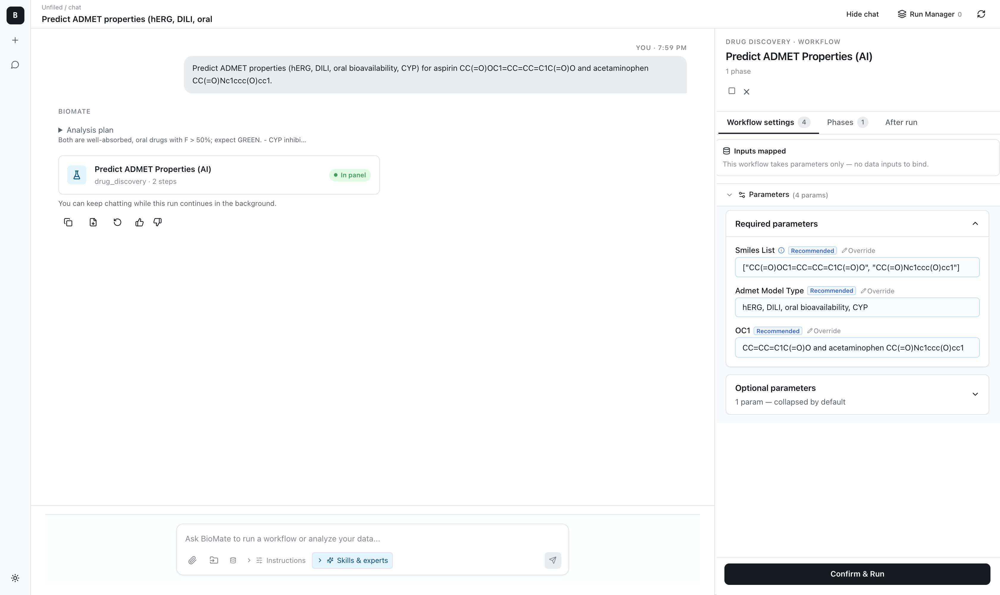

# 教程 W1 —— 运行前与运行中的工作流面板

> **适合谁读：** 任何向 BioMate 请求过一次分析、如今看到右侧弹出一个面板，并且想在它运行*之前*和运行*途中*
> 弄懂它每一个部分的人。不需要编程。读完这一篇，你会知道如何读取和设置参数、如何实时看着每个阶段运行，以及
> 运行途中弹出的质量闸门到底在问你什么。
> **用时：** 阅读约 10 分钟。
> **它在教程中的位置：** 教程三从高层讲完整的"运行并读报告"故事。本篇放大到**右侧面板本身** —— 它的标签页、
> 它的控件，以及当一次运行从*空闲*走向*运行中*时屏幕上会发生什么变化。它的姊妹篇 **W2** 讲的是运行*结束之后*
> 的面板。

---

## 1. 它解决什么问题

当你请求 BioMate 跑一次分析时，右侧会弹出一个面板。它一下子做了很多事：展示这条工作流会做什么、让你核对并
修改它的设置、在一个必填值缺失时拦住你不让开跑，然后 —— 一旦跑起来 —— 变成一个逐阶段完成的实时视图。如果
你不清楚哪一部分管什么，就很容易漏掉一个要紧的设置，或者盯着面板、却不确定到底有没有在动。

本篇把面板**一个控件一个控件地**走一遍，覆盖运行*开始之前*和*运行途中*这两段时间。（它结束*之后*出现的一切
—— 输出、分析结果、可复现记录 —— 是 W2 的内容。）

> **一句话概括：** 工作流面板是你核对一条流程的设置、启动它、再一步步看着它运行的地方 —— 而 BioMate 会拦住
> 你，不让你启动一次缺了必需项的运行。

---

## 2. 开始前需要了解的几个概念（用大白话讲）

**面板顶部有三个标签页。** 它们是 **Workflow settings（工作流设置）**、**Phases（阶段）** 和
**After run（运行后）**。面板会打开在最贴合当前运行状态的那个标签页上 —— 开跑前是 **Workflow settings**
（好让你配置它）、跑起来后是 **Phases**（好让你盯着看）、结束后是 **After run**（好让你读结果）。你随时可以
自己点任意标签页；一旦你点了，面板在这一会话剩下的时间里就不再自动切换。*（为什么重要：你从不会被"卡"在某个
标签页上 —— 面板只是先替你试着展示最有用的那一个。）*

**参数是一条工作流运行时所用的设置。** 相当于这次分析的"电话号码"：靶点、输入文件、一个阈值。BioMate 会填入
合理的默认值，而且当你用大白话描述过目标时，常常还会填入它从你话里推断出来的值。每一个值在任何东西运行之前
都会展示给你。

**必填参数 vs 可选参数。** 有些参数*必须*有值，否则运行无法开始（一个 **Required（必填）** 标记会标出它们，
而启动按钮会一直灰着，直到它们被填上）。另一些是可选的，带有安全的默认值。*（为什么重要：这是 BioMate 在
拒绝启动一次本会跑到一半才失败的运行 —— 而失败的原因本来你两秒钟就能修好。）*

**阶段与步骤。** 一条工作流被组织成若干**阶段（phase）**（大的环节），每个阶段由一个或多个**步骤（step）**
（具体的工具）组成。在 Phases 标签页里，每个阶段都是一张你能展开、看到其中各步骤的卡片。*（和教程三是同一个
概念 —— 这里你看到的是屏幕上实际的卡片。）*

**QC 闸门（质量闸门）。** 一项运行途中的自动质量检查。如果某个实测结果落在允许的阈值之外，运行会暂停，并弹出
一张卡片，把**实测值**和**要求值**对照展示，好让你决定怎么办。**它绝不会悄悄越过一个没通过的检查。**
*（为什么重要：这是 BioMate 最重要的可信特性之一 —— 见教程三。）*

**实时状态（SSE）。** 一次运行进行中，面板会实时地自我更新 —— 阶段卡片会自己从*等待中（pending）*变成
*运行中（running）*、再变成*已完成（completed）*，用不着你刷新。*（你不需要懂背后的机制；只需知道你看到的是
当前状态，而不是一张过时的快照。）*

---

## 3. 什么时候用它

- 你请求 BioMate 跑了点什么，想在花算力之前仔细核对它的设置。
- 一个必填值缺了，而你不确定该去哪里填。
- 一次运行正在进行，你想看看它跑到哪个阶段了，或者想弄懂刚弹出来的那条质量闸门消息。

---

## 4. 一步步来 —— 从打开面板到一条跑起来的工作流

1. **打开面板。** 在聊天里用大白话描述你的目标；BioMate 会挑中匹配的工作流，并在右侧打开它的面板（教程三 §4）。
   顶栏会显示工作流的名称、它的领域，以及它有多少个阶段。
2. **进入 Workflow settings，填好必填项。** 开跑前面板通常就打开在这里。展开 **Parameters（参数）** 条，先把
   **Required parameters（必填参数）** 过一遍（任何还空着的都会被标出来），如果你想改某个默认值，再处理
   **Optional parameters（可选参数）**。每一种控件类型见 §5。
3. **核对输出位置（可选）。** 在参数下方，你可以选择结果存在哪里 —— BioMate 托管的默认位置（保留 90 天）、
   你的项目文件夹，或你自己的存储桶（进阶）。
4. **按下"Confirm and run（确认并运行）"。** 就是面板底部那个启动按钮。它会一直禁用，并带一个提示告诉你还差
   几个必填值，直到所有需要的都填齐。
5. **切到 Phases 标签页，盯着看。** 运行一开始，面板就自动切到这里。每张阶段卡片会实时地从*等待中*走到
   *运行中*、再到*已完成*（§6）。如果某个质量闸门触发了，会弹出一张卡片请你决定（§7）。

<!-- CAPTURE route=/ ; state=workflow panel idle (pre-run), Workflow settings tab active, Parameters strip expanded showing Required parameters with one empty required field flagged, Confirm-and-run button disabled ; focus=workflow-artifact-panel ; note=展示三个标签页（Workflow settings · Phases · After run）、带红色"Required"标记的 Parameters 条，以及灰掉的运行按钮及其"还差 N 个必填参数"提示 -->
*（待补图：面板的开跑前状态 —— Workflow settings 标签页打开着，一个必填参数仍空着，启动按钮处于禁用状态。）*

*作为参照，这是同一个面板在一次已结束运行上的样子（取自教程三）：顶栏标明了工作流及其 4 个阶段，三个标签页
排在它下方，状态徽标是绿色的。开跑前，同一个面板会打开在 **Workflow settings** 标签页，启动按钮在底部；运行
途中，它则显示带实时状态的 **Phases** 标签页。*

---

## 5. Workflow settings 标签页 —— 读取并设置参数

这里是你配置这次运行的地方。参数住在一个可折叠的 **Parameters（参数）** 条里，分成两组：

- **Required parameters（必填参数）** —— 运行所需的值。只要还有空着的，参数条上就会出现一个红色的
  **Required（必填）** 标记，启动按钮保持禁用。先填这些。
- **Optional parameters（可选参数）** —— 默认折叠，安全的默认值已经设好。只有想改点什么时才去展开它们。

**你看到的控件取决于参数的类型：**

- **开/关设置** → 一个**开关（toggle）**（例如"单端读段：开"）。
- **从固定列表里选一项** → 一个**下拉框（dropdown）**（例如一个参考基因组、一个链特异性选项）。
- **一个数字** → 一个**数字框**。
- **一个文件** → 一个**文本框**，配一个 **Browse（浏览）** 操作，能打开你上传过的数据集，让你挑一个带进来的
  文件，而不用手打路径（带自己的数据进来是教程四的内容）。

**AI 填入的值会被标出。** 当 BioMate 从你的话里推断出一个值时，那个值会带一个徽标和一个 **Override（覆盖）**
选项，好让你看清它选了什么、为什么选，并在你不认同时改掉它。（BioMate 如何做这些判断、以及每一个背后的
"为什么？"，在教程一和教程二里讲。）

**输出位置（Output location）。** 在参数下方（针对云端流程），你可以选择输出写到哪里：*Default（默认，
BioMate 托管，保留 90 天）*、*My project folder（我的项目文件夹）*，或 *My S3 bucket（我的 S3 存储桶，
进阶 —— 你的桶必须授予 BioMate 写入权限）*。拿不准就留在 Default。

**权限与校验（Permissions & verification）。** 这个标签页靠下有两张小小的只读卡片：一张显示你在这里被允许做
什么（你自己的运行归你所有），另一张列出可能拦下一次运行的几类闸门（质量闸门、人工审批、许可证闸门）。它们
只是信息展示 —— 没有要填的东西。

**如果一条工作流没有任何设置，** 这个标签页会直接这么说，并把你指向启动按钮。

<!-- CAPTURE route=/ ; state=Workflow settings tab, Parameters strip open with a mix of control types visible — a toggle, a dropdown, a number box, and a file field with a Browse button; an AI-filled value showing its badge/Override ; focus=button-toggle-workflow-settings ; note=展示必填 vs 可选的分组，以及至少每种控件各一个，外加一个 AI 填入徽标 -->
*（待补图：展开的 Parameters 条 —— 一个开关、一个下拉框、一个数字框、一个文件字段，其中一个 AI 填入的值带着
徽标、可被覆盖。）*

---

## 6. Phases 标签页 —— 实时看一次运行

一旦你按下 **Confirm and run**，面板就切到这里。顶部有一个标签写着 **PHASES · N**（对一条单环节工作流则是
**STEPS · N**）。下面是**每个阶段一张卡片**。

**每张阶段卡片显示：**

- 一个**字母徽标**和该阶段的**名称**。
- 一个**状态标记** —— *RUNNING（运行中，带一个转圈图标）*、*DONE（完成）*、*FAILED（失败）*，或者在等待
  时显示一个纯粹的步骤计数。
- 一个 **N / M** 计数器，表示它的步骤完成了多少。
- 一个 **Run（运行）** 按钮（在整体运行启动之前），用来只跑那一个阶段。

**展开一张卡片**（点它的标题栏）能看到：

- **按阶段的参数** —— 收起时是一行紧凑的摘要，带一个 **edit（编辑）** 链接，用来修改只属于那个阶段的值。
- **步骤行** —— 每一行都有编号、步骤名，以及它自己的 *RUNNING / DONE / FAILED* 标记。一个步骤跑过之后，每行
  会提供 **Details（详情，该步骤做了什么的完整视图）**、**Rerun（重跑）** 和 **Params（调整参数并重跑）**，
  并列出它产生的**输出文件**，带 **view（查看）** 和 **dl（下载）** 操作。
- **一个 "QC Gates（质量闸门）" 区块** —— 该阶段的质量阈值，每一项显示为一个指标，带一个 *≥* 或 *≤* 以及它的
  值（例如"Alignment Rate ≥ 70%"，比对率 ≥ 70%）。一个 **edit（编辑）** 链接让你在运行前或两次运行之间改掉
  一个阈值数字。

**实时会变的东西：** 随着运行推进，每张阶段卡片的状态会自己从*等待中 → 运行中 → 已完成*，每个步骤标记会翻成
*DONE*，顶栏里那个整体徽标则跟踪整次运行。你什么都不用刷新。

**底部操作栏（运行途中）。** 面板底部会出现一条深色的条，带 **Pause（暂停）** 和 **Stop（停止）**；如果你
暂停了，它就变成 **Resume（继续）** 和 **Stop**。

<!-- CAPTURE route=/ ; state=Phases tab during a live run — one phase card expanded with status RUNNING (spinner) and at least one step row showing DONE and one showing RUNNING; the dark Pause/Stop action bar visible at the bottom ; focus=panel-phases ; note=抓一次真实的空闲→运行中→终态转变：至少一张阶段卡片 data-status="running" 且上面已有一个步骤完成 -->
*（待补图：运行途中的 Phases 标签页 —— 一张处于 RUNNING 状态的阶段卡片，一个已完成的步骤在一个运行中的步骤
上方，底部是 Pause / Stop 条。）*

---

## 7. 运行途中质量闸门触发时

如果某个实测结果落在允许的阈值之外，运行会暂停，面板里会出现一张琥珀色的卡片，标题是
**"QC Gate — <步骤名> — Review Required（质量闸门 —— <步骤名> —— 需要审核）"**。它会显示：

- 每一项没通过的检查占一行：**实测值**（红色）对照**要求阈值**（绿色），中间带它们之间的比较 —— 于是你能
  一眼看出差了多远。
- BioMate 能提供的任何**建议的设置改动**，写成*参数：当前值 → 建议值*。
- 一个简短的倒计时 —— *"除非你操作，否则流程将在 M:SS 后继续（Pipeline continues in M:SS unless you act）"*
  —— 因为 BioMate 不会一直无限期地卡住你的运行等着；如果你不选，它就保留当前设置继续，并把这件事告诉你。

**你有三个按钮：**

- **Apply suggestions（采纳建议）** —— 接受建议的改动，并从那一步停下的地方把它重跑一遍（它会复用已经做完的
  工作，而不是把整条流程从头来过）。
- **Keep current（保留当前）** —— 用现有的值继续。
- **Cancel run（取消运行）** —— 停掉这条工作流。

关键的如实之处（和教程三一样）：BioMate 会把没通过的检查**展示**给你、让你来决定 —— 它绝不会悄悄放它过去。

<!-- CAPTURE route=/ ; state=Phases tab with the QC gate inline card visible — "QC Gate — <step> — Review Required", a failing metric row with measured (red) vs threshold (green), a suggested param change, the countdown line, and the Apply suggestions / Keep current / Cancel run buttons ; focus=qc-gate-inline ; note=真实的质量闸门（例如比对率或 hERG 阈值），不是假造的 -->
*（待补图：运行途中的质量闸门卡片 —— 红／绿的实测值对阈值、一个建议改动、倒计时，以及三个决策按钮。）*

---

## 8. 如实的边界 —— 这个面板今天做什么、不做什么

- **没有"跳过阶段"或"跳过步骤"按钮。** 它们被有意不显示，因为跳过还没接进执行流程里。（开跑前你可能会看到一张
  小小的只读**跳过图（skip map）**，告诉你一条工作流*声明*了哪些阶段可跳过 —— 它只是信息展示；你没法对它
  操作。）
- **自动自纠正目前是关着的。** 没有"QC 失败时自纠正"的开关，而且在端到端测试进行期间，BioMate 不会自己悄悄
  重试一个阶段。当一个质量闸门触发时，由**你**来决定（采纳建议／保留当前／取消）—— 见 §7。那个自动修复视图
  （"原值 → 新值"的参数对比）在那条循环重新启用之前一直禁用。
- **没有实时百分比进度条，也没有运行前的费用估算。** 进度靠状态徽标和各阶段的标记来显示，而不是一个百分比
  进度条；面板也不会在你运行前显示一个美元估算（你的实际用量显示在计费页上）。
- **一个用量计量条**（已用 vCPU-小时 vs 你的上限）可能会在开跑前出现在启动按钮附近 —— 一个粗略的预算提示，
  而不是一次运行的价格。

---

## 9. 接下来去哪儿

| 你想… | 去哪儿 |
|---|---|
| 从高层看完整的"运行并读报告"故事 | **教程三** |
| 读运行*结束之后*的面板（输出、分析结果、记录） | **教程 W2** |
| 打开并读每一个单独的输出文件 | **教程五** |
| 把你自己的数据附到某个参数上 | **教程四** |
| 弄懂 AI 填入的值、以及每一个背后的"为什么？" | **教程一和教程二** |

习惯是：**Workflow settings（填好必填）→ Confirm and run → Phases（实时盯着看）→ 在任何质量闸门处做决定。**

---

## 10. 关键术语

| 术语 | 含义 —— 以及你为什么要在意 |
|---|---|
| **Workflow settings / Phases / After run** | 面板的三个标签页。面板会打开在贴合运行状态的那一个上；你可以随意切换。 |
| **参数（Parameters）** | 一条工作流运行时所用的设置；在运行前展示给你，好让你核对或修改。 |
| **必填参数（Required parameter）** | 一个运行没它就无法开始的值；启动按钮会一直禁用，直到它被填上。 |
| **阶段 / 步骤（Phase / step）** | 一个大环节 / 其中的一个单独工具；在 Phases 标签页里每个阶段是一张可展开的卡片。 |
| **QC 闸门（QC gate）** | 一项运行途中的质量检查，会暂停并把实测值对阈值展示出来，好让你决定；绝不会被悄悄放过。 |
| **实时状态（Live status）** | 运行途中面板会实时更新阶段和步骤的状态 —— 无需刷新。 |
| **Confirm and run（确认并运行）** | 那个启动按钮；在必填参数设好之前禁用。一次运行后会变成"Run again（再次运行）"／"Restart（重启）"。 |
| **输出位置（Output location）** | 结果存在哪里 —— BioMate 默认（90 天）、你的项目文件夹，或你自己的存储桶。 |

---

_面向进阶用户 / 开发者的配套技术参考：`docs/user-manual/modules/`（运行分析）。源组件：
`frontend/client/src/components/nextflow-workflow-viewer.tsx`。_
