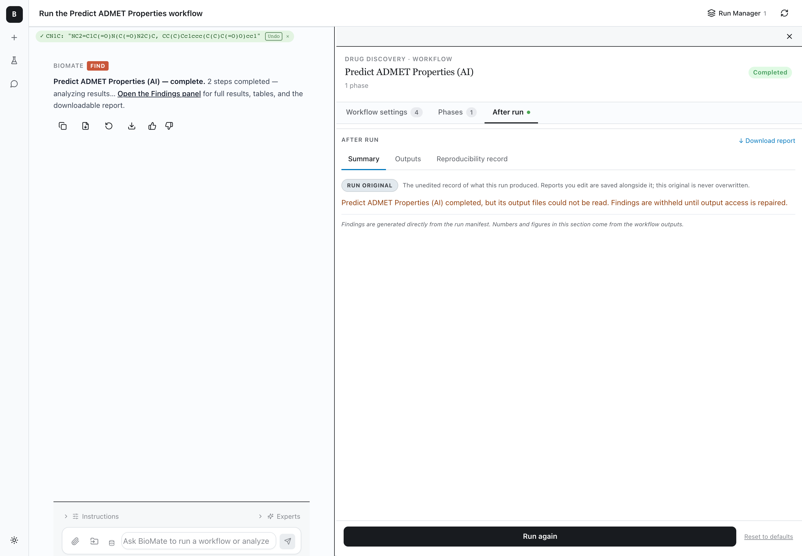
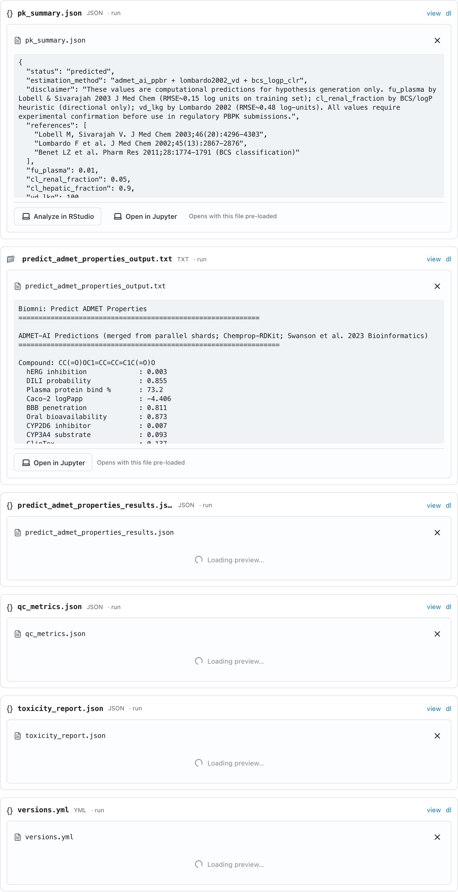
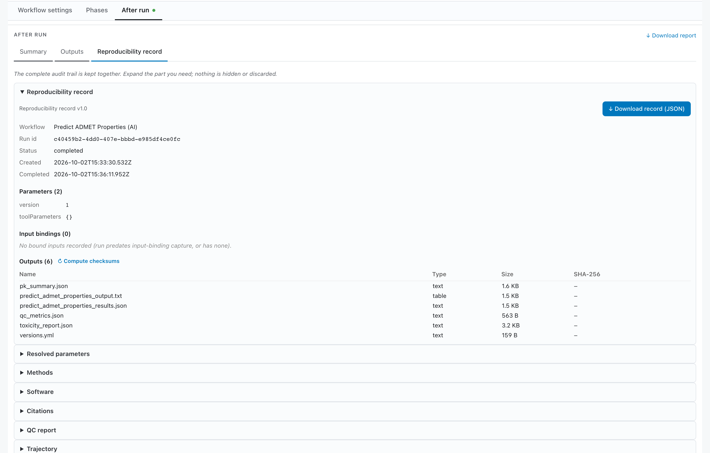

# 教程 W2 —— 运行后面板：Results（结果）与可复现记录

> **适合谁读：** 任何一次运行已经结束（或失败）、想弄懂工作流面板 **After run（运行后）** 这一节每一个部分的
> 人。不需要编程。读完这一篇，你会知道分析结果住在哪里、如何打开并下载输出文件、完整的审计留痕在哪里，以及
> 一次*失败*的运行会给你看些什么。
> **用时：** 阅读约 10 分钟。
> **它在教程中的位置：** 教程 W1 讲了运行*之前*和*途中*的面板。本篇是它的续篇：同一个面板在运行进入终态
> 之后的样子。教程三从高层讲完整的故事，教程五深入讲打开每一个单独文件 —— 本篇聚焦于**运行后那几个标签页的
> 结构**、以及它们是怎么拼到一起的。

---

## 1. 它解决什么问题

一次结束的运行会产出一大堆东西：一段大白话的摘要、一摞输出文件，以及一份关于这一切是怎么发生的完整记录。
如果这些东西散落各处，你就永远没法信任或复用这个结果。BioMate 把它们收拢进一个 **After run（运行后）** 节，
配一小组固定的标签页，于是你永远知道该去哪里找：头条的分析结果在一处、每一个文件在另一处、完整的审计留痕在
第三处。

本篇给每个标签页命名、说清里面到底有什么，并且 —— 这点很重要 —— 如实讲明哪些东西只在底层数据可用时才出现，
以及一次*失败*的运行长什么样。

> **一句话概括：** 一次运行结束时，运行后这一节把分析结果、文件和完整记录交给你 —— 各在自己的标签页里 ——
> 外加一个一键下载，把它们全部缝合到一起。

---

## 2. 开始前需要了解的几个概念（用大白话讲）

**运行后这一节正好有两个标签页。** 它们是 **Summary（摘要）**、**Outputs（输出）** 和
**Reproducibility record（可复现记录）**。一次运行一旦完成或失败，面板就自动打开在这里。*（为什么重要：这是
一份简短、固定的清单 —— 你用不着翻一堆标签页。）*

- **Summary** 是落地标签页：大白话的**分析结果（findings）**（所以"分析结果在哪儿？"—— 就在这里）。
- **Outputs** 是运行产生的每一个文件，按产生它的步骤分组。
- **Reproducibility record** 是完整的审计留痕 —— 身份信息、这次运行所用的**参数**、输入、输出、方法、软件、
  引文、QC 报告和决策日志，归拢成一组可展开的分节。

**分析结果是从真实的输出文件生成的。** Summary 的分析结果是从实际的输出里读出来的，不是编造的。如果 BioMate
读不到输出，它会**说分析结果不可用，而不是把它们凭空捏造出来** —— 这份如实正是它的特性（教程三展示的正是
这一行为）。

**校验和（SHA-256）是一个文件的指纹。** 它让任何人都能确认自己拿到的是不是一模一样的文件。在 BioMate 里，
这些是**按需**计算的 —— 你在记录里点击"Compute checksums（计算校验和）"。*（为什么重要：这正是一份可复现
记录之所以存在的那种防篡改凭据。）*

**下载报告（Download report）。** 一个按钮，把每个标签页的内容拼成一份合并文档，让你把整次运行留存或分享
在一个文件里。

---

## 3. 什么时候用它

- 一次运行结束了，你想读读它发现了什么，再打开关键文件去核查它们。
- 你需要一个结果的完整、可分享的记录 —— 用于论文、申报，或你的团队。
- 一次运行*失败*了，你想弄懂为什么，并再试一次。

---

## 4. Results 标签页 —— 分析结果（发现）住在顶部的横幅里

Summary 是落地标签页。顶部坐着一个 **Run original（原始记录）** 徽标，配一句简短的说明：这是这次运行所产出
内容的未经编辑的记录；你日后编辑的任何报告都会被存在它*旁边*，原件永不被覆盖。

下方是 **Findings Summary（分析结果摘要）** 卡片：

- **一段大白话的摘要**，关键数字取自输出。每个数字都读自某个具体的输出文件：该文件名列在下方 **Key Results（关键结果）**
  表的 **Source（来源）** 列里，并在同一 Results 标签页的 Outputs 部分就地内联预览（不再需要点击跳转）。
- **头条指标标记（Headline metric chips）** —— 排在最前面的几个结果，做成一眼可见的小标记。
- **Key Results（关键结果）** —— 一张可折叠的表（指标 · 值 · 解读 · 来源），默认折叠。
- **Supporting Literature（佐证文献）** —— 当工作流提供时的参考文献，每条都链接出去。
- **Caveats（注意事项）** —— BioMate 想让你知道的任何局限。
- **下载分析发现（Download findings）**，以及在提供时的 **Continue analysis（继续分析，把一个建议的下一步发到
  聊天里）**。

**分析结果还在准备中、或读不到时你会看到什么**（对这些要有心理准备 —— 它们是正常、如实的状态，不是错误）：

- *"Analyzing outputs…（正在分析输出…）"* 或 *"Analysis in progress…（分析进行中…）"* —— 分析结果还在生成；
  一旦就绪，卡片就会填上。
- *"Findings are unavailable because workflow outputs could not be read.（分析结果不可用，因为无法读取工作流
  输出。）"* —— 一条如实的消息；BioMate 不会编造一段摘要（见教程三里正是这种情况的实例）。
- 在一次**失败**的运行上：*"Analysis not available — workflow did not complete successfully.（分析不可用 ——
  工作流未成功完成。）"* —— 一条静态消息，没有卡住不动的转圈。

*取自教程三的如实行为：这次运行已完成、并产生了文件，但它的输出读不到，于是 Summary 据实说明，而不是编造一个
结果。"RUN ORIGINAL" 徽标标记的是未经编辑的记录。在一次正常运行中，这个标签页会显示上面所述的那张已填充的
分析结果摘要。*

<!-- CAPTURE route=/ ; state=After run → Results tab on a run with findings present — Findings Summary card showing a summary paragraph with a clickable number, headline metric chips, Key Results expanded, and the Download findings button ; focus=findings-card ; note=展示一张已填充的分析结果卡片（而不是暂不给出的状态），其中至少有一个发现数字渲染成链接 -->

---

## 5. Outputs 部分（Results 标签页内）—— 每个输出文件就地内联预览、可搜索

这里列出运行产生的每一个文件。（教程五深入讲*打开并读*每一个文件；这里讲的是这个标签页的布局。）

**顶部是批量操作：**

- **Download all as ZIP（打包下载为 ZIP）** —— 把每个输出放进一个压缩包。
- **Reproducibility bundle（可复现打包）** —— 在别处重跑这次分析所需的配置、命令脚本、日志和软件版本。
- **Save to Project（保存到项目）** —— 把输出复制进一个项目，在那里它们成为头等的数据集对象（质量、血统、
  版本 —— 就是教程四里那个数据集概念）。这就是一个结果如何成为下一次分析的输入。
- **Explore in…（在…中探索）** —— 一组用于交互式工具（Jupyter / RStudio / CellxGene）的按钮，*前提是它们在
  你的环境里配置好了*。开发站点今天没配，所以这些按钮根本不出现 —— 这是预期行为，不是 bug（教程五讲清楚了
  完整的范围）。

**接着是文件表** —— 每个文件一行，列有 **Step（步骤）· File（文件）· Type（类型）**，每行两个操作：
**view（查看，在一个浮层里内嵌打开，并以适合它类型的方式显示）** 和 **dl（下载）**。文件按产生它的步骤分组，
于是你能把任何结果追溯回它所来自的那个阶段。

**如果没有文件：** 标签页会显示 *"No output files registered yet（暂未登记任何输出文件）"* —— 或者，在一次
失败的运行上，*"No outputs — run did not complete successfully.（没有输出 —— 运行未成功完成。）"*

*一次真实运行的输出（来自教程三的那次体内 CAR-T 共同设计），按步骤分组。每一行都带着产生它的步骤、文件类型，
以及一个 **view** / **dl** 操作。点 **view** 就内嵌打开文件（教程五）。*

---

## 6. Reproducibility record 标签页 —— 完整的审计留痕

这个标签页开头有一句简短的说明 —— *"完整的审计留痕被保存在一起。展开你需要的那部分；没有任何东西被隐藏或
丢弃。（The complete audit trail is kept together. Expand the part you need; nothing is hidden or
discarded.）"* —— 然后是一组**可展开的分节**。第一个默认展开；点任意标题就能打开其余的：

- **Reproducibility record（可复现记录，默认展开）** —— 这次运行的身份信息（工作流、运行编号、状态、创建／
  完成时间）、它实际运行时所用的**解析后参数（resolved parameters）**、**输入绑定（input bindings，喂进去的
  文件）**，以及带类型、大小和一个 SHA-256 列的**输出**。一个 **Download record (JSON)（下载记录，JSON）**
  按钮把整份东西放进一个文件里给你。
- **Resolved parameters（解析后参数）** —— 同样这些参数值单独列出，带一个 **Run again with edits（改好后
  再次运行）** 快捷入口。
- **Methods（方法）** —— 一份 AI 撰写的方法说明，你可以读它，并通过 **Edit（编辑）** 开关修改并保存。
- **Software（软件）** —— 所用的工具版本（在运行记录了它们时显示）。
- **Citations（引文）** —— 该工作流的参考文献（在可用时显示）。
- **QC report（QC 报告）** —— 质量闸门日志：评估过、通过了、自动纠正过的，以及人工处理的闸门，带一张逐闸门的
  表。当没有任何东西被标出时，它会显示一行绿色的 *"All quality gates passed.（所有质量闸门均已通过。）"*
- **Trajectory（轨迹）** —— 这次运行的决策／步骤日志（在运行记录了它时显示）。

**校验和按需计算。** 在你点击 **Compute checksums（计算校验和）** 之前，SHA-256 列显示为"—"，点击后它会为每
个输出填入指纹（限定在一个合理的文件数量和大小内）。这正是一份记录之所以存在的那种防篡改凭据；它默认关着，
因为对字节做哈希并不是免费的。

**如实的空状态。** Software、Citations、Trajectory 和输入绑定这几个分节会出现在记录里，但只有当运行确实记录了
那份数据时才带内容 —— 例如输入绑定可能显示为 *"No bound inputs recorded (run predates input-binding capture,
or has none).（未记录绑定输入（该运行早于输入绑定采集，或本就没有）。）"*。一个空着的分节是信息，不是 bug。

*取自教程三的可复现记录：这次运行的身份信息、记录在案的参数，以及每一个输出及其类型、大小，和一个在你点击
**Compute checksums** 之前显示为"—"的 SHA-256。从前那几个并列的标签页（方法、软件、引文、QC 报告、轨迹）在
这里被折进可展开的分节 —— 没有任何东西被丢弃。*

---

## 7. 一键"下载报告"

在运行后这一节的顶部有一个 **Download report（下载报告）** 按钮。它会构建一份单一文档，把分析结果、输出清单、
方法、QC 事件、软件和引文缝合到一起 —— 整次运行装进一个你能留存或分享的文件里。（这和 **Download all as
ZIP** 不同，后者给你的是原始的输出*文件*；也和 **Download record (JSON)** 不同，后者给你的是结构化的审计
记录。）

---

## 8. 当一次运行失败时

如果一次运行失败或被取消，运行后这一节会在**标签页上方**显示一个专门的区块，好让你不用逐个打开标签页就拿到
来龙去脉：

- 一个 **"Run failed（运行失败）"**（或 **"Run cancelled（运行已取消）"**）徽标，以及一个
  **"Run again with edits（改好后再次运行）"** 按钮，它会重新打开面板、把你的参数准备好供调整。
- 当 BioMate 试图自动挽救这次运行时，一个 **Auto-fix（自动修复）** 摘要 —— 它尝试了多少次，以及一份可展开的
  尝试历史。这把*"修了 N 次之后仍失败"*和*"第一次就失败"*区分开来。
- **底层错误（underlying error）**，被改写成一行可读的起因（原始的流程日志替你裁剪过了）。
- **失败的步骤**，以及一段**日志尾部（log tail，输出的最后几行）**供细看。

面板底部的启动按钮也会相应变化：**Restart（重启，从头重跑）**，或者，当失败是可恢复的，**Resume from last
step（从上一步继续）** / **Fix & resume（修复并继续，复用已经做完的工作）**，并附一个 **Start over（从头来过）**
链接，供你宁愿丢弃缓存的工作时使用。

至关重要的是，一次失败运行的 Summary 会显示那条静态的 *"Analysis not available — workflow did not complete
successfully（分析不可用 —— 工作流未成功完成）"* 消息（§4）—— 而**不是**一个永远转不完的圈。

<!-- CAPTURE route=/ ; state=After run on a FAILED run — the failed-run block above the tabs: "Run failed" badge, Run-again-with-edits button, a humanized error line, failed step(s), and a log tail; the footer start button reading "Restart" ; focus=afterrun-failed-section ; note=真实的失败运行（例如一次容器／退出码失败），显示可读的一行错误，而不是原始的堆栈轨迹 -->
*（待补图：一次失败运行的运行后视图 —— "Run failed" 区块带可读的错误、失败的步骤和日志尾部，以及底部的
"Restart" 按钮。）*

---

## 9. 如实的边界 —— 该抱什么预期

- **两个标签页，不多不少。** 运行后这一节正好是 **Results · Reproducibility record**。
  **分析结果（findings）** 以摘要横幅形式位于 Results 标签页顶部（其下紧接输出文件的内联预览）（没有单独的"Findings"标签页），而**参数**住在可复现记录里
  （作为"Resolved parameters"、以及记录本身）—— 没有一个独立的"Parameters"标签页。一切都够得着；只是这么
  归类而已。
- **分析结果绝不编造。** 如果输出读不到，Results 标签页会说分析结果不可用，而不是把它们编出来（§4，以及教程三的
  实例）。
- **交互式工具只在配置好的地方出现。** 在开发站点上，Jupyter / RStudio / CellxGene 按钮不会显示；改用内嵌的
  **view** 和 **dl**（教程五）。
- **校验和在你要之前一直关着。** 在你点击 **Compute checksums** 之前，SHA-256 列一直是"—"。
- **记录里有些分节可能是空的。** Software、Citations、Trajectory 和输入绑定只在运行记录了它时才有内容 —— 这是
  一个如实的空状态，不是错误。
- **编辑 Methods 报告保存的是一份副本，而不是服务端的版本历史（就目前而言）。** 编辑并保存这个功能是能用的；
  完整的带版本报告历史是一个有文档记录的后续工作。

---

## 10. 接下来去哪儿

| 你想… | 去哪儿 |
|---|---|
| 从高层看完整的"运行并读报告"故事 | **教程三** |
| 运行*之前*和*途中*的面板（设置、阶段、QC 闸门） | **教程 W1** |
| 打开并读每一个单独的输出文件（表、结构等） | **教程五** |
| 把一个保存的输出变成下一次分析的输入 | **教程四** |
| 在一轮轮迭代中从结果里学习（闭环） | **教程二** |

习惯是：**After run → Summary（读分析结果）→ Outputs（打开并核查文件）→ Reproducibility record（留存审计
留痕）→ Download report 用来分享。**

---

## 11. 关键术语

| 术语 | 含义 —— 以及你为什么要在意 |
|---|---|
| **运行后这一节（After-run section）** | 一次运行结束后的面板 —— 两个标签页：Results、Reproducibility record。 |
| **Results 标签页** | 落地标签页：顶部是大白话**分析结果（发现）**横幅，下面是 Outputs 部分；每个数字在 **Source** 列标出其来源文件。 |
| **分析结果（Findings）** | **从真实输出**里读出的结果；输出读不到时如实暂不给出，绝不编造。 |
| **Outputs 部分**（Results 标签页内） | 运行产生的每个文件，就地内联预览、可搜索，每个都带 **view** 和 **dl**；外加 ZIP／打包／保存到项目。 |
| **可复现记录（Reproducibility record）** | 完整的审计留痕 —— 身份信息、解析后参数、输入、输出、方法、软件、引文、QC、轨迹。 |
| **校验和（SHA-256）** | 用于防篡改的文件指纹；通过"Compute checksums"**按需**计算。 |
| **Run original（原始记录）** | 这次运行所产出内容的未经编辑的记录；编辑另存在它旁边，绝不覆盖它。 |
| **Download report（下载报告）** | 把每个标签页缝合到一起的单一合并文档，用来留存或分享。 |
| **失败运行区块（Failed-run block）** | 一次失败运行时显示在标签页上方的错误来龙去脉 —— 徽标、可读的错误、失败的步骤、日志尾部，以及 Run-again。 |

---

_面向进阶用户 / 开发者的配套技术参考：
`docs/user-manual/modules/I08-outputs-viewers-interactive.md`、`I09-reports-and-reproducibility.md`。源组件：
`frontend/client/src/v2/AfterRunReport.tsx`、`frontend/client/src/components/findings-card.tsx`。_
