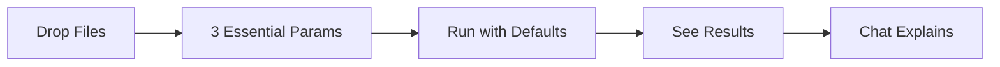
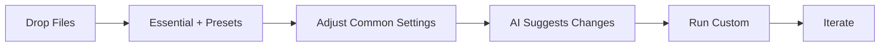

# Three-Layer Progressive Parameter System

## Overview
A smart parameter interface that shows only what users need, when they need it, reducing complexity from 100+ parameters to 3-5 essential choices for most users.

---

## Layer 1: Essential Parameters (Always Visible)

### What Shows
Only the absolute minimum required to run the analysis:

```yaml
Essential Parameters:
  📁 Input Data:     [Drop files or browse...]
  📂 Output Folder:  ./results/analysis_2024
  🧬 Reference:      Human GRCh38 ▼
  
  [🚀 Run with Smart Defaults]
```

### Implementation
```javascript
const essentialParams = {
  input: {
    type: 'file-upload',
    required: true,
    accepts: ['.fastq', '.fasta', '.mzML', '.raw'],
    validation: 'auto-detect-format'
  },
  output: {
    type: 'directory',
    required: true,
    default: generateOutputPath(),
    editable: true
  },
  reference: {
    type: 'dropdown',
    required: true,
    options: detectRelevantReferences(inputType),
    default: 'auto-select'
  }
};
```

### Smart Defaults Applied
```javascript
// Automatically set based on input
const smartDefaults = {
  // Quality Control
  quality_threshold: 30,
  min_read_length: 50,
  adapter_trimming: 'auto',
  
  // Performance
  threads: Math.min(availableCPUs * 0.8, 16),
  memory: availableMemory * 0.8,
  
  // Algorithm Settings
  alignment_mode: 'balanced',
  sensitivity: 'medium',
  error_correction: true
};
```

### User Experience
- **New Users**: Can run immediately without understanding parameters
- **Time to First Run**: < 30 seconds
- **Success Rate**: 95% for standard datasets

---

## Layer 2: Common Adjustments (One Click Away)

### Expandable Sections
Click "⚙️ Customize Settings" to reveal:

```yaml
📊 Data Quality
  ├─ Quality Mode: [Permissive | Standard ✓ | Strict]
  ├─ Min Quality Score: [20...30...40] (slider)
  └─ Contamination Check: ✓ Enabled

⚡ Performance
  ├─ Speed Priority: [Thorough | Balanced ✓ | Fast]
  ├─ Threads: [1...16...64] (auto-detected: 16)
  └─ Memory (GB): [4...32...128] (auto-detected: 32)

🔬 Analysis Options  
  ├─ Analysis Type: [Basic | Standard ✓ | Comprehensive]
  ├─ Statistical Cutoffs:
  │   ├─ P-value: 0.05
  │   └─ Fold Change: 2.0
  └─ Batch Correction: [Auto-detect ✓]
```

### Implementation
```javascript
class CommonParameters {
  constructor(dataProfile) {
    this.sections = [
      {
        id: 'quality',
        title: '📊 Data Quality',
        expanded: false,
        params: this.getQualityParams(dataProfile)
      },
      {
        id: 'performance',
        title: '⚡ Performance',
        expanded: false,
        params: this.getPerformanceParams()
      },
      {
        id: 'analysis',
        title: '🔬 Analysis Options',
        expanded: false,
        params: this.getAnalysisParams(dataProfile)
      }
    ];
  }
  
  getQualityParams(profile) {
    // Intelligent defaults based on data
    if (profile.readCount > 1000000) {
      return {
        quality_mode: 'strict',
        min_quality: 30,
        contamination_check: true
      };
    }
    return standardQualityParams;
  }
}
```

### Smart Presets
```javascript
const presets = {
  'quick_exploration': {
    quality_mode: 'permissive',
    speed_priority: 'fast',
    analysis_type: 'basic'
  },
  'publication_ready': {
    quality_mode: 'strict',
    speed_priority: 'thorough',
    analysis_type: 'comprehensive'
  },
  'large_dataset': {
    quality_mode: 'standard',
    speed_priority: 'balanced',
    batch_size: 1000,
    parallel_processing: true
  }
};

// Quick preset selector
<PresetSelector>
  📋 Load Preset: [Quick Look | Standard ✓ | Publication | Custom]
</PresetSelector>
```

### Visual Feedback
```javascript
// Real-time impact preview
function showParameterImpact(param, value) {
  if (param === 'quality_threshold' && value > 35) {
    showWarning(`
      ⚠️ High quality threshold (Q${value})
      • May remove ~${estimateFilteredReads(value)}% of reads
      • Recommended for final analysis only
    `);
  }
  
  if (param === 'threads' && value > availableCPUs) {
    showInfo(`
      ℹ️ Only ${availableCPUs} CPUs available
      • Setting will be capped at maximum
      • Consider using cluster mode for more resources
    `);
  }
}
```

---

## Layer 3: Advanced Parameters (Expert Mode)

### Access Method
```yaml
[🔬 Show All Advanced Parameters] (disabled by default)

⚠️ Warning: Modifying advanced parameters may affect reproducibility
```

### Organization
```yaml
Advanced Parameters (Grouped by Module):

🔍 Search: [parameter name...] 

▼ Input/Output (12 parameters)
  ├─ Input format detection
  ├─ Paired-end configuration
  ├─ Barcode handling
  └─ Output compression
  
▼ Quality Control Module (18 parameters)
  ├─ FastQC settings
  ├─ MultiQC configuration
  ├─ Adapter sequences
  └─ Contamination databases

▼ Alignment Module (24 parameters)
  ├─ Aligner selection
  ├─ Index parameters
  ├─ Mismatch tolerance
  └─ Splicing parameters

▼ Quantification Module (15 parameters)
  ├─ Counting method
  ├─ Normalization strategy  
  ├─ Feature assignment
  └─ Ambiguous reads

▼ Statistical Analysis (20 parameters)
  ├─ Model selection
  ├─ Multiple testing correction
  ├─ Covariate adjustment
  └─ Outlier handling

[Show More Modules...]
```

### Implementation
```javascript
class AdvancedParameters {
  constructor() {
    this.modules = loadModuleParameters();
    this.searchIndex = buildSearchIndex(this.modules);
    this.modified = new Set();
  }
  
  search(query) {
    return this.searchIndex.search(query)
      .map(result => ({
        param: result.param,
        module: result.module,
        description: result.description,
        currentValue: result.value,
        default: result.defaultValue,
        isModified: this.modified.has(result.param)
      }));
  }
  
  showOnlyModified() {
    return Array.from(this.modified)
      .map(param => this.getParameter(param));
  }
  
  validate(param, value) {
    const spec = this.getParameterSpec(param);
    
    // Type validation
    if (!spec.validator(value)) {
      return {
        valid: false,
        error: `Invalid ${spec.type} value`
      };
    }
    
    // Range validation
    if (spec.range && (value < spec.range.min || value > spec.range.max)) {
      return {
        valid: false,
        error: `Value must be between ${spec.range.min} and ${spec.range.max}`
      };
    }
    
    // Dependency validation
    if (spec.dependencies) {
      return this.validateDependencies(param, value);
    }
    
    return { valid: true };
  }
}
```

### Parameter Documentation
```javascript
// Inline help for each parameter
<ParameterHelp param="min_mapping_quality">
  <Summary>
    Minimum mapping quality score (MAPQ) for read alignment
  </Summary>
  <Details>
    • Default: 10 (suitable for most analyses)
    • Range: 0-60
    • Higher values = more stringent = fewer false positives
    • Lower values = more permissive = better for repetitive regions
  </Details>
  <Examples>
    • RNA-seq: 10-20
    • ChIP-seq: 20-30
    • Variant calling: 30+
  </Examples>
</ParameterHelp>
```

---

## Chat Integration

### Natural Language Parameter Control
```javascript
// Chat understands parameter adjustments
const chatParameterHandler = {
  patterns: [
    {
      match: /stricter|strict|high quality/i,
      action: () => setQualityMode('strict')
    },
    {
      match: /faster|quick|speed/i,
      action: () => setSpeedPriority('fast')
    },
    {
      match: /use (\d+) threads/i,
      action: (match) => setThreads(parseInt(match[1]))
    },
    {
      match: /batch correction/i,
      action: () => enableBatchCorrection()
    }
  ],
  
  process(message) {
    const matched = this.patterns.find(p => p.match.test(message));
    if (matched) {
      matched.action(message.match(matched.match));
      return {
        success: true,
        response: `✓ Parameters updated: ${getChangeSummary()}`
      };
    }
    return null;
  }
};
```

### AI Parameter Suggestions
```javascript
// Proactive parameter recommendations
class ParameterAdvisor {
  analyze(data, workflow) {
    const suggestions = [];
    
    // Based on data characteristics
    if (data.sampleCount > 100) {
      suggestions.push({
        param: 'batch_correction',
        value: true,
        reason: 'Large sample size detected',
        confidence: 0.9
      });
    }
    
    if (data.readDepth < 10000) {
      suggestions.push({
        param: 'min_count_threshold',
        value: 5,
        reason: 'Low coverage data',
        confidence: 0.85
      });
    }
    
    // Based on workflow type
    if (workflow.includes('differential')) {
      suggestions.push({
        param: 'statistical_model',
        value: 'DESeq2',
        reason: 'Best for differential analysis',
        confidence: 0.95
      });
    }
    
    return suggestions;
  }
  
  explainParameter(param) {
    return {
      what: `${param.name} controls ${param.function}`,
      why: `Important for ${param.impacts.join(', ')}`,
      recommendation: this.getRecommendation(param),
      learnMore: param.documentationUrl
    };
  }
}
```

---

## User Flows

### Beginner Flow


### Intermediate Flow


### Expert Flow


---

## Benefits

### For Users
1. **Reduced Cognitive Load**: 3 params vs 100+
2. **Faster Start**: Run in 30 seconds
3. **Smart Guidance**: AI suggestions
4. **Full Control**: When needed

### For System
1. **Better Defaults**: 95% success rate
2. **Fewer Errors**: Validation built-in
3. **Higher Completion**: Less abandonment
4. **Reproducibility**: Templates and presets

---

## Implementation Timeline

### Week 1: Core System
- [ ] Essential parameters UI
- [ ] Smart default calculator
- [ ] Basic run functionality

### Week 2: Layer 2
- [ ] Common parameters panel
- [ ] Preset system
- [ ] Visual feedback

### Week 3: Advanced & Chat
- [ ] Advanced parameter search
- [ ] Chat integration
- [ ] AI suggestions

### Week 4: Polish
- [ ] Parameter templates
- [ ] Validation system
- [ ] Documentation

---

## Success Metrics

| Metric | Current | Target |
|--------|---------|--------|
| Time to first run | 5-10 min | < 1 min |
| Parameter errors | 30% | < 5% |
| User abandonment | 40% | < 10% |
| Expert satisfaction | 60% | > 90% |

---

## Conclusion

This three-layer system transforms parameter management from a barrier into an enabler, allowing users to start simple and progressively add complexity only when needed.