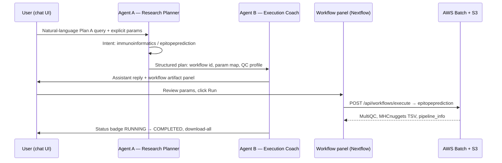

# BioMate UI scenario — Plan A epitopeprediction (two-agent information flow)

**Track:** ANDV Plan A — in silico class I epitope landscape (vaccine / immunogen design).  
**Primary workflow:** `nfcore/epitopeprediction/main.nf` (Galaxy id **12700**).  
**Frozen evidence run:** `research/anti-virus/runs/plan_a_epitope_a44876b7_s3_mirror/` (810 peptide–allele rows, MHCnuggets).

This document is the **product design** for how information moves from a natural-language user query through BioMate’s two internal agents into an executable workflow plan and monitored run. It mirrors the Cryo-EM stepwise E2E narrative (`frontend/e2e/cryoem-stepwise-and-output.e2e.ts`).

---

## Persona

Vaccine / immunoinformatics lead on **Plan A**: needs a reproducible MHC class I score table for a defined GP segment before expanding alleles or writing the manuscript.

---

## Designed user query (natural language)

```text
I'm on the ANDV Plan A vaccine immunoinformatics track. We need class I epitope binding scores
for our ninety-residue glycoprotein benchmark segment (PLAN_A_SMOKE_GP) before we expand the HLA panel.

Please run nf-core epitopeprediction with:
- input = s3://biomate-nextflow-work/inputs/andv_campaign/plan_a_epitope_samplesheet/samplesheet.csv
- tools = mhcnuggets
- genome_reference = grch37
- min_peptide_length_classI = 8
- max_peptide_length_classI = 12

The samplesheet lists HLA-A*02:01 and HLA-B*07:02. Use profile docker on AWS Batch.
All parameters are explicit — show the workflow card so I can Run from the panel.
```

**Samplesheet row (for audit):** `research/anti-virus/runs/plan_a_epitope_samplesheet_template/samplesheet_s3_batch.csv`

---

## Two-agent information flow

BioMate splits **planning** and **execution coaching** across two cooperating agents. The user sees one chat thread; the handoffs are internal.



### Agent A — Research Planner (what it must produce)

| Output | Content |
|--------|---------|
| **Intent label** | Plan A / vaccine / epitope prediction |
| **Workflow match** | `epitopeprediction` or `nf-core/epitopeprediction` |
| **Param extraction** | `input` (S3 samplesheet), `tools`, `genome_reference`, peptide length bounds |
| **Compute hint** | `profile: docker`, executor `awsbatch` (server-side when `NEXTFLOW_USE_AWS=true`) |
| **Risk notes** | Samplesheet `filename` column must be absolute `s3://`; sparse-checkout on server clone |

Agent A does **not** submit the job; it prepares the card and prefill map for Agent B and the UI.

### Agent B — Execution Coach (what it must produce)

| Output | Content |
|--------|---------|
| **Workflow card** | `[data-testid="button-run-workflow-panel"]` visible |
| **QC / prereq checklist** | Samplesheet reachable, required params non-empty |
| **Run guidance** | Short confirmation that Batch will stage FASTA from samplesheet |
| **Post-run narrative** | Where merged TSV and MultiQC live; no immunogenicity claims |

After Run, Agent B monitors `workflow-overall-status-badge` and surfaces completion banner + per-step outputs.

---

## Expected UI sequence (monitoring checklist)

| Step | User-visible signal | Selector / hint |
|------|---------------------|-----------------|
| 1 | Thinking / analysis | `chat-response-pending`, “Analyzing request” |
| 2 | Planner reply cites epitopeprediction / MHCnuggets | Latest `[data-is-latest-assistant="true"]` |
| 3 | Workflow artifact | `workflow-artifact-panel` |
| 4 | Param fields prefilled | `#input`, `#tools`, `#genome_reference` (names per schema) |
| 5 | Run | `button-run-workflow-panel` → `POST` `/api/workflows/execute` |
| 6 | Running | `workflow-overall-status-badge` **RUNNING** |
| 7 | Terminal | **COMPLETED** + `workflow-completion-banner` |
| 8 | Outputs | MultiQC HTML, `*_predictions.tsv` / merged table paths in step list |

---

## CLI parity (engineering reference)

Scripted submit (no UI): `research/anti-virus/scripts/run_plan_a_epitopeprediction_batch.py`  
Parameters must match the UI prefill for audit equivalence.

---

## Automated UI test (Playwright)

| File | Test IDs |
|------|----------|
| `frontend/e2e/plan-a-epitope-stepwise.e2e.ts` | PA-1 … PA-5 |

```bash
cd frontend
BIOMATE_URL=https://your-biomate.example.com \
E2E_TEST_TOKEN=<matches server> \
npx playwright test e2e/plan-a-epitope-stepwise.e2e.ts --project chromium
```

Screenshots: `frontend/e2e/screenshots/plan-a-epitope/`
