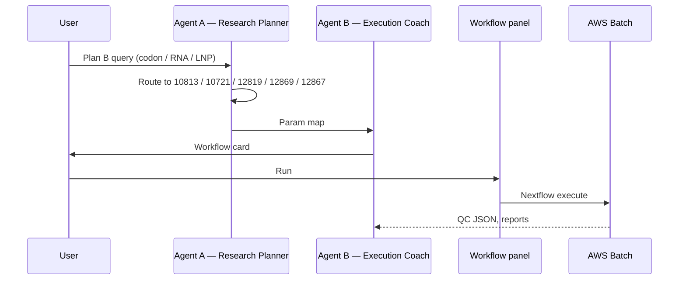

# BioMate UI scenario — Plan B mRNA-LNP (two-agent information flow)

**Track:** ANDV Plan B — mRNA construct optimization, RNA structure, mRNA QC, LNP formulation, NP PK modeling.  
**Implementation plan:** `research/anti-virus/ANDV_VACCINE_PLAN_B_mRNA_LNP_IMPLEMENTATION.md`  
**Smoke helper (print-only):** `research/anti-virus/scripts/run_plan_b_codon_lnp_smoke.sh`  
**Test report:** `research/anti-virus/runs/plan_b_test_report_20260519.md`

Phase 1 epitope discovery **reuses Plan A** (`nf-core/epitopeprediction`, id **12700**). This document covers Plan B–specific workflows only.

---

## Persona

Synthetic biology / vaccine platform lead optimizing an mRNA-LNP candidate: codon usage for expression, RNA secondary structure, integrated mRNA validation, formulation sweep, optional NP PK narrative.

---

## Registry workflows (Plan B in silico)

| Id | Step | Nextflow path |
|----|------|----------------|
| 10813 | Codon optimization | `nextflow_nfcore/subworkflows/synthetic_biology/optimize_codons_for_heterologous_expression/main.nf` |
| 10721 | RNA 2D structure | `nextflow_nfcore/subworkflows/microbiology/predict_rna_secondary_structure/main.nf` |
| 12819 | P0 mRNA validation | `nextflow_nfcore/subworkflows/drug_discovery/p0_mrna_validation/main.nf` |
| 12869 | LNP formulation | `nextflow_nfcore/subworkflows/drug_discovery/lnp_formulation_optimization/main.nf` |
| 12867 | NP PK / biodistribution | `nextflow_nfcore/subworkflows/pharmacology/nanoparticle_pk_biodistribution/main.nf` |

---

## Two-agent information flow

Same split as Plan A and inhibitor tracks:

**Agent A — Research Planner** maps natural language to the workflow above, extracts sequences / GenBank ids / S3 `outdir`, and hands off a param map.

**Agent B — Execution Coach** renders the card, validates prereqs, runs on Batch (or local docker for smoke), and reports terminal status + artifact paths.



---

## Designed query — Step 1 (codon / 10813)

```text
ANDV Plan B mRNA track — optimize codons for heterologous expression.
Use workflow optimize_codons_for_heterologous_expression (registry id 10813).
target_sequence = ATGAGTAAAGGAGAAGAACTTTTCACTGGAGTTGTCCCAATTCTTGTTGAATTAGATGGTGATGTTAATGGGCACAAATTTTCTGTCAGTGGAGAGGGTGAAGGTGATGCAACATACGGAAAACTTACCCTTAAATTTATTTGCACTACTGGAAAACTACCTGTTCCATGG
outdir = s3://biomate-nextflow-work/nextflow/outputs/plan_b_e2e/codon/
host_codon_usage = human expression defaults
Show the workflow card so I can Run from the panel.
```

---

## Expected UI sequence

| Step | Signal |
|------|--------|
| 1 | Assistant mentions codon / mRNA / synthetic biology |
| 2 | `workflow-artifact-panel` + `button-run-workflow-panel` |
| 3 | Advanced settings: `target_sequence`, `outdir`, optional `host_codon_usage` |
| 4 | Terminal badge COMPLETED or FAILED |
| 5 | Outputs / download when COMPLETED |

---

## Automated UI tests (Playwright)

| File | Test IDs | Status |
|------|----------|--------|
| `frontend/e2e/plan-b-codon-stepwise.e2e.ts` | PB-1 … PB-5 | **Added** — run against live stack |

```bash
cd frontend
PATH=/usr/bin:/bin:$PATH unset PLAYWRIGHT_BROWSERS_PATH
export PW_OUTPUT_DIR=/tmp/pw-plan-b-$$
export BIOMATE_URL=http://localhost:5000
export E2E_TEST_TOKEN=biomate-e2e-bypass-token-dev-only
npx playwright test e2e/plan-b-codon-stepwise.e2e.ts --project chromium
```

Screenshots: `frontend/e2e/screenshots/plan-b-codon/`
Audit: `plan-b-suite-audit.json`

---

## CLI / API parity

- Smoke: `bash research/anti-virus/scripts/run_plan_b_codon_lnp_smoke.sh` (prints examples only).
- API: `POST /api/ai_assistant/generate_workflow` with `request_text` (not `query`) routes codon intent to **10813** path.
- Execute: `POST /api/nextflow/execute` with `nextflow_path` and parameters per smoke script.

---

## Explicit non-goals

GMP manufacturing, mouse immunogenicity, real-time stability at scale — wet lab / CRO; out of BioMate in silico scope for Plan B.
