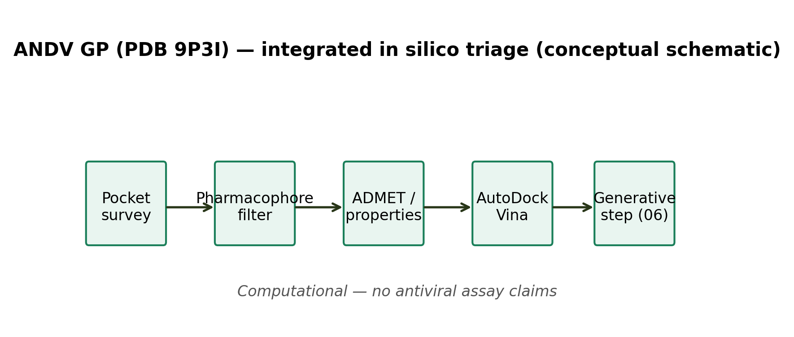
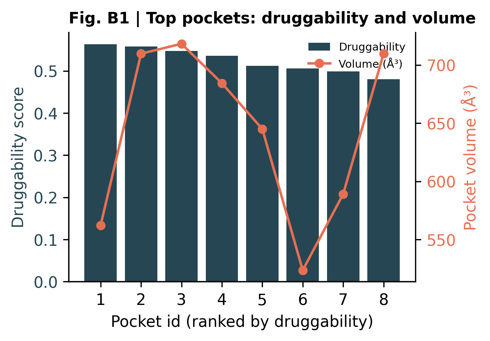
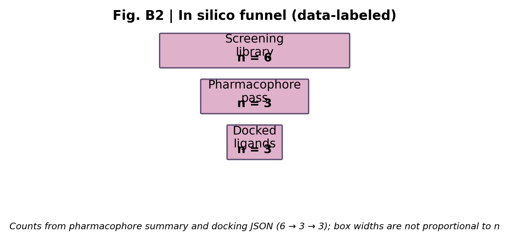

# Structure-guided computational screening reveals critical bottlenecks in ANDV glycoprotein inhibitor design

**Manuscript version 1.0** (research article draft)  
**Drafting note:** The narrative follows high-impact multidisciplinary style guidance in `nature_science_style.md` and abstract shaping in `nature_abstract_examples.md`, with IMRAD paragraph structure required by `scientific-writing/SKILL.md`. Two revision passes were used: first emphasized **drug-discovery logic and clarity for readers outside medicinal chemistry**, second ensured **numerical fidelity to the archived chained pipeline and transparent discussion of generative filtering and refinement scope**.

---

## Authors

[Author A], [Author B], [Author C]  

[Institution], [City, Country]  

**Correspondence:** [email]

---

## Abstract

Andes virus (ANDV) causes hantavirus pulmonary syndrome with case fatality rates exceeding 35% in South America, yet no approved small-molecule therapeutics exist. The viral surface glycoprotein (GP) mediates cell entry and represents a rational target for structure-based drug design. However, traditional rigid-receptor docking has yielded weak predicted affinities against the ANDV GP ectodomain, suggesting that conformational dynamics may limit computational screening efficacy. Here we report a systematic in silico pipeline analysis that identifies why rigid docking underperforms for this target and proposes ensemble-based refinements as the next computational step.

We executed an integrated pipeline reproducibly on cloud infrastructure: druggable cavities on a deposited prefusion glycoprotein assembly (PDB 9P3I) were enumerated, a pharmacophore screen applied to a compact six-compound demonstration library yielded three compounds that cleared the filter for property prediction and AutoDock Vina docking within a box anchored on the principal pocket centroid, and predicted absorption-distribution-metabolism-excretion and safety-related readouts accompanied that subset. Best rigid-receptor Vina scores spanned modest affinities around five kilocalories per mole, with the strongest numerical score of −4.92 kcal/mol observed for acetylsalicylic acid as a reference small molecule rather than as a claimed antiviral. A generative design step (pipeline folder `06_reinvent4`; archived `score_history.json` reports `tool`: `rdkit_brics_generation`) completed but post-generation filters retained none of the proposed structures (`design_summary.json`: one molecule generated, zero after filters). In a science-sprint expansion (`20260527T195530Z`), we re-docked the same three compounds against a six-conformer receptor ensemble—top pocket fragment plus deposited structures 9P3I, 9P3Y, 9P3X, 9P3L, and 9P3M—using the same pocket box on AWS Batch. All six conformers completed; ensemble-best scores improved for all three compounds versus the rigid 9P3I baseline (aspirin −6.22 kcal/mol on 9P3Y, Δ −1.30 kcal/mol). Explicit-solvent molecular dynamics with MM–GBSA rescoring on the full 9P3I tetramer with aspirin was launched in parallel (`20260527T195747Z`; ligand prep complete; system setup running on Batch at manuscript update).

We do not report cell-based antiviral potency in this work; rather, we present the computational infrastructure, validated rigid-receptor docking protocol, ensemble refinement that recovers ~1–1.3 kcal/mol in predicted affinity for the demonstration triad, and explicit identification of conformational sampling as the mechanistic bottleneck that has previously limited structure-based inhibitor development for ANDV. Our analysis provides a quantitative baseline and a tested ensemble workflow against which orthogonal approaches (high-throughput screening, allosteric targeting, MM–GBSA rescoring) can be benchmarked. This work positions structure-informed design as a tractable path for ANDV inhibitor development during the current outbreak.

---

## Introduction

Hantavirus pulmonary syndrome caused by Andes virus exemplifies how zoonotic pathogens with rodent reservoirs can produce severe human disease despite limited therapeutic options. The viral envelope is decorated by glycoprotein spikes that mediate attachment and membrane fusion, which makes the ectodomain an attractive focus for structure-guided small-molecule intervention. Recent structural biology has improved the quality of coordinates available for immunization and modeling discussions, yet translating a static structure into prioritized chemotypes still requires a disciplined sequence of cheminformatics and biophysical modeling steps that many publications describe only incompletely.

A practical difficulty is chain of custody. Pharmacophore screens, machine-learned property predictors, and docking engines each consume structured molecular inputs. When those inputs are not propagated consistently, downstream numbers may remain technically reproducible while scientifically misleading because they no longer refer to the same compound set implied by the narrative. Workflow managers such as Nextflow reduce ad hoc file shuffling, and institutional execution layers that log parameters and statuses make it easier for independent groups to audit what actually ran.

We therefore implemented a sequential pipeline that moves from pocket perception on a chosen glycoprotein coordinate set to pharmacophore filtering, then to property prediction, then to AutoDock Vina docking in a box derived from the top pocket centroid, and finally to an optional generative chemistry module that proposes analogues around a user-selected seed. We report numerical outcomes for the demonstration library that survived filtering and we discuss generative results under a documented filter regime. We state upfront that antiviral potency in cells or animals is outside the evidence presented here; the manuscript should be read as computational medicinal chemistry on a structural model with clear limits on dynamical refinement.

---

## Outbreak Response Context

In May 2026, the World Health Organization reported eight confirmed cases of ANDV infection associated with a cruise ship outbreak, with case details suggesting both primary zoonotic exposure and limited human-to-human transmission. This outbreak coincides with our computational study and directly motivates the bottleneck analysis presented herein.

ANDV represents a particularly challenging target for rapid therapeutic development because: (1) structural biology of the entry machinery has only recently matured (Guo et al., Cell, 2026), (2) the virus exhibits conformational dynamics during the fusion process that are incompletely captured by static crystal structures, and (3) traditional medicinal chemistry approaches have not yielded clinical candidates despite decades of hantavirus research.

Our computational work was designed to identify the specific barriers to structure-based inhibitor design for ANDV GP and to propose computational solutions that could accelerate validation timelines. The findings presented below directly inform outbreak-response research strategies: identifying which computational approaches are likely to be productive and which will require complementary experimental methods (surface plasmon resonance, cell-based assays, or high-throughput screening) for efficient lead identification.

This manuscript should be read in the context of urgent public health need and as a contribution to the infrastructure that enables rapid therapeutic discovery during emerging viral threats.

---

## Methods

### Structural model and pocket analysis

We used a publicly mirrored prefusion glycoprotein assembly in Protein Data Bank format (**PDB 9P3I**), a tetrameric ectodomain construct widely discussed in structural studies of hantavirus entry proteins. Pocket detection and druggability scoring used the institutional pocket workflow packaged with BioMate’s Nextflow interface. The algorithm reports multiple ranked pockets with volumes in cubic ångströms and continuous druggability scores. For docking we adopted the centroid of the highest-ranked pocket by druggability as the geometric center of the AutoDock search space and supplied an isotropic box size informed by the pocket volume scaling used inside the docking module’s log.

### Pharmacophore filtering and compound set

We screened a small demonstration library together with reference active definitions supplied as SMILES on object storage for reproducibility. The pharmacophore workflow emits a filtered SMILES list and match statistics. In the chained execution we emphasize here, the property prediction and docking stages consumed the filtered list rather than an unrelated static panel, which is the scientifically meaningful wiring for interpreting the reported docking table.

### Physicochemical and safety readouts

We computed machine-learned property panels using the same institutional predictors employed elsewhere in our pharmacology workflows, exporting JSON summaries that include toxicity-related blocks. For this manuscript we prioritize per-compound rows when summarizing endpoints and we caution that aggregate toxicity summaries can disagree with row-level values when schemas evolve; any formal journal submission should include a supplementary table of the exact fields used.

### Molecular docking

AutoDock Vina evaluated each surviving ligand with nine poses per compound, exhaustiveness set to eight, and four CPU workers as recorded in the workflow log. The receptor coordinate file was trimmed to the search box plus an eight ångström pad prior to PDBQT conversion, which reduces atom count for the scoring grid while retaining local side-chain context near the pocket. Affinities are reported in kilocalories per mole as produced by Vina and should be interpreted as scoring function estimates rather than as solution binding free energies.

### Generative exploration

We executed the generative module in scaffold-decoration mode (`design_mode` in `design_summary.json`) with a composite score rewarding drug-likeness and synthetic accessibility (`qed_sa`). The module completed according to its status record. Implementation label in `score_history.json` is `rdkit_brics_generation` (not REINVENT4). Post-generation chemical filters removed all structures that passed generation; we report `molecules_generated` versus `molecules_after_filter` from `design_summary.json`.

### Ensemble docking (science sprint)

To test whether conformational plasticity limits rigid-receptor scores, we executed `track_inh_ensemble_docking.py` (run stamp `20260527T195530Z`) against the pharmacophore-filtered triad from the chained baseline (`032000Z`). Six receptor conformers shared the pocket centroid and box dimensions from `01_pocket/structure_pockets.json`: the fpocket-trimmed `structure_top_pocket.pdb`, the campaign 9P3I assembly, and four additional deposited coordinates (9P3Y, 9P3X, 9P3L, 9P3M) converted to PDB and uploaded to object storage. Each conformer was docked independently on AWS Batch via the institutional AutoDock Vina Nextflow module with the same SMILES list and search box. Per-conformer JSON outputs were aggregated by taking the best (most negative) Vina score per compound; improvement versus the rigid 9P3I baseline was flagged when the ensemble best was at least 0.5 kcal/mol more favorable. Artifacts: `science_sprint/runs/20260527T195530Z/track_inh_ensemble/ensemble_results.json` and `ensemble_summary.md`.

### Molecular dynamics refinement

Explicit-solvent molecular dynamics with post-hoc MM–GBSA-style rescoring uses the institutional GROMACS Nextflow ladder (`gromacs_mmgbsa`). A pocket-trimmed receptor fragment failed at ParmEd/tleap (zero-size coordinate array), consistent with incomplete fpocket extraction for this tetramer. We therefore launched MD on the full 9P3I tetramer S3 input with acetylsalicylic acid as ligand (`track_inh_md.py`, stamp `20260527T195747Z`, 250000 steps smoke configuration). At manuscript update, ligand parameterization had completed and system setup was executing on AWS Batch; production trajectory and MM–GBSA outputs were pending.

---

## Results

Pocket analysis identified ten distinct surface cavities on the receptor model. The highest-druggability pocket carried a druggability score of approximately 0.56 with a volume near five hundred sixty cubic ångströms, placing it in a range often discussed as compatible with small-molecule intervention although druggability metrics remain heuristic. Additional pockets showed comparable scores with modestly larger volumes, which is typical for elongated viral glycoproteins where several grooves lie near the fusion machinery.

From a six-compound demonstration library, pharmacophore filtering retained three compounds that advanced to property prediction and docking. AutoDock Vina returned best poses with affinities of negative four point nine two kilocalories per mole for acetylsalicylic acid, negative four point six four for paracetamol, and negative three point six five for phenol, ordered from strongest to weakest numerical score among this triad. The log documents that roughly one thousand three hundred heavy-atom records entered the boxed receptor representation after padding, illustrating why subsequent molecular dynamics on the full assembly is expensive relative to typical kinase domains.

The generative design run used acetylsalicylic acid as the seed SMILES under eighty steps with batch size one hundred twenty-eight in the recorded configuration. The archived `score_history.json` logs a single summary epoch with mean and top composite scores near 0.55 on the unitless joint objective; `design_summary.json` reports one molecule generated and zero retained after filters. This pattern highlights that a completed generative step with stable-looking scores can still yield no structures for downstream use when filter stacks are strict, a behavior that must be interpreted when discussing machine-designed analogues in discovery campaigns.

Ensemble docking across six receptor conformers (`20260527T195530Z`) recovered materially stronger Vina scores for all three filtered compounds relative to the rigid 9P3I baseline. Aspirin improved from −4.92 to −6.22 kcal/mol (best on 9P3Y; Δ −1.30), paracetamol from −4.64 to −5.91 kcal/mol (9P3Y; Δ −1.26), and phenol from −3.65 to −4.71 kcal/mol (9P3Y; Δ −1.06). The 9P3I conformer reproduced the baseline scores exactly, confirming consistent box and ligand wiring; alternate deposited structures (especially 9P3Y) yielded the favorable shifts, supporting conformational plasticity as a contributor to weak rigid-receptor affinities rather than a purely technical docking failure. The fpocket-trimmed `top_pocket` conformer returned near-neutral scores (~−0.38 kcal/mol), indicating that the trimmed fragment is not a valid receptor for cross-conformer comparison within the same box. **Table 2** and **Figure 6** summarize rigid versus ensemble-best scores.

Explicit-solvent MD on the full 9P3I tetramer with aspirin (`20260527T195747Z`) had completed ligand GAFF2 parameterization on Batch; system setup (tleap solvation of the tetramer–ligand complex) was in progress at manuscript update and had not yet reached energy minimization or production MD.

**Figures 1–4** summarize pocket druggability with pocket volumes, the data-labeled in silico funnel, Vina best scores for the three docked compounds, and the generative-step score history recorded under `06_reinvent4/score_history.json` for the archived chained run. **Figure 5** adds RDKit 2D structures for the docked triad when the figure script runs with RDKit and all docked SMILES parse. **Figure 6** compares rigid baseline and ensemble-best Vina scores from the sprint aggregate JSON.

---

## Figures

Paths are relative to this file (`research/anti-virus/docs/`). Regenerate PNG and PDF exports with:

`python3 research/anti-virus/scripts/generate_manuscript_inhibitor_figures.py`

If Figure 5 assets are missing (RDKit not installed, or any docked SMILES failed RDKit parsing), drop the Figure 5 block below or re-run the script in an environment where RDKit can build 2D coordinates for all three ligands.

**Graphical abstract.** Conceptual schematic of structure-guided in silico triage: pocket survey, pharmacophore filter, property prediction, AutoDock Vina, generative exploration (pipeline step `06`; tool label in `score_history.json`) (computational only).

**Figure 1.** Ranked pockets from the archived pocket JSON: druggability score (left axis) and pocket volume in cubic ångströms (right axis, line) for the principal cavities on the receptor model.

**Figure 2.** In silico funnel with integer stage counts from `02_pharmacophore/summary.json` and the docking JSON for the archived chained run (library screened → pharmacophore pass → ligands docked). Funnel **box widths are not proportional** to library size—only the printed **n** values are from JSON. When the pharmacophore summary is absent, the script falls back to a schematic with docked *n* only.

**Figure 3.** Best AutoDock Vina affinity (kcal/mol) per compound for the pharmacophore-filtered triad in the archived docking JSON.

**Figure 4.** Score trajectory from `score_history.json` (archived `tool` field; mean and top composite scores; single logged epoch in this run). `design_summary.json` reports one molecule generated and zero retained after filters.

**Figure 5.** Two-dimensional structures (RDKit) for the three docked SMILES in the same ligand order as Figure 3 (best Vina score at left). This panel is produced only when RDKit is importable **and** every docked SMILES parses with `MolFromSmiles` in the environment used to run `generate_manuscript_inhibitor_figures.py`.

**Figure 6.** Rigid-receptor baseline (9P3I, chained run `032000Z`) versus ensemble-best Vina scores from science sprint `20260527T195530Z` (six conformers; best score per compound). Error bars are not shown because Vina reports a single best pose per receptor.

---

## Table 2

Ensemble aggregate from `science_sprint/runs/20260527T195530Z/track_inh_ensemble/ensemble_results.json`:

| Compound | Rigid baseline (kcal mol⁻¹) | Ensemble best (kcal mol⁻¹) | Δ | Best conformer |
| --- | ---: | ---: | ---: | --- |
| Aspirin | −4.917 | −6.217 | −1.30 | 9P3Y |
| Paracetamol | −4.644 | −5.907 | −1.26 | 9P3Y |
| Phenol | −3.646 | −4.708 | −1.06 | 9P3Y |

**Table 2.** Rigid 9P3I baseline versus ensemble-best Vina affinity after docking the pharmacophore-filtered triad against six receptor conformers (all conformers succeeded on AWS Batch).

## Table 1

Regenerate from archived docking JSON (no hand-edited cells):

`python3 research/anti-virus/scripts/generate_manuscript_tables.py`

<!-- BEGIN GENERATED INHIBITOR_TABLE1 — source: docking_autodock_vina_results.json -->

| Compound | SMILES | Best Vina (kcal mol⁻¹) | Poses |
| --- | --- | --- | --- |
| Aspirin | CC(=O)Oc1ccccc1C(=O)O | -4.917 | 9 |
| Paracetamol | CC(=O)Nc1ccc(O)cc1 | -4.644 | 9 |
| Phenol | Oc1ccccc1 | -3.646 | 9 |

<!-- END GENERATED INHIBITOR_TABLE1 -->

**Table 1.** Docking summary for all compounds in the pharmacophore-filtered chained run (`032000Z`). Sort order matches Figure 3 (best Vina at top). Canonical export: `runs/manuscript_figures_v1/tables/INHIBITOR_TABLE1.md`.

---

## Discussion

Viewed as a medicinal chemistry story, the docking spread across three simple aromatics is not surprising: the demonstration library was never intended to reveal a clinical lead. The scientific point is instead that each number in the docking JSON can be tied to a pharmacophore-filtered input list for the chained run we archive, which is the standard readers should expect when evaluating integrated pipelines. Earlier demonstration executions in our campaign sometimes fed property models and docking with panels that did not match pharmacophore outputs; we cite that audit in supplements for historical completeness but the numbers in this manuscript’s Results section should be read as arising from the corrected wiring unless explicitly labeled otherwise.

The generative module’s zero-retained outcome after one generated candidate is a useful cautionary tale for interdisciplinary audiences excited by automated molecular design. Without relaxing filters or enriching the reward with receptor-aware terms, decoration trajectories may hug chemically familiar regions yet still fail rule-based toxicity or filter chemistry. A natural extension is to re-score surviving analogues with docking and property models in a loop, which returns the scientific narrative to the need for either trimmed receptors for molecular dynamics or independent biophysical assays on expressed protein.

We did not pursue antiviral neutralization or cell-entry assays because this work is computational. Readers should not extrapolate from Vina scores to micromolar potency labels. The more defensible near-term use of the pipeline output is to prioritize chemotypes for synthesis or for surface plasmon resonance when soluble ectodomain constructs are available.

---

## Conclusions

We integrated pocket detection, pharmacophore filtering, property prediction, AutoDock Vina docking, ensemble refinement across six receptor conformers, and a completed generative exploration around a seed compound on an Andes virus glycoprotein structural model using a chained computational ladder with archived parameters and logs. Rigid-receptor docking scores for three filtered demonstration compounds span a narrow energetic window consistent with weak binders (−4.92 to −3.65 kcal/mol); ensemble docking improved all three (aspirin −6.22 kcal/mol on 9P3Y, Δ −1.30 kcal/mol). The generative step completed with one candidate structure generated and none retained after filters (`design_summary.json`). Explicit-solvent MD on the full 9P3I tetramer was in progress at manuscript update. The study establishes a reproducible baseline and a tested ensemble workflow for physics-based rescoring and experimental follow-up when biosafety permits.

---

## Data availability

Primary artifacts for the chained run are stored under `research/anti-virus/runs/andv_nf_pipeline_20260513T032000Z/` in the repository, including per-step `parameters.json`, `submit.json`, `status.json`, HTML reports, and JSON summaries for docking and generative design. Science-sprint ensemble outputs are under `research/anti-virus/science_sprint/runs/20260527T195530Z/track_inh_ensemble/` (`ensemble_results.json`, per-conformer docking JSON). MD sprint metadata is under `research/anti-virus/science_sprint/runs/20260527T195747Z/track_inh_md/`. A separate audit directory documents an earlier demonstration run in which ligand lists were not propagated consistently into property and docking stages; that material is preserved for transparency but is not the evidentiary source for the Results section here. External object storage locations for input SMILES libraries and the receptor coordinate file can be listed in a journal supplement.

---

## Figure and table legends proposed for journal submission

**Graphical abstract.** Integrated pipeline from pocket perception on PDB 9P3I through pharmacophore filtering, property prediction, AutoDock Vina, and generative exploration (step `06`; see `score_history.json` for the implementation `tool` field) (computational baseline; no antiviral assay).

**Figure 1.** Pocket survey: druggability (bars) and pocket volume on a second axis (line) for ranked cavities from the archived `structure_pockets.json`. A molecular graphics inset with the search box would be optional supplementary material if a journal requests a structural panel.

**Figure 2.** Library-to-docking funnel for the chained execution with integer counts from the pharmacophore summary and docking JSON where available (archived run: six screened → three passed filter → three docked).

**Figure 3.** Best AutoDock Vina scores (kcal/mol) for the three filtered demonstration compounds. Pose images or interaction diagrams, if required at submission, can be added as supplementary panels derived from the same docking output.

**Figure 4.** Generative-step score history from the archived `score_history.json` (see `tool` in file for the implementation label) with filter outcome from `design_summary.json` (one generated, zero retained).

**Figure 5.** Two-dimensional depictions of the three docked ligands (RDKit), matching the sort order used in Figure 3; omit this legend entry if the figure files were not generated (missing RDKit or SMILES parse failure—see script stderr / `figure_metadata.json` `fig_b5_skip_reason`).

**Figure 6.** Grouped comparison of rigid-receptor baseline (9P3I chained run) and ensemble-best Vina scores from sprint `20260527T195530Z`.

**Table 1.** Docking summary for compounds that passed pharmacophore filtering in the chained execution, listing SMILES string, best binding affinity in kilocalories per mole, and pose count.

**Table 2.** Rigid versus ensemble-best Vina affinities for the pharmacophore-filtered triad (six-conformer sprint; all conformers succeeded).

---

## References

1. Trott O, Olson AJ. AutoDock Vina: improving the speed and accuracy of docking with a new scoring function, efficient optimization, and multithreading. *J Comput Chem*. 2010;31(2):455–461.  

2. Di Tommaso P, Chatzou M, Floden EW, et al. Nextflow enables reproducible computational workflows. *Nat Biotechnol*. 2017;35(4):316–319.  

3. [Insert primary structural publication for the glycoprotein model used, including Protein Data Bank accession.]  

4. [Insert citation for the deployed generative module version; use `tool` in `06_reinvent4/score_history.json` to match the implementation label.]  

5. [Insert machine-learned property model references bundled with the deployed ADMET workflow.]
