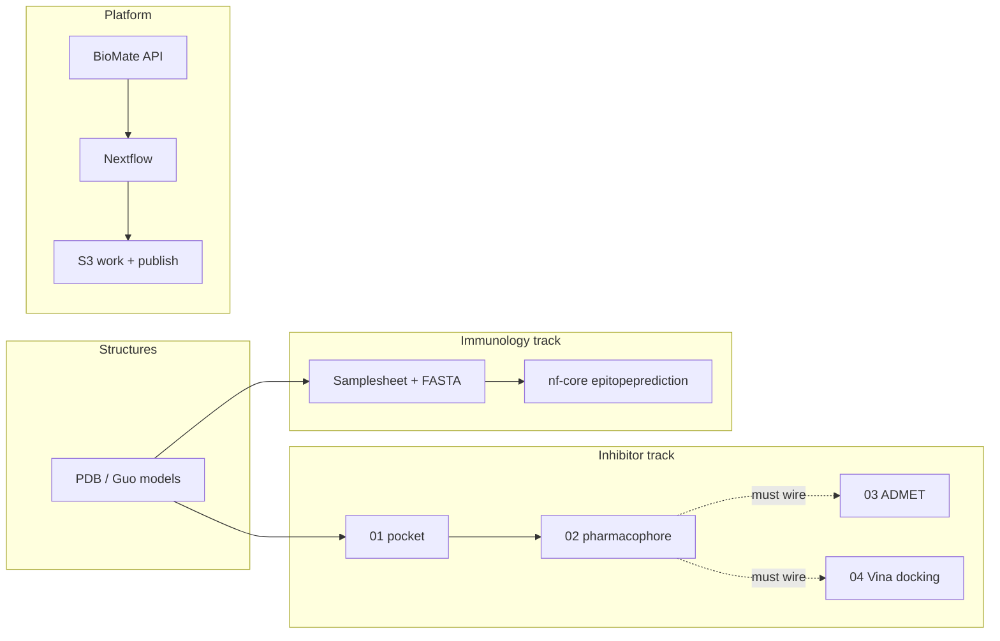

# Preprint manuscript — ANDV in silico campaign (bioRxiv-oriented draft)

**Target venue:** [bioRxiv](https://www.biorxiv.org/) (cold Spring Harbor Laboratory preprint server).  
**Suggested subject taxonomy:** Bioinformatics / Computational biology; Virology (select closest match at submission).  
**Article framing:** **Resource / Methods** — reproducible multi-workflow orchestration for structure-to-triage and epitope prediction, with explicit limits of the frozen demo runs documented in-repo.

**Status:** Draft for author fill-in. **Do not deposit** until (i) ligand chain-of-custody is either re-run or explicitly scoped in Abstract/Methods, and (ii) toxicity JSON inconsistency is resolved or bounded in text.

**Split drafts (same campaign, narrower scope):**

- **Plan A vaccine / epitope track:** `MANUSCRIPT_DRAFT_PLAN_A_VACCINE.md` (main text + §8 corpus / computational grounding without wet lab).  
- **Inhibitor track:** `MANUSCRIPT_DRAFT_ANDV_INHIBITOR.md` (main text + §9 experimental validation tiers and computational proxies).

---

## Title (preprint)

**Recommended:**  
**Reproducible cloud workflows for Andes virus targets: integrated pocket detection, pharmacophore screening, ADMET, docking, and nf-core epitope prediction**

**Short title (running head):**  
ANDV in silico workflows on Nextflow / AWS Batch

---

## Authors and affiliations

| Author | ORCID | Affiliation | Email |
|--------|-------|-------------|-------|
| [Name] | [0000-…] | [Dept, Institution, City, Country] | [ ] |
| … | … | … | … |

**Corresponding author:** [name, email]

---

## Keywords (5–8)

Andes virus; alphavirus; Nextflow; nf-core; molecular docking; pharmacophore; ADMET; epitope prediction; AWS Batch; reproducibility

---

## Abstract (single paragraph; target 150–250 words)

Alphaviruses such as **Andes virus (ANDV)** motivate parallel **small-molecule** and **immunoinformatics** discovery tracks grounded in structural models. Here we describe a **computational resource**: a set of **Nextflow** workflows orchestrated via **BioMate**, spanning **pocket characterization**, **pharmacophore screening**, **ADMET** profiling, **AutoDock Vina** docking, and **nf-core/epitopeprediction** on **AWS Batch** with **S3-backed** work directories and published outputs. We provide **frozen run manifests**, per-step **execution identifiers**, and **HTML plus machine-readable reports** (JSON summaries, pose coordinates, samplesheet-driven epitope inputs). We explicitly document **orchestration caveats** for a reference demo execution in which **ADMET and docking consumed a fixed small-molecule panel** rather than the **pharmacophore-filtered** list from the preceding step, and we flag an **internal inconsistency** in one toxicity JSON aggregation relative to per-compound rows—issues that must be resolved or disclosed before any **therapeutic ranking** claim. Overall, this preprint contributes a **transparent workflow bundle** and **deployment notes** (container profiles, S3 samplesheet validation, Batch staging) intended to accelerate **reproducible** in silico triage for emergent **hantavirus / alphavirus** targets. **[Insert quantitative summaries after ligand feeds and epitope outputs are frozen for v2 of the preprint.]**

---

## Graphical abstract (for PDF panel)

**One panel, landscape orientation:** Left: cartoon or surface of viral target with pocket highlighted. Center: linear icons for pocket → pharmacophore → ADMET → Vina. Right: peptide/epitope icon feeding into nf-core logo; beneath, “Nextflow + AWS Batch + S3.” **Footline:** “Manifested runs; open audit trail.”

Export as **PDF vector** or ≥600 dpi raster; keep fonts ≥8 pt after scaling.

---

## Introduction

### Paragraph 1 — Disease and structural motivation

Andes virus (ANDV) [cite reviews / WHO PAHO as appropriate] causes hantavirus cardiopulmonary syndrome in endemic regions. Structural models of viral proteins [cite Guo et al. and PDB IDs used in this work, e.g. 9P3I] enable **structure-guided** ligand design and **rational immunogen** discussion when paired with **MHC–peptide** predictors.

### Paragraph 2 — Gap

Campaigns often accumulate **disconnected** scripts and ad hoc parameters. **Nextflow** improves portability; **nf-core** improves standardization for selected pipelines. **Gaps remain** in (i) **documented handoffs** between screening and downstream cheminformatics, and (ii) **cloud-native** execution with **auditable** artifacts suitable for preprint **resource** standards.

### Paragraph 3 — What this preprint is (and is not)

We report a **workflow integration and execution study** with **fixed demonstration parameters** for portions of the inhibitor track. We do **not** claim prospective validation of new chemical matter or vaccine immunogenicity **unless** wet-lab or orthogonal binding data are added in a revision.

**Contributions (numbered):**

1. A **four-step inhibitor-oriented pipeline** (pocket → pharmacophore → ADMET → Vina) with **per-step** Nextflow reports and JSON outputs, executed in a **manifested** configuration.
2. An **epitopeprediction** path compatible with **nf-core** conventions, including **S3-resolved** samplesheet rows and **`docker`** profile usage on **AWS Batch**.
3. **Operational documentation** for common failure modes (sparse checkout of vendored nf-core trees; Batch + biocontainer **AWS CLI** staging and **library path** requirements).
4. **Satellite workflows** (codon optimization, RNA secondary structure, LNP-oriented run) demonstrating **modular** expansion of the same API surface.

---

## Methods

### Structures and molecular inputs

- **Protein structure:** source PDB(s), deposition dates, chains retained, any curation applied before pocket detection.
- **Small-molecule libraries:** origin of pharmacophore library files (S3 URIs, compound counts, license if applicable).
- **Epitope inputs:** FASTA provenance; samplesheet schema version matching **nf-core/epitopeprediction** revision in use.

### Software and versions

Collate from each step’s **`versions.yml`** and Nextflow **`status.json`** / logs:

| Component | Version source | Notes |
|-----------|----------------|--------|
| Nextflow | `status.json` / `.nextflow.log` | Pin `NXF_VER` if relevant |
| BioMate / Galaxy API | deployment tag | Redact secrets |
| nf-core/epitopeprediction | workflow commit / `-r` tag | Record vendored path vs remote |
| AutoDock Vina / ADMET stack | module container tags | From `versions.yml` |

### Orchestration and compute

- **API:** `POST /api/nextflow/execute` (document `X-API-Key` handling as institutional practice; **do not** embed keys in the preprint PDF).
- **Executor:** `awsbatch` vs `local`; **region**; **S3 bucket** for `workDir` and `outdir`.
- **Profiles:** e.g. **`docker`** for epitopeprediction on Batch; record invalid **`aws`** profile for that pipeline to forestall reviewer confusion.

### Inhibitor pipeline steps (01–04)

Describe **intended** data flow and **actual** data flow for the frozen run cited in the Results:

- **01_pocket:** detection parameters; outputs (`structure_pockets.json`, druggability TSV, QC JSON, `structure_top_pocket.pdb` if used only as marker).
- **02_pharmacophore:** feature counts, pass threshold, outputs (`filtered_compounds.smi`, `match_report.tsv`).
- **03_admet:** models or services invoked; output JSON paths.
- **04_docking_vina:** receptor preparation, box definition (link to pocket center), exhaustiveness, CPU count, number of poses.

**Critical methods disclosure (preprint ethics):** For run **`andv_nf_pipeline_20260512T181054Z`**, state verbatim that **ADMET and docking `smiles_list` parameters did not list the pharmacophore-filtered SMILES set**; cite **`AUDIT.md`** in supplement. If you perform a **chained re-run**, replace this subsection with the new manifest and archive the old run as “demo v1” only.

### Computational-only inhibitor validation ladder

For a **wet-lab-free** revision, order claims as **computational evidence only**: pocket definition and docking boxes → pharmacophore or library triage → in silico ADMET/safety layers → AutoDock Vina poses → optional MD with MM-GBSA-class rescoring → optional generative elaboration (REINVENT4 / scaffold hopping). PK/PD, PBPK, exposure–response, and trial-simulation workflows in BioMate may appear only as **documented optional modules** with **synthetic or cited non-ANDV PK inputs**, never as substitutes for antiviral potency or clinical outcomes. Full workflow paths, registry IDs, invocation notes for steps 5–6 (GROMACS ligand on S3, REINVENT4 seed), and an explicit “no wet lab” methods paragraph are in **`research/anti-virus/docs/ANDV_INHIBITOR_INSILICO_PREPRINT_STACK.md`**.

### Epitope pipeline (nf-core/epitopeprediction)

- Samplesheet CSV columns; requirement that **`filename`** column uses **absolute `s3://`** when the samplesheet itself is on S3.
- **Tools** parameter (e.g. mhcnuggets), **reference genome** build, allele string format.
- Batch-specific **containerOptions** / staging note if reported as reproducibility guidance (generic wording acceptable: “host-provided AWS CLI inside minimal containers required `LD_LIBRARY_PATH` augmentation for zlib resolution during S3 staging”).

### Auxiliary workflows (Plan B)

Brief methods for **10813** (codon), **10721** (RNA 2D), **12869** (LNP): inputs, success definition, output prefixes under `plan_b_exec_*`.

### Statistics

State “not applicable” for this resource preprint **or** define any comparative tests if added (e.g. runtime vs local executor).

---

## Results

**Instruction:** Every quantitative sentence should cite **Table 1** or a **Figure**; every workflow claim should cite **Supplement S1** (manifest + redacted parameters).

### Pocket detection (01)

- Top pocket ID, druggability score, volume, QC tier.
- **Figure:** structure + pocket surface (Fig 3).

### Pharmacophore screen (02)

- Library size, pass count, pass rate, example compound IDs.
- **Figure:** pharmacophore features schematic (optional) or table.

### ADMET (03)

- Per-compound table of key endpoints.
- **If toxicity JSON remains inconsistent:** present **per-compound** rows only, and add a boxed note that aggregate block is **excluded pending schema fix**—reviewers will accept transparency.

### Docking (04)

- Best affinity per ligand; correlation narrative only if ligand set is scientifically unified.
- **Figure:** poses (Fig 5).

### Epitope prediction

- Summarize after freezing one **completed** nf-core run bundle (scores, allele coverage).

### Auxiliary workflows

- One short paragraph each with runtime and output pointer.

---

## Discussion

### Integration and chain of custody

Discuss **why** unchained ADMET/docking still validates **individual** workflow modules but **does not** validate **end-to-end** ligand triage. Use **diagram** Fig 2 with solid vs dashed edges.

### Comparison to prior art

- Other integrated platforms (Snakemake + X; Galaxy public servers; commercial ELNs).
- nf-core ecosystem advantages (schema validation, containers).

### Limitations

- In silico-only; **no** animal or human data here.
- **Epitope tool** limitations (allele coverage, training data bias).
- **Docking**: rigid receptor approximations, scoring function limits.

### Future work

- Chained re-execution; **orthogonal** affinity assays; **HLA** typing–aware epitope ranking for relevant populations.

---

## Data and code availability

**Minimum for bioRxiv:**

- **Code / configs:** Public Git repository (Zenodo snapshot with DOI recommended): BioMate revision, workflow paths, `research/anti-virus/runs/**` manifests and `AUDIT.md` / `EXECUTION_REPORT.md` files as **read-only** provenance.
- **Data:** PDB IDs (RCSB); S3 bucket names may be redacted to placeholders in PDF if needed; **must** preserve enough detail for **reconstruction** (bucket layout or anonymous example).
- **Large artifacts:** Zenodo dataset DOI for HTML reports and JSON bundles if Git LFS is impractical.

**Statement template:**  
“All workflow manifests, audit notes, and draft supplementary tables are available at [URL] and archived at [Zenodo DOI]. Protein structures are from the Protein Data Bank under accession codes [IDs].”

---

## Acknowledgments

[Funding, cloud credits, colleagues, disclaimers.]

---

## Author contributions (CRediT taxonomy)

| Author | Conceptualization | Software | Validation | Writing – original draft | … |
|--------|-----------------|----------|------------|---------------------------|---|
| … | ✓ | ✓ | … | … | … |

---

## Competing interests

[None / specify commercial relationships, equity, patents.]

---

## Ethics approval

Not applicable (computational study only).

---

## Tables and figures (for main PDF)

| ID | Description |
|----|-------------|
| **Table 1** | Run registry: workflow name, `run_id`, executor, profile, duration, primary output URI or path. |
| **Figure 1** | Graphical abstract (see above). |
| **Figure 2** | Pipeline schematic (Mermaid source below → export SVG/PDF). |
| **Figure 3** | Structure + pocket + docking box. |
| **Figure 4** | ADMET heatmap / toxicity panel (after data reconciliation). |
| **Figure 5** | Docking poses + affinity chart. |
| **Figure 6** | Epitope results summary (pending). |

### Figure 2 — Mermaid (export for Fig 2)

---

## Supplementary material (ZIP / separate PDF)

| File | Contents |
|------|----------|
| **S1** | `pipeline_manifest.json`, redacted `parameters.json` per step, `AUDIT.md` |
| **S2** | Collated `versions.yml` |
| **S3** | Representative `status.json` excerpts (no API keys) |
| **S4** | Long tables (full ADMET rows, full docking table) |

---

## References (seed list — verify and expand)

1. Guo et al. [full citation for structural models used].  
2. Di Tommaso P et al., *Nat Biotechnol* — Nextflow.  
3. Ewels PA et al., *Nat Biotechnol* — nf-core.  
4. nf-core/epitopeprediction [Zenodo DOI / nf-core citation].  
5. Trott O, Olson AJ — AutoDock Vina.  
6. [ADMET or toxicity model papers actually invoked by your subworkflow modules.]

---

## bioRxiv submission checklist (internal)

- [ ] **PDF:** main text + figures embedded; **file size** within [bioRxiv limits](https://www.biorxiv.org/about/FAQ) (check current FAQ; historically on the order of tens of MB for main PDF).
- [ ] **Main text file:** often Word/LaTeX converted to PDF only; confirm current server requirements (bioRxiv has accepted PDF-only workflows at times—verify at submission).
- [ ] **Graphical abstract:** included as **last figure** or separate file per current guideline.
- [ ] **Keywords** and **taxonomy** selected at upload.
- [ ] **Funding** and **COI** completed in web form.
- [ ] **License:** CC-BY-NC-ND vs CC-BY (choose deliberately for downstream journal transfer).
- [ ] **Zenodo:** code + bulky artifacts versioned **before** posting DOI in PDF.
- [ ] **Abstract** contains **no** overstated therapeutic claim.
- [ ] **Chained re-run** OR **explicit demo scope** in Abstract + Methods + Discussion.
- [ ] **Toxicity** tables use a **single** consistent DILI source.
- [ ] All authors **approve** final PDF.

---

## Versioning note

**v0.1 (this file):** Preprint-oriented restructure; scientific numbers pending frozen chained runs.  
**v0.2 (planned):** Replace cautionary language in Abstract once ADMET/docking inputs match pharmacophore outputs and toxicity JSON is reconciled.
