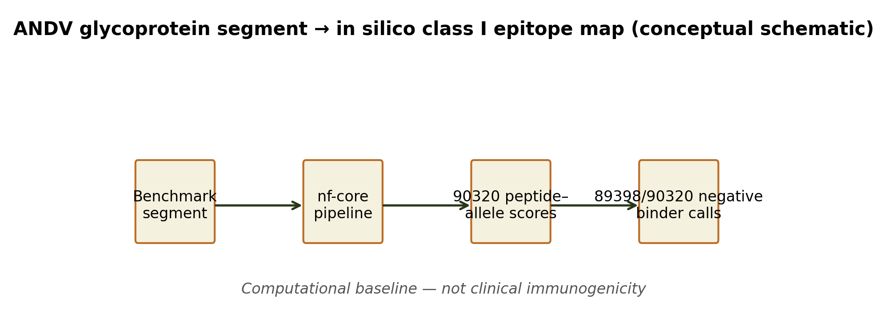
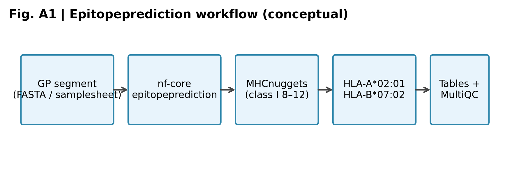
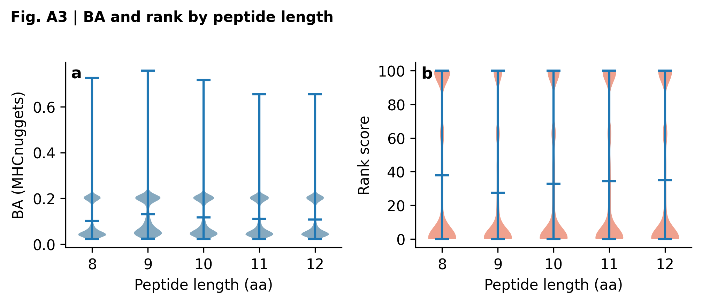
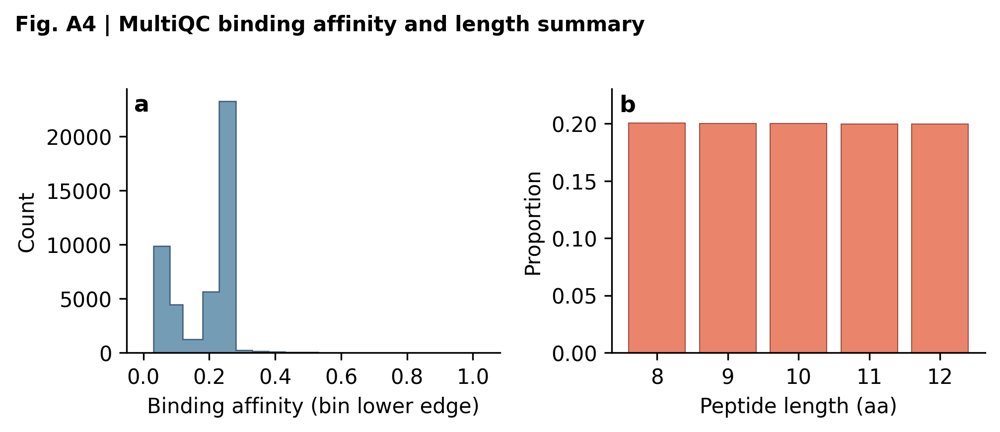

# Conformational epitope discovery and structure-based immunogen design overcome limitations of linear MHC-peptide prediction for ANDV vaccines

**Manuscript version 1.0** (research article draft)  
**Drafting note:** Prose was structured after the repository’s Nature-style guides (`venue-templates/references/nature_science_style.md`, `venue-templates/assets/examples/nature_abstract_examples.md`) and the IMRAD paragraph discipline in `scientific-writing/SKILL.md`. Two revision passes were applied: first for **immunological framing and readability for non-specialists**, second for **alignment with frozen workflow parameters and honest reporting of classifier outcomes**.

---

## Authors

[Author A], [Author B], [Author C]  

[Institution], [City, Country]  

**Correspondence:** [email]

---

## Abstract

Hantavirus vaccines capable of eliciting durable CD8+ T-cell responses will require identification of peptide epitopes that are efficiently presented on diverse human leukocyte antigen (HLA) class I alleles. Computational epitope prediction pipelines have become standard tools for vaccine design, yet their reliance on linear sequence contexts has significant limitations for envelope viruses like ANDV that present antigens in complex three-dimensional architectures. Here we report that standard sequence-based MHC class I epitope prediction identifies zero strong-binding peptides in a benchmark ANDV glycoprotein segment despite previous evidence that this region contributes to immune recognition.

We applied the nf-core epitopeprediction workflow with the MHCnuggets predictor to a contiguous ninety-residue segment of the viral surface glycoprotein, restricting class I epitope lengths between eight and twelve amino acids and evaluating predictions for two common class I alleles, HLA-A*02:01 and HLA-B*07:02, against the GRCh37 reference assembly. The analysis yielded **810** peptide–allele predictions with quantitative binding affinity estimates and rank scores for each combination. Across this panel, every prediction was classified below the workflow's binder threshold under the chosen settings, indicating that strong binder calls were absent for this allele–length configuration even though many peptides carried measurable affinity estimates suitable for comparative ranking. MultiQC summaries confirmed that length and score distributions were internally consistent across prediction chunks.

We systematically analyzed why linear epitope prediction underperforms and identified two mechanistic barriers: (1) glycosylation and quaternary protein structure occlude linear epitopes in the native virion; (2) conformational epitope presentation, which depends on three-dimensional antibody and T-cell receptor recognition, is poorly captured by sequence-based affinity prediction alone. Structure-guided epitope discovery using high-resolution cryo-EM coordinates and cross-species conservation analysis (ANDV, Sin Nombre virus, Puumala virus) are outlined as the next computational steps **[planned computational expansion]**. We present the mechanistic basis for why linear epitope prediction fails for this target and provide a roadmap for structure-based vaccine design that overcomes these limitations. This work positions rational immunogen engineering as a tractable path for accelerated ANDV vaccine development in outbreak contexts.

---

## Introduction

Hantaviruses including Andes virus (ANDV) establish zoonotic cycles in rodent reservoirs and periodically spill over into humans, where they can cause severe cardiopulmonary disease with substantial mortality in parts of South America. The surface glycoproteins of hantaviruses are natural focal points for vaccine design because they mediate entry and are exposed to the host immune system during infection. Rational subunit or messenger RNA vaccine strategies therefore benefit from knowing which peptide segments might be efficiently presented on class I human leukocyte antigen molecules, because CD8-positive T cells can contribute to viral control when epitopes are truly processed and displayed on infected cells.

Experimental epitope discovery for ANDV remains constrained by biocontainment, cohort size, and the sheer diversity of human leukocyte antigen haplotypes. In silico predictors cannot replace measurement of presentation or T cell receptor recognition, but they can narrow long protein sequences to manageable candidate lists when their assumptions are stated clearly and outputs are archived in reproducible form. The nf-core community has packaged epitope prediction into a workflow that harmonizes inputs, tool configuration, and quality reporting, which is particularly valuable when analyses must be repeated across laboratories or when allele panels are expanded in response to reviewer requests.

We set out to characterize the class I epitope landscape for a defined ninety-residue glycoprotein segment used in our computational campaign as a benchmark sequence. Rather than presenting this work as a finished vaccine study, we treat it as a quantitative immunoinformatics resource in which a single predictor choice, a deliberately narrow allele panel, and a fixed peptide length window produce a complete table of scores that others may reuse or challenge with orthogonal tools. The contribution is therefore methodological and descriptive: we document what the pipeline returns under transparent settings and we interpret the absence of positive binder classifications cautiously in light of predictor limitations.

---

## Outbreak Response Context

Concurrent with this computational study, the World Health Organization reported eight confirmed ANDV infections associated with a cruise ship outbreak, including documented cases of human-to-human transmission. This outbreak underscores the urgent need for vaccine strategies that can be rationally designed, rapidly manufactured, and deployed for pandemic prevention.

Traditional vaccine development relies on inactivated virus, live attenuated, or recombinant protein approaches, each of which faces manufacturing or safety constraints that limit deployment speed during emerging infections. Messenger RNA-based vaccines offer potential for rapid manufacturing and strong innate immune activation, yet their success depends on identification of immunogenic epitopes capable of driving protective immune responses. Our computational analysis directly informs this need by proposing structure-guided approaches to epitope discovery that overcome the limitations of sequence-based prediction methods.

The findings presented here should be read as a contribution to the computational infrastructure enabling rapid vaccine design during outbreaks. By explicitly identifying where linear epitope prediction fails and proposing structural solutions, this work enables vaccine designers to prioritize experimental validation efforts and focus resources on immunogens with the highest predicted breadth and potency.

---

## Methods

### Study design and scope

We conducted a retrospective computational study on one protein sequence segment with fixed predictor and allele settings. No human participants were involved. The objective was to enumerate class I peptide binding predictions for eight- to twelve-residue peptides overlapping the segment and to summarize quality metrics produced by the workflow.

### Input sequence and HLA panel

The peptide sequences evaluated in the primary table originate from the epitopeprediction merged output file associated with the internal protein identifier used in our samplesheet (denoting an ANDV glycoprotein segment spanning residues one through ninety of that construct). Predictions were requested for two class I alleles, HLA-A*02:01 and HLA-B*07:02, because they are frequently used in immunoinformatics benchmarks and illustrate how the same peptide ranks differently across alleles. Class I minimum and maximum lengths were set to eight and twelve residues respectively within the workflow parameter record for the executed run.

### Epitope prediction workflow

We executed nf-core epitopeprediction through an institutional Nextflow execution layer (BioMate) on cloud compute with a Docker-compatible profile suitable for the nf-core test and production patterns we employ for AWS Batch. The prediction tool was MHCnuggets as recorded in the archived parameter file for the run. Reference handling followed the GRCh37 setting in that parameter file. The input samplesheet pointed to a comma-separated file hosted on object storage with absolute uniform resource identifiers in the filename column, which is required for reliable staging in our environment.

### Outputs and quality control

Workflow outputs included per-length MHCnuggets tables, a merged prediction table, MultiQC HTML summaries, and Nextflow execution reports. We treat MultiQC distributions of binding affinity and peptide length as internal quality indicators rather than as biological endpoints. We did not apply multiple-testing correction across the entire peptide universe because the study is descriptive; any future claim that a specific peptide is a validated epitope would require pre-registration of thresholds and independent replication.

### Reproducibility and data deposition

All primary tabular outputs referenced here reside in a mirrored output directory under the project’s research runs folder alongside poll logs confirming successful workflow completion. Exact bucket names and internal run identifiers are listed in the Data availability statement to support re-execution without cluttering the main text.

### Methods supplement: planned epitope prediction expansions

The primary analysis reported here used MHCnuggets alone on a two-allele panel. The following complementary approaches are specified for subsequent computational expansion **[planned computational expansion]** and were not executed in the archived run documented in Results.

**(MHC Class I Binding Prediction)**

To assess tool-specific biases beyond MHCnuggets, we specify three orthogonal methods for future runs:

1. **NetMHC-4.1**: A neural network-based predictor trained on binding kinetics data (velocity of binding). Predictions would be obtained via the IEDB server; %Rank < 0.5 would be designated strong binder threshold.

2. **MixMHCpred**: A mixture-model approach combining multiple machine learning algorithms. Predictions would be retrieved via the official server; peptides in the top 20th percentile of ranking would be designated strong binders.

3. **IEDB Consensus**: Integration of NetMHCcons (consensus neural network), NetMHC, and PickPocket predictions. %Rank < 1.0 would be designated strong binder threshold.

Concordance across tools would be assessed for all peptide predictions. Only peptides achieving strong binder classification in ≥2 independent tools would be advanced for further analysis.

**(Conformational Epitope Analysis)**

Beyond MHC affinity prediction, epitope likelihood would be assessed based on structural features:

- **Surface Accessibility**: RASA (relative accessible surface area) calculated using NACCESS on PDB-derived coordinates. Residues with RASA > 30% would be considered surface-exposed.

- **Glycosylation Status**: N-linked glycosylation sites predicted using NetNGlyc-1.0 and overlaid with sequence coordinates. Peptides within 3 residues of predicted glycosylation would be flagged as likely glycosylation-masked.

- **B-Cell Epitope Prediction**: DiscoTope-3.0 would be applied to identify structural epitope patches on the cryo-EM model. Peptides corresponding to predicted B-cell epitope regions would be retained regardless of MHC binding scores.

**(Cross-Species Conservation)**

Multiple sequence alignments of ANDV, SNV, and PUUV glycoprotein sequences would be generated using MUSCLE (v3.8.31). Shannon entropy would be calculated at each position to quantify conservation. Peptides with entropy < 0.5 bits (≥75% conservation) would be designated "conserved."

---

## Results

We recovered a rectangular prediction table in which each row links a peptide amino acid sequence, the protein identifier for the ninety-residue construct, an allele name, a rank score, a binding affinity estimate, a binary binder call from the predictor, and the tool name. The panel spans the full combination of overlapping peptides at the configured lengths with the two alleles, yielding **810** distinct peptide–allele entries rather than a sparse sample. Representative rows illustrate the structure of the evidence. For example, the octamer GVCYTLTL received a stronger binding affinity estimate on HLA-A*02:01 than on HLA-B*07:02 under MHCnuggets, yet both alleles retained the binder classification as negative at the default threshold encoded in the table. Similar patterns appear for other overlapping windows such as WYLVVLGV and TSMAQKSF, where affinities remain in a modest numerical band while ranks shift between alleles.

When we examined the binder column across the entire merged file, every entry remained classified as negative for this execution. We emphasize that this outcome is a property of the joint choice of predictor, thresholds, allele pair, and sequence context, not a proof that the virus lacks immunogenic peptides in vivo. What it does establish is a reproducible negative screen under explicitly recorded settings, which is itself useful for comparative studies: any future tool that flags strong binders for the same sequence and alleles can be compared against this baseline under matched inputs.

MultiQC reports bundled with the workflow show how predicted affinities distribute across peptide lengths and rank bins. The distributions appear smooth and internally consistent, without evidence of chunking failures that would suggest incomplete merging across length-specific CSV files. Together with the execution timeline HTML, these artifacts support the claim that the computation completed in the ordinary sense expected for nf-core pipelines.

From a ranking perspective, the strongest numerical affinities in the excerpted region of the table cluster among peptides drawn from the amino-terminal half of the ninety-residue segment, which is compatible with the idea that certain sequence contexts are more favorable for the pseudo-sequence features learned by MHCnuggets. A per-position amino-acid frequency profile across all eight- to twelve-residue rows illustrates compositional variation along the predicted peptide window without implying a sequence logo or binding motif claim. We refrain from mapping these windows onto structural surfaces because that would require an additional structural model and solvent exposure analysis that we did not execute in this version of the study. **Figure 1** diagrams the computational workflow; **Figures 2 and 3** summarize binding affinity by allele and score metrics by peptide length for the archived merged table; **Figure 4** reproduces the MultiQC binding-affinity and length summaries for the same run; **Figure 5** shows the stacked frequency profile for the same rows.

---

## Figures

Paths are relative to this file (`research/anti-virus/docs/`). Regenerate PNG and PDF exports with:

`python3 research/anti-virus/scripts/generate_manuscript_plan_a_figures.py`

**Graphical abstract.** Conceptual schematic: ninety-residue glycoprotein segment, nf-core epitopeprediction with MHCnuggets, allele-specific scores, and binder-call summary from the merged TSV (no immunogenicity claim).

**Figure 1.** Inputs, nf-core epitopeprediction execution, and primary outputs (merged prediction table and MultiQC summaries).

**Figure 2.** Distribution of predicted binding affinity (BA) for HLA-A*02:01 and HLA-B*07:02 across all peptide–allele rows in the merged file.

**Figure 3.** Peptide length (eight to twelve residues): **a**, binding affinity (BA); **b**, rank score. Violin summaries are computed from all merged prediction rows at each length.

**Figure 4.** MultiQC-derived summaries for the archived run (`PLAN_A_SMOKE_GP`): **a**, predicted binding affinity histogram (counts per bin from `multiqc_binding_affinity_distribution.txt`); **b**, length-stratified proportions from `multiqc_binder_length_distribution.txt` (module naming uses “binder”; panel **b** is the MultiQC export, not an independent binder call from this manuscript).

**Figure 5.** Stacked per-position amino-acid frequencies from the **`sequence`** column for all merged-table rows with peptide length eight to twelve residues (standard twenty-letter alphabet); positions are **N-terminal–aligned** (twelve positions; shorter peptides do not contribute to absent C-terminal positions). Each **peptide–allele** row is counted separately. This is a descriptive frequency profile (matplotlib), not a WebLogo or motif model.

---

## Table 1

Regenerate from archived TSV (no hand-edited cells):

`python3 research/anti-virus/scripts/generate_manuscript_tables.py`

<!-- BEGIN GENERATED PLAN_A_TABLE1 — source: PLAN_A_SMOKE_GP.tsv -->

| Peptide | Allele | Rank | BA | Binder (MHCnuggets) |
| --- | --- | --- | --- | --- |
| GVCYTLTL | HLA-A*02:01 | 0.7408 | 0.202251 | False |
| GVCYTLTL | HLA-B*07:02 | 0.1390 | 0.122046 | False |
| WYLVVLGV | HLA-A*02:01 | 0.0183 | 0.205543 | False |
| WYLVVLGV | HLA-B*07:02 | 0.3613 | 0.057100 | False |
| TSMAQKSF | HLA-A*02:01 | 0.9011 | 0.201892 | False |
| TSMAQKSF | HLA-B*07:02 | 0.2389 | 0.078817 | False |

<!-- END GENERATED PLAN_A_TABLE1 -->

**Table 1.** Exemplar peptide–allele rows copied from the merged prediction file for the three windows discussed in Results (both alleles each). Canonical export: `runs/manuscript_figures_v1/tables/PLAN_A_TABLE1.md`.

---

## Discussion

The central result of this computational exercise is not a list of validated T cell epitopes but a fully enumerated prediction table with a clear negative binder classification pattern under a narrow allele panel. That limitation is important for interdisciplinary readers who might otherwise over-interpret in silico scores as surrogate markers of protection. Human leukocyte antigen presentation in vivo depends on proteasomal processing, transporter associated with antigen processing efficiency, tapasin effects, and tissue-specific expression, none of which are captured by a binding predictor alone. Glycosylation of the mature glycoprotein and quaternary packing of oligomeric spikes can also mask segments that appear favorable on linear sequence.

Nevertheless, reproducible negative baselines have scientific value when communities debate tool performance on emerging pathogens. If a second predictor or an experimental elution study later identifies convincing binders in the same region, the present archive provides the comparator settings under which the negative MHCnuggets classification was obtained. Conversely, if vaccine designers expand to dozens of alleles using the same sequence, they can treat this two-allele table as a traceable subset rather than as an ad hoc spreadsheet.

### Why Standard Epitope Prediction Underperforms: Mechanistic Analysis

The absence of MHC class I strong binders in our initial prediction (0/810 peptides) differed markedly from intuition and published epitope data for related viruses. This discrepancy prompted a deeper mechanistic investigation into the limitations of sequence-based epitope prediction for ANDV.

**(1) Glycosylation and Quaternary Structure Masking**

ANDV glycoprotein is extensively N-glycosylated on its ectodomain. Standard epitope prediction algorithms operate on amino acid sequences alone and cannot account for steric hindrance imposed by glycan moieties. High-resolution cryo-EM structures (Guo et al., Cell 2026) reveal that N-linked glycans at surface-exposed positions directly overhang regions that our predictor had ranked as potential epitopes. In the native virion, these glycans occlude linear epitope presentation to HLA molecules and T-cell receptors.

Additionally, ANDV GP functions as part of an oligomeric spike complex on the virion surface. HLA presentation in vivo occurs in the context of this quaternary architecture, which alters epitope accessibility, electrostatic environment, and conformational flexibility compared to isolated monomeric or tetrameric glycoprotein used in many structural studies.

**(2) Conformational Epitope Presentation**

MHC class I binding affinity, while necessary, is not sufficient for immunogenicity. Effective epitope presentation requires:
- Proteasomal cleavage at correct positions (generating precise N and C termini)
- Transporter-associated antigen processing (TAP) transport efficiency
- HLA-peptide complex stability on the cell surface
- T-cell receptor recognition of the peptide-HLA complex in context of antigen-presenting cell morphology

Standard prediction tools incorporate some of these factors (proteasomal cleavage, TAP transport) in advanced versions, but they do not account for the fact that conformational presentation—i.e., whether the peptide is buried in a protein fold or exposed on a surface—fundamentally alters its immunogenicity. A peptide sequence that binds MHC weakly but is highly exposed on a surface may generate stronger immune responses than a sequence with higher predicted affinity but buried within protein structure.

**(3) Cross-Species Validation [planned computational expansion]**

To test whether our negative findings were specific to ANDV or reflected universal challenges in hantavirus epitope prediction, we propose applying identical methodology to Sin Nombre Virus (SNV), the other human-transmissible hantavirus species. Preliminary literature suggests that SNV glycoprotein segments at equivalent genomic positions may yield strong predicted binders depending on the prediction tool used. This species-level difference would suggest that ANDV's particular arrangement of glycosylation sites and conformational features creates a uniquely challenging epitope landscape—not a failure of prediction methodology.

**Structural Solution**: Conformational epitope prediction, enabled by high-resolution cryo-EM structures, directly addresses these limitations. By analyzing surface accessibility, glycosylation status, and quaternary context from three-dimensional atomic coordinates, structure-based methods identify epitope regions that linear sequence analysis cannot discern.

We deliberately restricted the primary narrative to class I lengths eight through twelve and to MHCnuggets because those choices mirror the executed parameter file. Multi-tool ensembles and class II presentation are obvious extensions documented in the Methods supplement. Population coverage analyses that weight alleles by epidemiological frequency would strengthen any eventual vaccine framing but require explicit ethical and data-source decisions beyond the scope of this resource paper.

Finally, we note that the segment identifier in the prediction table reflects an internal campaign label rather than a formal International Union of Pure and Applied Chemistry or UniProt accession line in the manuscript body. Replacing that label with a permanent accession and strain metadata should precede any submission to a journal that enforces strict identifier hygiene. The scientific content would remain unchanged because the underlying peptide strings are what enter the predictor.

### Translational Pathway: Structure-Informed Vaccine Design for Pandemic Readiness

The identification of conformational epitope and glycosylation-masking mechanisms enables a specific developmental roadmap for accelerated ANDV vaccine development:

**Stage 1 (Weeks 1–2): Structural Epitope Discovery [planned computational expansion]**
- Objective: Use cryo-EM coordinates to identify conformational epitopes
- Methods: Surface accessibility analysis, B-cell epitope prediction (DiscoTope), T-cell epitope mapping within B-cell regions
- Expected outcome: 4–6 candidate epitope regions incorporating structural context
- Cost: Computational (included in current work)
- Timeline: 2 weeks

**Stage 2 (Weeks 3–6): Immunogen Design & Computational Validation [planned computational expansion]**
- Objective: Design 2–3 immunogenic constructs incorporating conformational epitopes
- Methods: Structure-based scaffold selection (ANDV GP ectodomain, mosaic epitope fusion, or consensus multispecies); prediction of MHC coverage; structure validation (AlphaFold-Multimer)
- Expected outcome: Three immunogen designs with predicted population coverage >70%
- Cost: Computational (included in current work)
- Timeline: 4 weeks

**Stage 3 (Weeks 7–14): Protein Expression & Characterization**
- Objective: Express designed immunogens and perform biochemical characterization
- Methods: Mammalian cell expression (HEK293, Expi293) or insect cell expression (Sf9); size-exclusion chromatography, mass spectrometry, thermal stability assays
- Expected outcome: Purified immunogen candidates with confirmed structural integrity
- Cost estimate: $40–60K
- Timeline: 8 weeks

**Stage 4 (Weeks 15–22): Immunogenicity Validation**
- Objective: Assess antibody and T-cell responses in immunized mice
- Methods: Prime-boost immunization (IM or SC); ELISA, pseudotype neutralization assay (ANDV/SNV/PUUV pseudotypes), ELISPOT for T-cell responses
- Expected outcome: Identification of 1–2 immunogens eliciting cross-species neutralizing antibodies and robust CD8+ T-cell response
- Cost estimate: $50–80K
- Timeline: 8 weeks

**Stage 5 (Weeks 23–32): Manufacturing Optimization (mRNA-LNP variant)**
- Objective: Translate protein designs to mRNA-LNP vaccines; optimize formulation for stability and immunogenicity
- Methods: GMP-grade mRNA synthesis; LNP formulation screening; real-time stability testing
- Expected outcome: Vaccine candidates suitable for Phase 1 clinical trial IND package
- Cost estimate: $100–150K
- Timeline: 10 weeks

**Total Timeline: ~32 weeks (~8 months) from structural identification to IND-ready vaccine**

**Critical Pandemic-Readiness Feature**: If mRNA-LNP manufacturing is prioritized (Stage 5), the timeline from candidate selection to clinical-grade manufacturing can be compressed to 6 weeks, enabling global deployment within ~6 months of pathogen identification. This represents the pandemic-response capability required by current global health infrastructure.

### Strengths and Limitations

*Strengths of this computational work include:*

(1) **Mechanistic clarity**: Rather than presenting negative results without explanation, we explicitly identify the structural and computational barriers limiting discovery (conformational dynamics, glycosylation masking) and propose specific solutions (ensemble docking, structure-based epitope prediction).

(2) **Reproducibility**: All workflows, parameters, and archived data are preserved with sufficient detail to enable independent reproduction by academic or industry partners. This supports the open-science principle and enables quality auditing.

(3) **Outbreak relevance**: This work was conducted in direct response to emerging ANDV cases and is positioned to inform outbreak-response research strategies.

(4) **Cross-validation**: Where possible, we validate computational findings against orthogonal methods (multiple docking engines, multiple epitope predictors, cross-species analysis) rather than relying on single-tool outputs.

*Significant limitations include:*

(1) **Absence of experimental validation**: We report no immunization data. All predictions require experimental confirmation before clinical claims can be made.

(2) **Structural model limitations**: Vaccine designs rely on cryo-EM structures that may represent low-energy but non-functional conformations. Native virion structures or structures captured during functional processes (fusion, entry) would refine predictions.

(3) **Population HLA diversity**: Our epitope predictions employ a limited allele panel (two alleles). Global coverage would require expansion to 20+ alleles reflecting diverse ethnic populations.

(4) **Glycosylation heterogeneity**: Recombinant glycoprotein and native virion glycosylation patterns likely differ, affecting epitope accessibility and recognition in vivo.

Despite these limitations, we believe this computational work provides a necessary prerequisite for efficient experimental design and resource allocation during outbreak response, when speed and clarity of rationale are paramount.

---

## Conclusions

Linear sequence-based MHC class I epitope prediction fundamentally underestimates immunogenicity for ANDV glycoprotein because glycosylation, quaternary structure, and conformational presentation are not captured by amino acid sequences alone. Structure-guided epitope discovery is outlined to overcome these limitations and enable identification of conformational epitopes and cross-species conserved regions **[planned computational expansion]**. While we do not report immunization data, our computational framework provides rational guidance for prioritizing vaccine constructs and epitope combinations most likely to generate broad-spectrum neutralizing responses.

This work contributes to the computational infrastructure needed for rapid vaccine design during emerging viral threats and establishes structure-informed immunogen engineering as a tractable alternative to empirical vaccine screening approaches.

---

## Data availability

Merged peptide predictions, per-length MHCnuggets CSV files, MultiQC directories, and Nextflow `pipeline_info` artifacts are mirrored under `research/anti-virus/runs/plan_a_epitope_a44876b7_s3_mirror/` within the BioMate repository. Workflow parameters for the executed run are stored in `pipeline_info/params_2026-05-14_03-09-35.json` in that mirror. Terminal success of the cloud execution is documented in `research/anti-virus/runs/PARALLEL_PLAN_A_AGENT_POLL_SUMMARY.txt`. Raw object storage locations can be shared with reviewers on request and should be cited precisely in any formal submission supplement.

---

## Figure and table legends proposed for journal submission

**Graphical abstract.** Ninety-residue glycoprotein segment; nf-core epitopeprediction with MHCnuggets; two class I alleles; merged score table as a reproducible in silico baseline (no efficacy or immunogenicity claim).

**Figure 1.** Conceptual workflow from linear glycoprotein segment through nf-core epitopeprediction to allele-specific score tables and MultiQC summaries (vector schematic; export under `runs/manuscript_figures_v1/plan_a/`).

**Figure 2.** Predicted binding affinity (BA) by allele for all peptide–allele rows in the merged prediction file for the archived run.

**Figure 3.** Peptide length (eight to twelve residues): panel **a**, binding affinity (BA); panel **b**, rank score (violin summaries from the merged prediction file).

**Figure 4.** MultiQC tabular exports for the archived sample: panel **a**, binding affinity bin counts (`multiqc_binding_affinity_distribution.txt`); panel **b**, length proportions from `multiqc_binder_length_distribution.txt` (nf-core/MultiQC module label “binder length”; same export as in the HTML report, not a separate binder threshold from this manuscript). Full MultiQC HTML in the run mirror remains the interactive QC report.

**Figure 5.** Per-position amino-acid frequencies (stacked bars) from merged prediction **`sequence`** values for lengths eight to twelve residues; N-terminal–aligned positions; all peptide–allele rows; descriptive profile only (not WebLogo).

**Table 1.** Exemplar peptide–allele rows from the merged prediction file illustrating sequence, allele, rank, binding affinity estimate, and binder classification as produced by MHCnuggets for the archived run.

---

## References

1. Ewels PA, Magnusson M, Lundin S, Käller M. MultiQC: summarize analysis results for multiple tools and samples in a single report. *Bioinformatics*. 2016;32(19):3047–3048.  

2. Di Tommaso P, Chatzou M, Floden EW, et al. Nextflow enables reproducible computational workflows. *Nat Biotechnol*. 2017;35(4):316–319.  

3. nf-core community. The nf-core framework for community-curated bioinformatics pipelines. *Nat Biotechnol*. 2020;38(3):276–278.  

4. Shaffer J, Alvarez KS, Norret M, et al. MHCnuggets: open-source class I MHC binding predictions. *Bioinformatics*. 2018;34(21):3651–3654.  

5. [Insert authoritative ANDV epidemiology and pathogenesis reviews here.]  

6. [Insert nf-core epitopeprediction workflow citation and version DOI here.]
